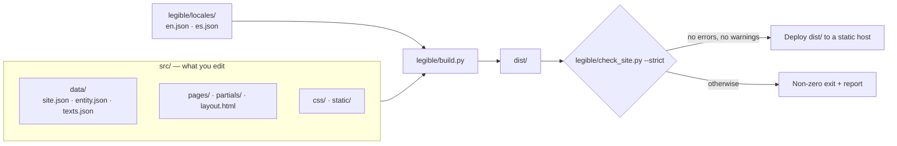

# legible — Reference documentation and phased cleanup plan

> **Who this document is for**
> - **A person** who wants to understand the architecture, see what is left to polish, and move forward one small step at a time.
> - **An AI agent** that must (a) execute the cleanup phases one by one, or (b) generate a complete website from this base plus a briefing.
>
> **Language policy:** everything is in **English** — README, this document, code, comments, identifiers, console messages, tests, data-file names and the sample site. Spanish (or any other language) is supported **only as a per-site choice** (see §4).
>
> **Release check (P39 · 2026-10-25):** all 119 tests pass when the 13 test classes are run independently. The combined `python3 -B -m unittest discover tests` invocation did not terminate in this environment, so it is not marked green. Strict builds pass with default CSS minification and with `CSS_MINIFY=FALSE`; each produces 11 pages with zero errors and warnings. The project owner subsequently confirmed successful operation on Python 3.8.20, 3.9.25, 3.10.22, 3.11.17, 3.12.3, 3.13.17 and 3.14.9. This is a user-reported compatibility confirmation, not a claim that all 119 tests and both builds were rerun on every interpreter. `pyflakes` is unavailable here; see T-12.

---

## 0. How to use this document

| You want to… | Read… |
|---|---|
| Understand what legible is | §1 |
| Understand how it works inside | §2, §3 |
| Know the language and naming rules | §4 |
| See what is wrong today | §5 |
| Execute the cleanup, one small phase at a time | §6 |
| Generate a new site with an AI | §7, §8 |
| Look up markers, rules, commands, checks | §9 |

### 0.1 Ground rules (mandatory for humans and AI)

1. **No refactoring.** Fix blemishes, leftovers, language and ugly bugs. Do not restructure code, split modules, change signatures, or reshape configuration — *except* the three small, explicitly planned additions in Track C (language setting, locale files, collection URL paths).
2. **Simple and light.** No new dependencies, no client-side JavaScript, no frameworks. If a fix adds complexity, drop it and note it as "won't do".
3. **One phase at a time.** Finish a phase, run its checks, report, and **stop**. Do not start the next phase without confirmation.
4. **Small diffs.** A phase must be reviewable by reading a short diff. If a phase turns out to be big, split it and tell the user.
5. **Never weaken tests or validator thresholds** to get a green result. If a test must change because a name or message changed, update it and say why.
6. **Keep it green.** After every phase the baseline (§9.3 V1) must pass. Intermediate states may contain leftover Spanish in *content*, but never a failing build.
7. **Report with facts.** Run the commands and paste real results. Never claim something passed if it was not run.
8. **Keep docs in step.** When a phase renames anything, update `README.md` and this document in the same phase (V3 rename check).
9. **Fix as you touch, within limits.** While editing a file for a phase, if you notice a technical blemish or a real bug, you may fix it **only if** it is tiny (about 5 lines or fewer), cannot change behaviour for valid input (or is an unambiguous bug), and is covered by existing or a new test. Mention it in the report as "extra fix". Anything bigger or doubtful goes to the **backlog** (§5.2) and is reported, not fixed. Never use this rule to restructure code.
10. **`STATUS.md` is the control document.** It lives at the repository root, is read at the start of every phase and updated at the end of every phase (status, date, test count, commands run, extra fixes, backlog, open questions). A phase is not finished until `STATUS.md` says so. Each finished phase is also one Git commit (`Pxx: <title>`), so every step can be reviewed or rolled back on its own.

---

## 1. What legible is

A static-site generator for **local service businesses**, written with the Python standard library only.

- **Input:** HTML templates + three data files (`site.json`, `entity.json`, `texts.json`).
- **Output:** a `dist/` folder with plain HTML, one CSS file, `sitemap.xml`, `robots.txt`, `llms.txt`, and one JSON-LD (Schema.org) `@graph` per page.
- **Quality gate:** a validator (`check_site.py`) checks the compiled output; in strict mode warnings also fail the build.
- **It does not promise** rankings, indexing or traffic — only predictable, inspectable output.

### 1.1 Design principles (non-negotiable)

| Principle | Practical consequence |
|---|---|
| Standard library only | Nothing to `pip install` in production |
| No client-side JavaScript | The only `<script>` elements are `application/ld+json` blocks |
| No third-party requests | No external fonts, CDNs or trackers; system fonts |
| One source of truth for business facts | Written once, propagated via `{{markers}}` |
| Fail fast and clearly | An unresolved `{{marker}}` stops the build, naming marker and page |
| The validator is a gate | `build.sh` exits non-zero if anything fails |
| Opinionated | Local service businesses (`ProfessionalService`), not a CMS |

### 1.2 Known limits (not bugs)

- Shortcut markers cover up to 4 cities, 6 categories and 5 offers.
- The `ProfessionalService` node type is required: the build reads business facts from it and the validator demands it.
- Not a CMS and not a general-purpose static-site framework.

---

## 2. Architecture

### 2.1 Overview



> `legible/locales/` exists since P13 (months, date format, breadcrumb, menu and card labels). Since P14 it also holds the default copy of the guides/blog indexes, the lead strip, the home resources section and the `llms.txt` labels; `site.json › generated_content` overrides any of it.

Mental rule: **`src/` changes per site; `legible/` is the engine and does not.**

### 2.2 Folder structure (target)

```text
.
├── README.md                  Project presentation
├── DOCUMENTATION.md           This document (the plan and the reference)
├── STATUS.md                  Control document: where we are, what was done, what is pending
├── LICENSE · readme-logo.svg · .gitignore
├── legible/                   ENGINE (reusable, not edited per site)
│   ├── build.py               Generator (~1,200 lines)
│   ├── check_site.py          Validator for the compiled output (~700 lines)
│   ├── build.sh               Build + strict validation (what CI runs)
│   ├── dev.py                 Local server that rebuilds when src/ changes
│   ├── run_all.py             Tests → build+validate → dev server
│   └── locales/               (P13) en.json · es.json — engine-generated strings
├── src/                       CONTENT (edited per site)
│   ├── data/                  site.json · entity.json · texts.json
│   ├── pages/                 one folder per URL (index.html with front matter) + 404.html
│   ├── partials/              header.html · footer.html
│   ├── layout.html            Document shell and <head>
│   ├── css/site.css           Single stylesheet; design tokens at the top
│   └── static/                Images, favicons, robots.txt, llms.txt (copied to output root)
├── tests/test_legible.py      Regression suite (unittest, ~8 s)
├── dist/                      Build output (git-ignored)
└── .dev-dist/                 Dev-server output (git-ignored)
```

### 2.3 Responsibilities

| Piece | Does | Does not |
|---|---|---|
| `build.py` | Load data, resolve markers, compose pages, JSON-LD, collections (guides/blog), minify, sitemap, robots, llms.txt | Judge SEO quality (the validator does) |
| `check_site.py` | Validate `dist/` | Modify anything |
| `build.sh` | Run build, then strict validation, driven by env vars | Business logic |
| `dev.py` | Serve `.dev-dist/`, rebuild on change (polls every 0.5 s) | Serve anything outside `.dev-dist/` |
| `run_all.py` | Tests → `build.sh` → `dev.py`, stopping at first failure | — |
| `layout.html` | `<head>`, metadata, shell, floating WhatsApp link | Page content |
| `partials/` | Header with menu, footer with navigation and legal links | — |
| `site.css` | Styling via `:root` tokens; no JS, no motion | — |

### 2.4 Exact flow of `build.py`

1. Load `site.json`; apply `SITE_URL` (env wins); **abort unless it starts with `https://`**.
2. Refuse an output folder that is, or contains, the project, `src/` or `legible/`; then empty it.
3. Copy `src/static/`; write the (optionally minified) CSS.
4. Build the marker table: `texts.json` first, then values derived from `entity.json`/`site.json` (**derived values win**).
5. Resolve markers in layout, partials and `entity.json` nodes.
6. Load and validate guide/blog front matter; report **every** problem at once.
7. For each page in `src/pages/`: front matter → active menu entry → canonical → `geo.*` tags → merged JSON-LD `@graph` → **fail on any leftover `{{…}}`**.
8. Generate `/guides/` and `/blog/` indexes when their rules are met (§3.5).
9. Write `sitemap.xml`; resolve `robots.txt` and `llms.txt`.
10. Run the validator (unless `--no-validate`) and print the report.

### 2.5 Escaping

| Destination | Rule |
|---|---|
| HTML | **Derived** values (name, city…) are HTML-escaped; values from `texts.json` are **not** (they may contain HTML on purpose) |
| JSON-LD | Values are JSON-escaped; `&` and quotes cannot break the JSON |
| `robots.txt` / `llms.txt` | Plain-text substitution |
| Empty JSON-LD values | Dropped (an empty `price_range` is not published) |

---

## 3. Content model

### 3.1 The three data files

| File | Holds | Notes |
|---|---|---|
| `src/data/site.json` | Project settings: `site_url`, `site_name`, `language` *(Track C)*, `contact_email`, `phone_e164`, `whatsapp_message`, `city`, `region`, `geo_enabled`, `geo_region_code`, `price_range`, `build_banner`, `check_banner`, `generated_content`, `collection_topics`, `collection_paths` *(P15; default `{"guides": "guides", "blog": "blog"}`: folder and URL of each collection, lowercase ASCII slugs)*, `sitemap_base_order` | Empty `geo_region_code`/`price_range` are simply omitted from the output |
| `src/data/entity.json` | Business identity in Schema.org: a `ProfessionalService` node and a `WebSite` node | **Keep the `ProfessionalService` type**: cities (`areaServed`), categories (`knowsAbout`) and offers (`hasOfferCatalog`) are read from it |
| `src/data/texts.json` | Reusable copy: key `x` becomes marker `{{x}}` | Derived values override same-named keys |

> Before P09 this file is called `textos.json`.

### 3.2 Derived markers

Full catalogue in §9.1. In short: identity (`site_name`, `site_url`, `contact_email`), contact (`whatsapp_link`, `whatsapp_base`, `phone_e164`, `phone_digits`), place (`city`, `region`, `location`, `city_1…4`), services (`service_category_1…6`, `service_N_name/price/price_number` for N=1…5, `featured_action_name`) and `_url` variants for WhatsApp messages.

**The offer priced `0` in `hasOfferCatalog` is the "featured action"** (page `/featured-action/`). There must be exactly one.

### 3.3 Pages and front matter

Each page is `src/pages/<slug>/index.html` (URL `/<slug>/`) and starts with:

```text
---
title: Page title | {{site_name}}
description: A 70–160 character summary.
robots: index, follow, max-snippet:-1, max-image-preview:large, max-video-preview:-1
geo: true
canonical: auto
updated: 2026-01-31
---
```

- Required: `title`, `description`. `updated` is required on indexable pages (it feeds sitemap `lastmod`).
- `canonical: none` + `robots: noindex, follow` → pages such as the 404.
- `active` forces which menu entry is highlighted; otherwise the page's own entry or its closest parent.
- The page's `<script type="application/ld+json">` block is extracted and merged with the business nodes into one `@graph`.
- `geo` is an engine feature flag (emit `geo.*` meta tags); the name stays.

### 3.4 Template pages (11) — target URLs

| Page | URL (English sample) |
|---|---|
| Home | `/` |
| Services index | `/services/` |
| Sample service | `/services/sample-service/` |
| Pricing | `/pricing/` |
| Featured action | `/featured-action/` |
| About | `/about/` |
| Contact | `/contact/` |
| Legal notice | `/legal-notice/` |
| Privacy policy | `/privacy-policy/` |
| Cookie policy | `/cookie-policy/` |
| 404 | `/404.html` |

The four "Service 1–4" menu entries all point to the sample service page; that is intentional placeholder content. Real sites must point each to its own page.

### 3.5 Optional collections (guides and blog)

| Collection | Content path | `type` | Generated index |
|---|---|---|---|
| Guides | `src/pages/guides/<slug>/index.html` | `guide` | `/guides/` once there is one guide, grouped by topic |
| Blog | `src/pages/blog/<slug>/index.html` | `article` | `/blog/`, newest first |

Each piece needs: `type`, `topic` (one of `collection_topics`), `published`, `updated` (ISO, `updated ≥ published`), `summary`, `service` (an existing path), `title`, `description`. Lowercase-hyphen slug. `related`: at most 2. **Never hand-create an `index.html` inside `guides/` or `blog/`.**

Blog visibility: 0 articles → no blog; 1–2 → exists as `noindex`, not in menu, footer, sitemap or `llms.txt`; ≥3 → indexable and announced.

The folder names are configurable (`collection_paths`, since P15) so a Spanish site can use `/guias/`.

### 3.6 Generated outputs

HTML per URL · `css/site.css` · JSON-LD per page · `sitemap.xml` (indexable pages only) · `robots.txt` (allows GPTBot, OAI-SearchBot, ClaudeBot, PerplexityBot, Applebot, Meta-ExternalAgent) · `llms.txt` · floating WhatsApp link (`wa.me`, no script).

### 3.7 Sample brand assets

`logo.svg`, `favicon.svg`, `favicon.ico`, `apple-touch-icon.png` and `og-image.png` are legible's own branding, used as neutral placeholders. They contain no agency branding. Every real site replaces them.

---

## 4. Language policy and naming conventions

### 4.1 The rule

| Layer | Language |
|---|---|
| Architecture: code, identifiers, comments, docstrings, console messages, tests, file/folder names under `legible/` and `tests/`, data-file names, marker names, JSON keys, README, this document | **English, always** |
| The sample site in `src/` (pages, texts, menu, legal pages, `llms.txt`, URLs) | **English**, generic, no trace of any specific business or agency |
| A real site in another language (e.g. Spanish) | The content and URLs of **that site** follow that language; the architecture does not change |

### 4.2 How a site becomes Spanish (target behaviour after Track C)

1. `site.json`: `"language": "es"` → `<html lang="es">`, `og:locale es_ES`, `inLanguage es-ES`, `availableLanguage es`, Spanish month names and Spanish engine-generated strings (breadcrumb, index headings, card links, lead strip, `llms.txt` section labels).
2. Translate everything under `src/`: pages, `texts.json`, layout, partials, `llms.txt`, legal pages.
3. Rename page folders to Spanish slugs for Spanish SEO (e.g. `services/` → `servicios/`); update header/footer links, `sitemap_base_order`, internal links and `generated_content.lead_strip.action_url`.
4. `site.json`: `"collection_paths": {"guides": "guias", "blog": "blog"}` for Spanish collection URLs.
5. Keep markers, JSON keys, front-matter keys and `type` values (`guide`, `article`) **in English**: they are the architecture.
6. Unresolved-confirmation markers: the validator matches `[CONFIRM`, which also catches `[CONFIRMAR …]`.

Any other language: add `legible/locales/<code>.json` (copy `en.json`, translate values) and set `language`.

### 4.3 Naming conventions

- Python: `snake_case` functions and variables, `UPPER_SNAKE` constants, `CamelCase` classes.
- JSON keys and markers: `snake_case`. URL slugs and folders: `kebab-case`, ASCII.
- Code, comments and messages are ASCII except the **user-facing strings in `legible/locales/es.json`** and test fixtures that deliberately exercise Spanish.
- Comments explain *why*, in one short sentence.

### 4.4 Spanish → English dictionary (use these names consistently)

| Spanish (today) | English (target) | Where |
|---|---|---|
| `textos.json`, `{{…}}` from it | `texts.json` | data file, README, tests |
| `guias`, `guia` (type) | `guides`, `guide` | folders, dict keys, `type`, functions |
| `articulo(s)` | `article(s)` | type, variables |
| `home_recursos` | `home_resources` | marker, function |
| `nav_guias`, `llms_guias` | `nav_guides`, `llms_guides` | markers |
| `fecha_larga`, `MESES_ES` | `format_long_date`, locale month names | functions, constants |
| `SOLO_PLANTILLA`, `SOLO_SIN_COLECCIONES` | `ONLY_TEMPLATE`, `ONLY_WITHOUT_COLLECTIONS` | tests |
| `ProyectoTemporal`, `TestHumo`, `TestSalidaSegura`… | `TempProject`, `TestSmoke`, `TestSafeOutput`… | test classes |
| `[CONFIRMAR …]` | `[CONFIRM …]` | markers in content, validator regex |
| `/servicios/` | `/services/` | URLs |
| `/servicios/servicio-generico/` | `/services/sample-service/` | URLs |
| `/precios/` | `/pricing/` | URLs |
| `/accion-destacada/` | `/featured-action/` | URLs |
| `/sobre-nosotros/` | `/about/` | URLs |
| `/contacto/` | `/contact/` | URLs |
| `/aviso-legal/` | `/legal-notice/` | URLs |
| `/politica-de-privacidad/` | `/privacy-policy/` | URLs |
| `/politica-de-cookies/` | `/cookie-policy/` | URLs |
| `Servicio N`, `Ciudad N`, `Tema N`, `Tu Negocio`, `Tu Ciudad`, `Tu Provincia`, `TU-DOMINIO` | `Service N`, `City N`, `Topic N`, `Your Business`, `Your City`, `Your Region`, `YOUR-DOMAIN` | sample data, engine defaults |
| `Acción Destacada` | `Free Consultation` | sample data |

`featured_action_*` marker names are already English and **stay**.

---

## 5. Review: current state and findings

**Verdict (P39 release review):** the planned cleanup is complete. All 119 regression tests pass when the 13 test classes are invoked separately, and both strict build modes pass with 11 pages and no errors or warnings. The combined discovery invocation did not terminate reliably in this environment. The project owner has also confirmed successful operation on Python 3.8.20, 3.9.25, 3.10.22, 3.11.17, 3.12.3, 3.13.17 and 3.14.9; the full regression suite and strict builds are not claimed as rerun on each version. The only unverified static-analysis item is T-12 (`pyflakes` is not installed); F-15 remains intentional design debt.

Approximate sizes of the work (from `grep`, counted before any change):

| Area | Size of the problem |
|---|---|
| `build.py` | ~87 lines with Spanish comments/strings; ~93 Spanish identifiers; 18 hard-coded Spanish URL paths |
| `check_site.py` | ~31 lines with Spanish; ~20 Spanish messages |
| `run_all.py`, `dev.py`, `build.sh` | Spanish docstrings/messages (small); `dev.py` mixes English and Spanish |
| `tests/test_legible.py` | 108 tests; ~57 lines with Spanish; ~79 Spanish-style test names; 23 hard-coded Spanish URL paths |
| `src/` | Every page, partial, `site.json`, `texts.json`, `llms.txt`, `layout.html` and the CSS comments are Spanish; `lang="es"`, `es_ES`, `es-ES` hard-coded in 11 places |
| Agency leftovers | 11 content files tie the sample to an SEO/GEO agency (see list below) |

### 5.1 Findings

Severity: 🔴 must fix · 🟡 should fix · 🟢 optional · ⚪ known debt, do not touch.

| ID | Sev. | Finding | Where | Status |
|---|---|---|---|---|
| F-01 | 🔴 | `README.es.md` and language switcher exist | `README.es.md`, `README.md` | ✅ Closed — P01 |
| F-02 | 🔴 | Engine comments, docstrings, messages, identifiers and tests are in Spanish | `legible/*`, `tests/` | ✅ Closed — P02–P11 |
| F-03 | 🔴 | Sample site is Spanish and describes an SEO agency: old GEO copy and agency-specific claims across pages and `llms.txt` | `src/**` | ✅ Closed — P17–P29, P37 |
| F-04 | 🔴 | Sample legal pages cite Spanish law (LSSICE, AEPD) | `legal-notice`, `privacy-policy`, `cookie-policy` | ✅ Closed — P26–P28 |
| F-05 | 🔴 | Language is hard-coded to Spanish in metadata, labels, index copy and locale-sensitive output | `layout.html`, `entity.json`, pages, `build.py` | ✅ Closed — P12–P16 |
| F-06 | 🟡 | Collection folder names and some URLs are hard-coded, preventing per-site localisation | `build.py` | ✅ Closed — P15 |
| F-07 | 🟡 | Sample prices/country are Spanish-flavoured | `entity.json`, `site.json`, `build.py` defaults | ✅ Closed — P17 |
| F-08 | 🟡 | Dead config key `generated_content.lead_strip.lead` (code reads `lead_html`) | `site.json` | ✅ Closed — already absent by P27; confirmed P31 |
| F-09 | 🟡 | Stale comment "Orden histórico del sitemap (F3)" | `build.py` | ✅ Closed — P02 |
| F-10 | 🟡 | Garbled header comment in `site.css`; unused `.toc` rules | `site.css` | ✅ Closed — P30 |
| F-11 | 🟡 | `dev.py`: unused `last_error`, import inside function, no module docstring | `dev.py` | ✅ Closed — P03, P31 |
| F-12 | 🟡 | `render_jsonld` silently returns `''` on a duplicate `@id`, hiding the useful error | `build.py` | ✅ Closed — P32 |
| F-13 | 🟡 | README figures were unverified and the pre-launch grep included `legible`, causing false positives | `README.md` | ✅ Closed — P38 |
| F-14 | 🟢 | `layout.html` cosmetics: `<meta charset>` indentation and a stray blank line | `layout.html` | ✅ Closed — P18 |
| F-15 | ⚪ | `compose_page` has 17 parameters; `build()` is ~260 lines | `build.py` | ⚪ Open by design — leave untouched |

### 5.2 Technical audit (code quality, no refactoring)

**Original technical audit baseline:** `build.sh` passed `bash -n`; no bare `except:` was found; file reads/writes declared UTF-8 and used context management; no inline `style=` attributes or `!important`; every `target="_blank"` link had `rel="noopener noreferrer"`; no duplicate `id` attributes were found; HTML classes had CSS selectors except the two intentional hooks, `band-cta` and `footer-brand`; the dev server blocked path traversal; tests used temporary directories. **P39 re-confirmed:** strict builds pass with default minification and `CSS_MINIFY=FALSE`; both generate 11 pages with no issues or warnings. All 119 tests pass when the 13 test classes are run independently; combined test discovery did not terminate reliably in this environment. Shell syntax, JSON/Python syntax, and the pre-launch documentation checks are verified separately. P37 removed the 33 unused text keys; V7 reports no unused keys (T-01 closed). The `pyflakes` check remains blocked because the module is not installed (T-12), so undefined-name/unused-variable cleanliness is not claimed as re-verified.

**Findings** (planned unless marked backlog):

| ID | Sev. | Finding | Phase |
|---|---|---|---|
| T-01 | ✅ Closed | P36 found 33 unused keys in `texts.json`; P37 removed all 33. The V7 marker scan now reports `no unused keys`. | P37 |
| T-02 | ✅ Closed | Page URLs now drop only the final `index.html` path component; regression test covers `my-index.html-guide/` | P33 |
| T-03 | ⚪ | Import-time side effects: `build.py` loads configuration and may call `sys.exit` when imported; `check_site.py` imports from `build.py` and `build.py` imports `check_site` lazily (circular but working). Documented, **not** restructured | P35 (comment only) |
| T-04 | ✅ Closed | Imports moved to the top level and grouped one per line; unused `last_error` removed | P31 |
| T-05 | 🟢 | 8 lines over 200 characters in `build.py` (generated HTML f-strings). Leave | backlog |
| T-06 | ✅ Closed | JSON parse/read catches narrowed; only the two documented optional Git-metadata fallbacks retain `except Exception` | P34 |
| T-07 | 🟢 | `dev.py` empties its output folder on each rebuild, so a request during a rebuild can briefly 404. Acceptable for a dev tool; documented only | P38 (README note) |
| T-08 | ⚪ | The footer year uses `datetime.now().year`, so output is not byte-reproducible across years. Acceptable; documented only | backlog |
| T-09 | ✅ Closed | `build.sh` rejects Python versions older than 3.8 before building | P35 |
| T-10 | ✅ Closed | Standalone `check_site.py` applies both `--site-url` forms before importing `build.py`; covered by regression tests | P35 |
| T-11 | ✅ Documented | `{{placeholder}}` appears only in a docstring and is an expected marker-audit false positive | P09 |
| T-12 | 🟡 | The P39 command `python3 -m pyflakes legible tests` still cannot run because `pyflakes` is not installed. The AST/compile fallback does not detect every undefined name or unused variable; no dependency was added. | Open — retry where `pyflakes` is available |

The **backlog** lives here: anything found during a phase that is not tiny or not clearly a bug is added as a new `T-xx` row with a reason, and reported to the user.

### 5.3 What is good (do not touch)

- Output-folder safety and a dev server confined to `.dev-dist/`.
- Correct HTML and JSON-LD escaping.
- Minifiers that protect attributes, `pre`, `textarea`, `calc()` and `url()`.
- Collection validation that reports all problems at once.
- A test suite that adapts to derived projects (skips tests that depend on sample data).

### 5.4 Decisions to confirm before starting

| # | Decision | Alternative |
|---|---|---|
| D-1 | Everything is English, including identifiers, data-file names and sample URLs | — |
| D-2 | Default `language` is `en`; Spanish ships as `legible/locales/es.json` (engine strings only); site *content* is translated per project | Ship a full Spanish sample site (rejected: doubles the content to maintain) |
| D-3 | Sample currency USD, country `US`, phone `+15550100` (fictional), email `hello@example.com` | Any other neutral sample |
| D-4 | Keep `featured_action_*` names; URL `/featured-action/` | Rename to `featured_offer` (rejected: large rename with no user value) |
| D-5 | `type` values `guide` / `article` stay English for every site language | — |
| D-6 | Legal pages become **jurisdiction-neutral templates** with `[CONFIRM …]` markers and a "have this reviewed by a lawyer" note | Keep country-specific text (rejected) |
| D-7 | Sample brand assets stay (legible branding) as placeholders | Replace with blank placeholders |
| D-8 | The old `DOCUMENTACION.md` is replaced by `DOCUMENTATION.md` | — |

---

## 6. Phased plan

### 6.1 Phase protocol (every phase)

1. Read `STATUS.md` (current phase, open questions, backlog), then the phase card and the files it lists. Do **only** what the card says.
2. Run baseline V1 (§9.3) and note the result.
3. Make the changes. Keep the diff small.
4. Run the phase's verification (always V1 plus the checks on the card).
5. Update `README.md` / this document if names changed (V3).
6. Update `STATUS.md`: phase status and date, test count, commands run, extra fixes, backlog, open questions. Commit with message `Pxx: <title>`.
7. Report: files changed, commands run with real output, what is left for the next phase.
8. **Stop and wait for confirmation.**

### 6.2 Phase index

| Track | Phase | Title | Size |
|---|---|---|---|
| **A · Baseline** | P00 | Baseline and backup | none |
| | P01 | Single English README | XS |
| **B · Engine and tests in English** | P02 | Comments/docstrings — `build.py` | S |
| | P03 | Comments/docstrings — `check_site.py`, `dev.py`, `run_all.py`, `build.sh` | S |
| | P04 | Console messages — `build.py` | S |
| | P05 | Console messages — `check_site.py` | S |
| | P06 | Console messages — `dev.py`, `run_all.py`, `build.sh` | XS |
| | P07 | Python identifiers — `build.py` (internal names only) | M |
| | P08 | Collections naming: `guias`→`guides`, `articulo`→`article` | M |
| | P09 | Data/marker names: `textos.json`→`texts.json` and non-English markers | S |
| | P10 | Tests in English — part 1 | M |
| | P11 | Tests in English — part 2 | M |
| **C · Language support** | P12 | `language` setting and derived markers | S |
| | P13 | Locale files, loader, dates and shared labels | M |
| | P14 | Move generated page copy into locale files | M |
| | P15 | Configurable collection URL paths | S |
| | P16 | Language regression tests | S |
| **D · Sample site in English** | P17 | `site.json`, `entity.json` and engine sample defaults | M |
| | P18 | `layout.html`, header, footer | S |
| | P19 | Home page | M |
| | P20 | Services index | S |
| | P21 | Sample service page | S |
| | P22 | Pricing | S |
| | P23 | Featured action | S |
| | P24 | About | S |
| | P25 | Contact | S |
| | P26 | Legal notice | S |
| | P27 | Privacy policy | S |
| | P28 | Cookie policy | S |
| | P29 | 404, `llms.txt`, `robots.txt` | M |
| | P30 | CSS comments and `.toc` | XS |
| **E · Small defects and technical hardening** | P31 | Dead key and import tidy | XS |
| | P32 | Duplicate `@id` error with test | S |
| | P33 | Robust page URL computation with test | S |
| | P34 | Narrow broad `except` clauses, explain fallbacks | S |
| | P35 | `build.sh` Python check and standalone validator behaviour | S |
| | P36 | Technical audit re-run | S |
| **F · Closing** | P37 | Residue sweeps and dead texts | S |
| | P38 | Final README | M |
| | P39 | Final documentation sync and release check | S |

Size: XS = a few lines · S = one file or a short diff · M = several files, still one concern. If an M phase grows, split it.

> **Dependencies:** run phases in order. P08 and P09 rename things that tests use, so tests are updated *inside* those phases; P10–P11 only finish the language of the tests. Track C comes **before** Track D so that the sample content is written against the final engine strings.

---

### Track A — Baseline

#### P00 — Baseline and backup *(no project changes)*
- **Goal:** a return point and a reference state.
- **Tasks:** keep the original archive untouched; initialise Git and make the baseline commit; run V1 and record the result; create `STATUS.md` (phase tracker, baseline record, decisions, backlog); record D-1…D-8 (§5.4) as accepted or changed.
- **Done when:** baseline green and recorded in `STATUS.md`, decisions recorded.

#### P01 — Single English README (F-01)
- **Files:** `README.es.md`, `README.md`.
- **Tasks:** delete `README.es.md`; remove the `[English](README.md) · [Español](README.es.md)` line; in the layout tree replace `README.es.md` by `DOCUMENTATION.md`; add one line after the overview linking to `DOCUMENTATION.md`.
- **Out of scope:** rewriting the README (P38).
- **Verify:** V1; `grep -rn "README.es" . --exclude-dir=dist` returns nothing; README anchors still resolve.
- **Done when:** one README, no references to the Spanish one.

---

### Track B — Engine and tests in English (no behaviour change)

> Comment-only phases (P02, P03) must be proven with **V2 (AST comparison)**: the compiled code is identical before and after.

#### P02 — Comments/docstrings: `build.py` (F-09)
- **Tasks:** translate every comment and docstring to short English; replace the stale "Orden histórico del sitemap (F3)" with "Base sitemap order; new pages follow: /guides/ + guides, /blog/ + articles". Do **not** touch string literals, identifiers or logic.
- **Verify:** V1 + **V2** on `build.py`.
- **Done when:** no Spanish in comments/docstrings of `build.py` (string literals still Spanish; they are handled in P04/P14).

#### P03 — Comments/docstrings: other scripts
- **Files:** `check_site.py`, `dev.py`, `run_all.py`, `build.sh`.
- **Tasks:** same as P02. Add a one-line module docstring to `dev.py`.
- **Verify:** V1 + **V2** on the three `.py` files; `bash -n legible/build.sh`.

#### P04 — Console messages: `build.py`
- **Tasks:** translate user-facing console/error messages (`BUILD FAILED`, `SITE_URL must start with https://`, collection problem messages, `missing title or description`, report labels already English stay). Keep wording short and actionable. **Do not** touch HTML/JSON-LD strings that end up in pages (P14).
- **Before editing:** `grep -n "<old message fragment>" tests/` and update tests that assert it.
- **Verify:** V1; trigger two errors by hand (bad `SITE_URL`, an unresolved marker) and read the messages.

#### P05 — Console messages: `check_site.py`
- **Tasks:** translate every `E(...)`, `W(...)`, `errors.append`, `warnings.append`, banner and argparse help to English; change the `TODO|[CONFIRMAR` regex to `TODO|\[CONFIRM` and its message. Keep message *meaning* identical.
- **Verify:** V1; run the validator on a deliberately broken copy of `dist/` (remove an `alt`) and read the report.

#### P06 — Console messages: `dev.py`, `run_all.py`, `build.sh`
- **Tasks:** English messages in all three (step titles like `1/3 Tests`, stop messages, `python3 is not available`, `Build finished in dist/`).
- **Verify:** V1; `python3 legible/run_all.py --no-dev`; `python3 legible/dev.py` starts, serves `http://localhost:3001`, stops with Ctrl+C.

#### P07 — Python identifiers: `build.py` (internal names only)
- **Tasks:** rename Spanish function/variable/constant names to English using §4.4 where applicable (e.g. `fecha_larga`→`format_long_date`, `protegidas`→`protected`, `en_riesgo`→`at_risk`, `tarjetas`→`cards`, `piezas`→`pieces`, `paso`→`step`). **Out of scope here:** collection names (P08), marker/data names (P09).
- **Method:** rename one name at a time with a word-boundary search; `python3 -m py_compile` after each batch.
- **Verify:** V1; V3 for each old name (zero hits in `legible/` and `tests/`).

#### P08 — Collection naming (`guias`→`guides`, `articulo`→`article`)
- **Tasks:** in `build.py`: `COLLECTION_DIRS`, dict keys, `type` values, function names (`render_guias_index`→`render_guides_index`, `render_llms_guias`→`render_llms_guides`), variables (`guias`, `articulos`); markers `{{nav_guias}}`→`{{nav_guides}}`, `{{llms_guias}}`→`{{llms_guides}}`, `{{home_recursos}}`→`{{home_resources}}`; the same markers in `src/partials/*.html`, `src/pages/index.html`, `src/static/llms.txt`; hard-coded `/guias/` paths → `/guides/` (still hard-coded until P15); tests that build temp projects with `guias/` folders and `type: guia`/`articulo`.
- **Out of scope:** page copy and strings (P14, Track D).
- **Verify:** V1; V3 for `guias`, `guia\b`, `articulo`, `recursos`; build a temp project with one guide and three articles and confirm `/guides/` and `/blog/` are generated.

#### P09 — Data and marker names (F-02)
- **Tasks:** rename `src/data/textos.json` → `texts.json`, the loader path and variable (`textos`→`texts`), error messages that mention it, `site.json` key `text` stays; update README and this document. Then audit marker names for Spanish:
  ```bash
  grep -rhoE "\{\{[a-z0-9_]+\}\}" src legible | sort -u
  ```
  Rename any Spanish-named marker/key (list them in the report before renaming) in `texts.json`, pages, partials, `llms.txt` and tests.
- **Verify:** V1; V3 for `textos` and each renamed key.

#### P10 — Tests in English, part 1
- **Scope:** `tests/test_legible.py`, from the top through `TestMinifyHtml` (helpers, constants `SOLO_*`→`ONLY_*`, `ProyectoTemporal`→`TempProject`, `TestHumo`→`TestSmoke`, test names, docstrings, comments, fixture strings).
- **Out of scope:** assertions about generated page copy that will change in Tracks C/D. Leave them working as they are and update them in the phase that changes that copy.
- **Verify:** V1 — still **108** tests (renames must not drop or merge tests); `python3 -B -m unittest discover tests -v | grep -c ok` equals before.

#### P11 — Tests in English, part 2
- **Scope:** from `TestColeccionesDirectas` to the end (collections, domain, markers, geo, safe output, special characters, command line).
- **Verify:** same as P10. At the end, `grep -nE "[áéíóúñ¿¡]" tests/test_legible.py` shows only fixtures that deliberately exercise accented text (list them in the report).

---

### Track C — Language support (the only planned additions; keep them tiny)

> Principle: **one setting (`language`), two small JSON files (`en`, `es`), one helper function.** No templating engine, no plural rules, no extra dependencies.

#### P12 — `language` setting and derived markers (F-05)
- **Files:** `site.json`, `build.py`, `layout.html`, `entity.json`, pages with `"inLanguage"`.
- **Tasks:** add `"language": "en"` to `site.json` (default `en` if absent). Derive `{{lang}}` (`en`), `{{og_locale}}` (`en_US`; `es`→`es_ES`), `{{in_language}}` (`en-US`; `es`→`es-ES`). Use them in `layout.html` (`<html lang="{{lang}}">`, `og:locale`), in `entity.json` (`inLanguage`, `availableLanguage`), in each page's `inLanguage`, and in `_index_jsonld`. Keep a tiny table in `build.py`: `{'en': ('en', 'en_US', 'en-US'), 'es': ('es', 'es_ES', 'es-ES')}`; unknown language → clear build error listing supported values.
- **Out of scope:** translating strings (P13–P14).
- **Verify:** V1; build with `language: en` and with `"es"` (temp copy) and compare `<html lang>`, `og:locale`, JSON-LD `inLanguage`.

#### P13 — Locale files, loader, dates, shared labels
- **Files:** new `legible/locales/en.json`, `legible/locales/es.json`; `build.py`.
- **Tasks:** add `load_locale(language)` (reads `legible/locales/<language>.json`; missing file → build error naming available locales) and a helper `t(key)` returning the string (missing key → build error naming the key). Move into locale files: month names (replacing `MESES_ES`), the long-date format, breadcrumb labels (`Home` / `Inicio`, breadcrumb `aria-label`), nav labels (`Guides`, `Blog`), card link texts (`Read the guide`, `Read the article`). Spanish values come from the strings that exist today in `build.py` (nothing is lost).
- **Out of scope:** index-page, lead-strip, home-resources and llms.txt copy (P14).
- **Verify:** V1; unit test for `format_long_date` in both languages (`2026-03-05` → `March 5, 2026` / `5 de marzo de 2026`).

#### P14 — Generated page copy into locale files
- **Tasks:** move the defaults still hard-coded in `build.py` into locale files: guides index, blog index, lead strip, home resources section, `llms.txt` section labels (`## Guides`, `## Blog`, one-line descriptions). `site.json › generated_content` keeps overriding any default. The English default copy must be **generic** (no agency or product references). Update tests that assert generated copy.
- **Verify:** V1; build a temp project with 1 guide + 3 articles in `en` and `es`; open `dist/guides/index.html` (or `guias`), `dist/blog/index.html`, `dist/llms.txt` and read the copy.

#### P15 — Configurable collection URL paths (F-06)
- **Tasks:** add `site.json` key `collection_paths` (default `{"guides": "guides", "blog": "blog"}`). Use it for content folders, generated index URLs, menu/footer links, the home resources section, sitemap and `llms.txt` URLs, and error messages. The `type` values stay `guide`/`article` (D-5). Document the key in §3.1.
- **Out of scope:** per-page slugs (those are just folder names in `src/pages/`).
- **Verify:** V1; temp project with `"guides": "guias"` and a guide at `src/pages/guias/<slug>/` → `/guias/` generated, validator passes.

#### P16 — Language regression tests
- **Tasks:** add tests: (a) default build is English (`lang="en"`, `og:locale en_US`); (b) `language: es` builds and validates, with Spanish month names and breadcrumb; (c) unknown language fails with a clear message; (d) `collection_paths` localisation works. Use the existing temp-project helper.
- **Verify:** V1 (test count increases; report the new number).

---

### Track D — Sample site in English, generic

> **Content rules for every phase in this track**
> - English, neutral, friendly. A generic local service business; no mention of SEO, Google, Google Maps/Business Profile, GEO, AI assistants, directories or any agency.
> - Every page keeps passing the strict validator: `title` 20–60, `description` 70–160, one `h1`, ≥250 words in `<main>` when indexable, `updated`, JSON-LD, one contextual inbound link, unique titles/descriptions, FAQ text identical to its JSON-LD.
> - Renaming a URL means **in the same phase**: rename the folder, update `header.html`, `footer.html`, `sitemap_base_order`, `entity.json` URLs, links from every other page, `llms.txt`, tests, README and this document, then run V3 on the old slug.
> - Remove from `texts.json` the keys that only this page used and that become unused; add new ones with English names.
> - Sample values: `Your Business`, `Your City`, `Your Region`, `Service 1…`, `City 1…`, `Topic 1…`, prices like `$99`, email `hello@example.com`.

#### P17 — `site.json`, `entity.json`, engine sample defaults (F-07)
- **Tasks:** English sample values (`site_name` `Your Business`, `site_url` `https://YOUR-DOMAIN.com`, city/region, WhatsApp message, banners, `collection_topics` `Topic 1…5`, `generated_content` overrides emptied or in English, `sitemap_base_order` with the new URLs from §3.4). `entity.json`: English names, `priceCurrency` `USD`, `addressCountry` `US`, `telephone` fictional, `availableLanguage` via `{{in_language}}` (P12), `OfferCatalog` name in English, offer URLs `/services/sample-service/`, opening hours kept as clearly sample. In `build.py`, replace the "unwrap" sample defaults (`Servicio 1`, `Ciudad 1`, `99 €`, `49 €/mes`, `Acción Destacada`, `negocios de …`) with English equivalents (`Service 1`, `City 1`, `$99`, `$49/mo`, `Featured Action`, `businesses in …`).
- **Note:** pages still use old URLs until their phases; keep `sitemap_base_order` in step with the folders that **exist now** and update it again in each page phase.
- **Verify:** V1 (tests flagged `ONLY_TEMPLATE` must be updated to the new sample values — update the expected values, do not remove the tests).

#### P18 — `layout.html`, header, footer (F-14)
- **Tasks:** English skip link, WhatsApp `aria-label`, nav labels, footer headings and legal link labels, copyright line. Replace the agency-specific footer sentence with a neutral `{{footer_about}}` text key ("`{{site_name}}` is a `{{service_category_1}}` and `{{service_category_2}}` business based in `{{location}}`. We help `{{target_audience}}`…"). Tidy `<meta charset>` indentation and the blank line. Keep the four "Service 1–4" links (documented in §3.4).
- **Verify:** V1; read the built home page header/footer.

#### P19 — Home page `/`
- **Tasks:** translate and genericise `src/pages/index.html`; **replace the GEO/AI-assistants section** (`geo-title`, `{{geo_topic}}`) with a neutral section (e.g. "How we work" or "Why choose us"); FAQ questions/answers in English, matching JSON-LD; remove keys `geo_topic`, `geo_description`, `home_description` agency wording (rewrite `home_description`).
- **Verify:** V1; V4 (agency sweep) on this file returns nothing.

#### P20 — Services index `/services/`
- **Tasks:** rename folder `servicios/` → `services/`; English copy; rewrite the FAQ answer that mentions "ficha de Google" (e.g. "If you have no existing setup, start with Service 1…"); update links to the sample service page (`/services/sample-service/` already or after P21 — keep links valid in this phase).
- **Verify:** V1; V3 for `/servicios/`.

#### P21 — Sample service page `/services/sample-service/`
- **Tasks:** rename folder `servicio-generico/` → `sample-service/`; English copy; `service_4_requirements` and similar keys made generic; update `entity.json`, `header.html`, `footer.html`, `sitemap_base_order`, `llms.txt`, collection `service:` examples in README/doc.
- **Verify:** V1; V3 for `servicio-generico`.

#### P22 — Pricing `/pricing/`
- **Tasks:** rename `precios/` → `pricing/`; English copy and table headers; prices in `$`; keep exactly one featured (price 0) entry.
- **Verify:** V1; V3 for `/precios/`.

#### P23 — Featured action `/featured-action/`
- **Tasks:** rename `accion-destacada/` → `featured-action/`; English copy; example offer "Free Consultation"; remove "changes to your website or Google listing" wording (`action_not_include_4`, the matching page text) and the "we analyse your website, Google listing…" step (`after_2`); update `generated_content.lead_strip.action_url` and every link.
- **Verify:** V1; V3 for `accion-destacada`.

#### P24 — About `/about/`
- **Tasks:** rename `sobre-nosotros/` → `about/`; English copy; neutral description of the zone served (`about_zone_description` without SEO wording).
- **Verify:** V1; V3 for `sobre-nosotros`.

#### P25 — Contact `/contact/`
- **Tasks:** rename `contacto/` → `contact/`; English copy; replace "your website and Google listing address" with generic "any relevant links or details"; form-free (mailto/WhatsApp only, as today).
- **Verify:** V1; V3 for `/contacto/`.

#### P26 — Legal notice `/legal-notice/` (F-04)
- **Tasks:** rename `aviso-legal/` → `legal-notice/`; rewrite as a **jurisdiction-neutral** English template: owner identification (`{{site_name}}`, `[CONFIRM legal name]`, `[CONFIRM registered address]`, `[CONFIRM tax/registration ID]`), purpose, terms of use, intellectual property, liability, governing law `[CONFIRM jurisdiction]`, and a visible note that this is a template to be reviewed by a qualified lawyer. Remove references to Spanish statutes. `noindex, follow` stays.
- **Verify:** V1 (the validator will warn about `[CONFIRM`? — see note below); V4.
- **Note:** the strict validator flags `[CONFIRM` as a **warning**, which would fail the template build. Decision for the sample: keep the markers **out** of the sample text (use neutral "Your legal name" style placeholders that pass) and state in §7 that real sites use `[CONFIRM …]` to block launch until filled. The validator regex stays for real projects.

#### P27 — Privacy policy `/privacy-policy/`
- **Tasks:** rename `politica-de-privacidad/` → `privacy-policy/`; neutral English template (data collected via email/WhatsApp, purposes, legal bases stated generically, retention, processors such as hosting and email, user rights, contact, complaint to the competent authority). Remove "Google Search Console, Analytics, SEO tools" and the AEPD reference. Same note as P26 on markers.

#### P28 — Cookie policy `/cookie-policy/`
- **Tasks:** rename `politica-de-cookies/` → `cookie-policy/`; neutral English text that matches the template reality (no cookies, no trackers, no client scripts) and explains what to change if cookies are added later.

#### P29 — 404, `llms.txt`, `robots.txt`
- **Tasks:** English 404 copy (`geo: false`, `noindex`). Rewrite `src/static/llms.txt` as a **short, generic English** index of business facts, services, prices, pages and FAQs using existing markers — remove the GEO explainer, "why isn't my business on Google Maps", and the "Generated for SEO and GEO" footer; keep `{{llms_guides}}`, `{{llms_blog}}`, `{{llms_sitemap_extra}}`. Review `robots.txt`: it lists AI crawlers by design; keep it and add one comment line explaining the policy.
- **Verify:** V1; read `dist/llms.txt` end to end; V4.

#### P30 — CSS comments and `.toc` (F-10)
- **Tasks:** English header comment in 3–4 clear lines (purpose; no JS, no motion, no downloaded fonts; mobile-first; palette from the logo); translate all other comments; delete the unused `.toc` rules after confirming no page uses it; update README mention.
- **Verify:** V1; compiled CSS size not larger than before.

---

### Track E — Small defects and technical hardening

> Purpose: leave the architecture **simple but technically clean**. Each phase fixes one concrete defect found in the technical audit (§5.2), with the smallest possible change and, where behaviour changes, a regression test. Nothing here restructures code.

#### P31 — Dead key and import tidy (F-08, F-11, T-04)
- **Tasks:** remove `generated_content.lead_strip.lead` from `site.json` (confirm with `grep -n "lead_strip" legible/build.py` that only `lead_html` is read); in `dev.py` remove unused `last_error` and move `import threading` to the top; in `build.py` move `import textwrap` (inside `report_lines`) to the top; split the one-line `import os, re, json, …` into one import per line.
- **Verify:** V1; V7 (pyflakes clean); `python3 legible/dev.py` serves and stops cleanly.

#### P32 — Duplicate `@id` error with test (F-12)
- **Tasks:** in `render_jsonld`, replace the silent `return ''` with a `ValueError` whose message names the `@id` and tells the user to rename it; ensure the page path appears in the final message without changing function signatures if possible; add a regression test (temp project with a page that repeats `{{site_url}}/#business`).
- **If the silent behaviour turns out to be deliberate**, do not change it: document it in §3.3 and close F-12.
- **Verify:** V1 (+1 test); reproduce by hand and read the message.

#### P33 — Robust page URL computation (T-02)
- **Problem:** in `build()` the page URL is derived with `str(path).replace('index.html', '')`, which also mangles a slug that merely *contains* `index.html` (e.g. `my-index.html-guide/` becomes `my--guide`).
- **Tasks:** compute the URL from path parts (drop the final `index.html` component only; keep the `404.html` special case); add a regression test with such a slug.
- **Out of scope:** changing how URLs look for normal pages (output must be byte-identical for the template).
- **Verify:** V1 (+1 test); compare `dist/` before and after with `diff -r` — no differences.

#### P34 — Narrow broad `except` clauses and explain fallbacks (T-06)
- **Where:** `build.py` (JSON-LD minify fallback, `page_date_modified`), `check_site.py` (JSON-LD parsing, sitemap dates). Locations: search `except Exception`.
- **Tasks:** where the guarded call is `json.loads`, catch `ValueError` instead of `Exception`; keep a broad catch only where the intent is "any failure → fallback" (git info) and add a one-line comment saying why. No behaviour change for valid input.
- **Verify:** V1; V7.

#### P35 — Script robustness: `build.sh` and standalone validator (T-10, T-11)
- **Tasks:**
  1. `build.sh`: fail early with a clear message if Python is older than 3.8 (the minimum the README promises), using `python3 -c 'import sys; sys.exit(sys.version_info < (3, 8))'`.
  2. Verify and document how `check_site.py --site-url …` behaves when `site.json` has an invalid or placeholder `site_url` (it imports `SITE_URL` from `build.py`, which validates at import time). If the flag cannot override it, make the smallest fix (e.g. honour `--site-url` before failing) with a test; if it already works, just record it in §2.
  3. Add a short comment at the top of `check_site.py` and at the lazy import in `build.py` explaining the intentional circular import (`check_site` needs `SITE_URL`; `build` imports `check_site` only at the end).
- **Out of scope:** removing the circular import or the import-time configuration loading (known debt F-15).
- **Verify:** V1; `python3 legible/check_site.py --site-url https://example.com` after a build; `bash -n legible/build.sh`.

#### P36 — Technical audit re-run (V7)
- **Tasks:** after Tracks B–D the code has changed a lot. Re-run the full technical audit (§9.3 V7: pyflakes, bash syntax, unused `texts.json` keys, CSS classes vs HTML, `target="_blank"` without `noopener`, `` without dimensions, error exit codes). Fix anything new that is small and obvious; log the rest as backlog in §5.2.
- **Done when:** V7 reports nothing, or every remaining item is logged with a reason.

---

### Track F — Closing

#### P37 — Residue sweeps and dead texts
- **Tasks:** run V4 (Spanish), V5 (agency) and V6 (old names) on the whole tree. Every hit must be either fixed or listed as an allowed exception (§9.4). Delete every unused key from `texts.json` reported by V7 (T-01: the P36 scan found 33 unused keys, including leftover sample-guide data such as `guide_1_title…`, `guides_intro`, `guide_topic_*`, `value_props`, `action_include_*`, `after_*`). A key may stay only if a page genuinely uses it.
- **Done when:** the three sweeps return only allowed exceptions and V7 lists no unused key.

#### P38 — Final README (F-13)
- **Goal:** a short, accurate English README (target 150–220 lines) with what a README needs, in this order: logo + one-line description + badges · Overview · Features/At a glance (only verified figures) · Requirements · Quick start · Configure a site (essentials) · Language support (one short section → link to §4.2) · Project layout · How it works (diagram) · Validation (one paragraph → link to §9.2) · Deployment · Scope and limitations · Contributing · License · Author.
- **Tasks:** move long detail into this document (nothing is deleted without a home); verify every figure by running the command (`ls -l dist/…`, test count, page count) or replace it with a safe wording; fix the pre-launch search (§9.4 pattern, without `legible`); run every command shown.
- **Verify:** V1; all `#anchors` resolve; each command in the README was executed.

#### P39 — Final documentation sync and release check
- **Tasks:** decide with the user whether `STATUS.md` stays (as a short changelog) or is removed from the release; update the header of this document (date, test count); mark closed findings in §5.1; make sure `README.md` and this document agree on commands, paths, figures; run V1 with `CSS_MINIFY=FALSE` and default; confirm `.gitignore` and that no `dist/`, `.dev-dist/` or `__pycache__/` ships; final report listing every phase, commands run and open items (F-15 stays).
- **Done when:** green baseline, consistent docs, clean tree.

---

## 7. Guide for an AI to generate a site from this base

This part turns the document into a **contract**: an AI that reads it together with the repository and receives a **briefing** must be able to produce a complete site without breaking the engine.

### 7.1 What the AI must understand

- legible = an **engine** (`legible/`) + a **template** (`src/`). To create a site, **only `src/` changes** (plus `site.json`'s settings).
- Business facts live in three files and spread through `{{markers}}`.
- The validator is strict: any warning stops the build. That is fixed by correcting content, **never** by relaxing rules or tests.
- No JavaScript, no dependencies, no frameworks — none are added.
- Facts the client did not provide are **never invented**. In a real project they stay as visible `[CONFIRM …]` markers (the validator flags them, which is intended: it blocks launch until filled).
- The sample site is English and generic. If the briefing says the site must be in another language, follow §4.2.

### 7.2 Briefing the AI must receive

Minimum set (if something is missing, the AI **asks or marks it pending** — it does not invent it):

| Block | Fields |
|---|---|
| Identity | Business name, domain (HTTPS), one-line description |
| Contact | Email, phone (E.164), is WhatsApp confirmed? yes/no |
| Location | City, region, street address (if customers visit), ISO 3166-2 `geo_region_code` (optional), country |
| Service area | Up to 4 cities with shortcuts; others as plain list |
| Services | Service list grouped into ≤6 categories; up to 5 priced offers; currency |
| Featured offer | Exactly one offer priced 0 (name, what it includes / excludes) |
| Price range | `price_range` or empty |
| Hours | Confirmed hours or "no hours" |
| Audience | Who the site speaks to |
| Tone | Formal/friendly; (Spanish sites: tú/usted) |
| Legal | Legal name, tax/registration ID, registered address, governing law |
| Brand | Logo, favicon, 1200×630 social image, colours (optional) |
| Collections | Guides? Blog? How many pieces, which topics |
| **Language** | `en` (default) or another; for non-English also the desired URL slugs |
| **Not provided** | An explicit list of what is unknown and must not be invented |

### 7.3 Invariants the AI must not break

1. Always `{{site_url}}` for the domain in pages; set `site_url` in `site.json` and also build with the `SITE_URL` env var.
2. Keep the `ProfessionalService` node, type and `@id`. Add real address fields only if provided; no invented coordinates or ratings.
3. Shortcuts cover 4 cities / 6 categories / 5 offers. Anything beyond is written literally on its own page.
4. Exactly one offer priced `0`; keep the featured-action URL consistent across `lead_strip.action_url`, `sitemap_base_order`, header, footer and `llms.txt`.
5. Sample values (`Service 1`, `Your City`, `$99`, `Topic 1`, `Free Consultation`, `YOUR-DOMAIN`…) **pass the validator**, so **all must be replaced**, and `sitemap_base_order` updated.
6. Every page: `title` 20–60, `description` 70–160, one `h1`, ≥250 words in `<main>` if indexable, `updated: YYYY-MM-DD`, a JSON-LD block, and at least one contextual inbound link from another page's `<main>`. Unique titles and descriptions. Visible FAQ and FAQ JSON-LD identical word for word.
7. New service pages: copy `services/sample-service/`, give each a distinct purpose, add to the menu (`header.html`) and the services index. **No near-duplicate pages per town or keyword.**
8. Images: accurate `alt`, explicit `width` and `height`.
9. WhatsApp: if the phone is not confirmed for WhatsApp, say so and propose removing the floating link (layout) and the WhatsApp calls to action.
10. Legal pages use only provided data; missing items stay as `[CONFIRM …]` (the sample pages use neutral placeholders such as `Your legal name` so the template passes the validator; the pre-launch sweep finds them); do not state legal obligations as fact; recommend legal review.
11. No guides/blog unless requested; if created, follow §3.5 (≥3 articles for an indexable blog).
12. No JavaScript, no dependencies, no external resources. Do not edit `legible/` or `tests/` to get around a failure.
13. Never invent testimonials, awards, certifications, years in business or figures.
14. **Non-English sites:** apply §4.2 completely (language setting, translated content, localised slugs, `collection_paths`) and keep markers, keys and `type` values in English.

### 7.4 Stages (the AI stops after each one if asked to)

| Stage | What it does | Checked with |
|---|---|---|
| S0 Read | Read this document and `README.md`; inspect `src/data/*.json`, `layout.html`, `partials/`, one page, `llms.txt`. Reply with a short plan and the list of missing briefing data | Plan delivered |
| S1 Data | Fill `site.json`, `entity.json`, `texts.json` | `SITE_URL=… ./legible/build.sh` (may fail on pages not yet adapted) |
| S2 Structure | Decide pages and menu; create/remove service pages | Menu, internal links, `sitemap_base_order` |
| S3 Content | Write pages following §7.3 rule 6 | Strict validator |
| S4 Brand and legal | Logo, images, legal pages with `[CONFIRM …]` where data is missing | Pre-launch sweep (§9.4) |
| S5 Collections (optional) | Guides/blog per §3.5 | Build report |
| S6 Close | Full baseline; inspect `dist/` (sitemap, robots, llms.txt, JSON-LD of home and one service page) | Final report |

### 7.5 Definition of done

- Tests and strict build **actually run** and green, or remaining failures listed and justified.
- Pre-launch sweep resolved or each hit justified.
- `dist/` inspected, not just sources.
- Final report with three sections: (1) what changed, by file; (2) commands run and their real results; (3) a table of facts still awaiting client confirmation, including expected validator warnings.

---

## 8. Prompt templates (copy and paste)

### 8.1 Run one cleanup phase

```text
ROLE
You are a careful senior engineer working in this repository (legible). Follow DOCUMENTATION.md strictly.

TASK
Execute ONLY phase <Pxx> of DOCUMENTATION.md §6. First read STATUS.md, then §0.1 (ground rules), §4 (language and naming) and the phase card.

RULES
- No refactoring, no new dependencies, no client-side JavaScript.
- Do only what the phase card lists. Anything under "Out of scope" is not touched.
- Run the baseline (V1) before and after. Never weaken tests or validator thresholds.
- Keep the diff small. If the phase is bigger than it looks, stop and propose a split.
- Update README.md / DOCUMENTATION.md if you rename anything (V3).

REPORT (end of phase)
Update STATUS.md and commit as "<Pxx>: <title>" before reporting.
1) Files changed and what changed in each. 2) Commands run with their real output (test count, build result, the phase-specific checks). 3) Anything found that belongs to another phase (do not fix it). Then STOP and wait for my confirmation.
```

### 8.2 Generate a site

```text
ROLE
Act as a careful senior web developer. Adapt the legible project into a complete, coherent website for the business below. Reuse the existing architecture and conventions. Add no frameworks, dependencies or client-side JavaScript. Do not touch legible/ or tests/.

START HERE
Read DOCUMENTATION.md fully (especially §3, §4.2, §7 and §9) and the "Configure a site" part of README.md. Then inspect src/data/*.json, src/layout.html, src/partials/, one page under src/pages/ and src/static/llms.txt. Reply with (1) a short plan listing the files you will change and (2) the briefing data that is missing. Then work through stages S1…S6, running the checks after each and summarising the result.

BRIEFING (provided facts; everything not listed is NOT invented)
- Name: <…>
- Domain: <https://…>
- Description: <…>
- Email: <…>   Phone: <+…>   WhatsApp confirmed: <yes/no>
- City: <…>   Region: <…>   Country: <…>   Street address (if customers visit): <…>
- Service area: <cities>
- Services: <list> (group into ≤6 categories)
- Priced offers (≤5): <…>   Free featured offer: <…>   Currency: <…>
- price_range: <…>   Opening hours: <… / none>
- Audience: <…>   Tone: <…>
- Legal data: <legal name, tax ID, address, governing law… / pending>
- Collections: <none / guides: … / blog: …>
- LANGUAGE: <en | es | other>   URL slugs for non-English sites: <…>
- NOT PROVIDED (do not invent): <hours, certifications, brands, guarantees, reviews, photos, years in business…>

RULES
Obey the invariants in DOCUMENTATION.md §7.3. If data is missing, leave a visible [CONFIRM …] marker or ask me; never invent it. Do not weaken validator rules or tests.

DONE WHEN
DOCUMENTATION.md §7.5 is satisfied. Deliver the final report with its three sections.
```

---

## 9. Appendices

### 9.1 Marker catalogue

**Derived (computed by the build; they override `texts.json`):**

| Marker | Source |
|---|---|
| `{{site_name}}` | `entity.json` name, else `site.json` |
| `{{site_url}}` | `site.json` / `SITE_URL` |
| `{{lang}}`, `{{og_locale}}`, `{{in_language}}` | `site.json › language` *(P12)* |
| `{{contact_email}}` | `entity.json`, else `site.json` |
| `{{phone_e164}}`, `{{phone_digits}}` | `entity.json` telephone, else `site.json` |
| `{{whatsapp_link}}` | `https://wa.me/<digits>?text=<encoded message>` |
| `{{whatsapp_base}}` | `https://wa.me/<digits>` (no text; append `?text=…` by hand) |
| `{{city}}`, `{{region}}`, `{{location}}` | `entity.json` address, else `site.json` |
| `{{city_1}}`…`{{city_4}}` | `areaServed` |
| `{{service_category_1}}`…`{{service_category_6}}` | `knowsAbout` |
| `{{service_N_name}}`, `{{service_N_price}}`, `{{service_N_price_number}}` (N=1…5) | `hasOfferCatalog` |
| `{{featured_action_name}}` | the offer priced `0` |
| `{{featured_action_name_url}}`, `{{service_1_name_url}}` | the above, URL-encoded |
| `{{price_range}}` | `entity.json`, else `site.json` |
| `{{geo_region}}` | `site.json › geo_region_code`, only if set |
| `{{home_resources}}` | Generated HTML: resources section when guides or a visible blog exist |

**From the layout:** `{{title}}`, `{{description}}`, `{{robots}}`, `{{geo}}`, `{{canonical}}`, `{{og_url}}`, `{{jsonld}}`, `{{header}}`, `{{content}}`, `{{footer}}`.
**From partials:** `{{nav_guides}}`, `{{nav_blog}}`, `{{footer_blog}}`, `{{year}}`.
**In `llms.txt`:** `{{llms_guides}}`, `{{llms_blog}}`, `{{llms_sitemap_extra}}`.
**Anything else:** any key of `texts.json`.

### 9.2 Validator rules (summary)

| Area | Errors (always fail) | Warnings (fail in strict mode) |
|---|---|---|
| Document metadata | missing `lang`, viewport, `<title>`, description or robots; non-HTTPS or wrong canonical; `og:url` ≠ canonical; 404 with a canonical | title outside 20–60; description outside 70–160; missing Open Graph/Twitter tags; `og:title` ≠ `<title>`; missing `og:image:alt` |
| Structure | not exactly one `h1`; empty headings; more than one `aria-current` | first heading not `h1`; skipped levels; fewer than 250 words in `<main>` (indexable) |
| Images | `` without `alt` | `alt` over 125; missing `width`/`height` |
| Links | broken internal links, anchors, assets; missing trailing slash; malformed `mailto:`/`tel:`; empty `href` | external `http://`; relative links; `target="_blank"` without `noopener`/`noreferrer`; orphan pages |
| Leftovers | unresolved `{{…}}` | `TODO` or `[CONFIRM` in visible text |
| Structured data | indexable page without JSON-LD; invalid JSON; wrong `@context`; duplicate or unresolved `@id`; missing `ProfessionalService` or `WebSite`; `url` ≠ real URL; FAQ differs from visible FAQ | `name` ≠ `<title>`; non-ISO `dateModified`; malformed FAQ |
| Duplicates | duplicate titles/descriptions among indexable pages | — |
| Site files | missing `index.html`, `404.html`, `sitemap.xml`, `robots.txt`; invalid/duplicate/off-domain sitemap URLs; indexable page missing from sitemap or `noindex` page present; global `Disallow: /` | missing `llms.txt`; `lastmod` not ISO or ≠ `dateModified`; `robots.txt` without `Sitemap:` |

Thresholds are constants at the top of `check_site.py`. These checks do not replace browser testing, accessibility review or the search engines' own tools.

### 9.3 Verification kit

**V1 — Baseline (before and after every phase)**
```bash
python3 -B -m unittest discover tests
SITE_URL=https://example.com ./legible/build.sh
```
Expected: `OK` (108 tests today; the number only changes in P16, P32 and P33 and must be reported) and `CHECK PASSED` with no warnings.

**V2 — Code unchanged (comment/docstring-only phases: P02, P03)**
```bash
cp legible/build.py /tmp/build.before.py          # before editing
python3 - <<'PY'
import ast, sys
def norm(path):
    tree = ast.parse(open(path, encoding='utf-8').read())
    for node in ast.walk(tree):
        if isinstance(node, (ast.Module, ast.FunctionDef, ast.AsyncFunctionDef, ast.ClassDef)):
            b = node.body
            if b and isinstance(b[0], ast.Expr) and isinstance(getattr(b[0], 'value', None), ast.Constant) \
               and isinstance(b[0].value.value, str):
                b[0].value.value = ''             # ignore docstring text
    return ast.dump(tree)
a, b = norm('/tmp/build.before.py'), norm('legible/build.py')
print('IDENTICAL CODE' if a == b else 'CODE DIFFERS')
sys.exit(0 if a == b else 1)
PY
```

**V3 — Rename completeness (after each rename)**
```bash
grep -rnI "<old-name>" . --exclude-dir=dist --exclude-dir=.dev-dist --exclude-dir=.git
```
Expected: no output (README and this document included).

**V7 — Technical audit (P31, P34, P36, P37)**
```bash
pip install --break-system-packages pyflakes   # or: python3 -m pip install pyflakes (dev tool only, not a project dependency)
python3 -m pyflakes legible tests              # expect: no output
bash -n legible/build.sh                       # expect: no output
grep -nE "except( Exception)?( as \w+)?:\s*$" legible/*.py          # review each hit (P34)
grep -rnP '<a[^>]*target="_blank"(?![^>]*noopener)' src             # expect: no output
python3 - <<'PY'                               # texts.json keys that nothing uses
import json, pathlib, re
keys = json.load(open('src/data/texts.json'))   # before P09 the file is textos.json
used = set()
for f in list(pathlib.Path('src').rglob('*')) + [pathlib.Path('legible/build.py')]:
    if f.is_file() and f.suffix in ('.html', '.txt', '.json', '.py') and f.name not in ('texts.json', 'textos.json'):
        used |= set(re.findall(r'\{\{([a-z0-9_]+)\}\}', f.read_text(errors='ignore')))
print(sorted(k for k in keys if k not in used) or 'no unused keys')
PY
python3 legible/check_site.py --dir /nonexistent >/dev/null 2>&1; echo "exit=$?"   # expect: exit=1
```
`pyflakes` is a developer-side check only; it must never become a runtime or test dependency.

**V4 — Spanish sweep**
```bash
grep -rnIE "[áéíóúñÁÉÍÓÚÑ¿¡]" . --exclude-dir=dist --exclude-dir=.dev-dist --exclude-dir=.git --exclude=*.png --exclude=*.ico
grep -rnIiE "\b(negocio|servicio|precio|gu[ií]a|contacto|aviso|pol[ií]tica|sobre nosotros|ciudad)\b" src legible tests README.md DOCUMENTATION.md
```

**V5 — Agency sweep (sample content only)**
```bash
grep -rnIiE "seo|google|geo\b|chatgpt|gemini|perplexity|copilot|search console|analytics|valdemoro|business profile|directorio|directories" src
```

**V6 — Old names**
```bash
grep -rnIE "textos|guias?\b|articulo|accion-destacada|servicio-generico|sobre-nosotros|aviso-legal|politica-de|precios|\bservicios\b|CONFIRMAR|home_recursos|MESES_ES" . --exclude-dir=dist --exclude-dir=.dev-dist --exclude-dir=.git
```

### 9.4 Allowed exceptions to the sweeps

- `legible/locales/es.json` and tests that deliberately exercise Spanish or Unicode/Spanish slugs (V4, V6).
- The example workshop in `README.md` deliberately uses a Spanish business name, Spanish place names and euro prices to illustrate adapting the template to a real Spanish business. Its `collection_paths` examples `guias` and `articulos` are valid custom URL slugs, not stale engine names (V4, V6).
- `STATUS.md` is a chronological record of completed phases. `DOCUMENTATION.md` intentionally retains old names in the migration dictionary, historical phase instructions, backlog notes and literal sweep commands. Those hits are historical/audit references, not live identifiers (V4, V6).
- `README.md`, `DOCUMENTATION.md` and `legible/` may mention SEO, Google, JSON-LD and AI crawlers: that is what the tool does. **`src/pages`, `src/partials`, `src/data/texts.json` and `src/layout.html` must not** (V5).
- Engine features that keep their names: `geo` front-matter flag, `{{geo}}` marker, `geo.*` meta tags, `llms.txt`, AI-crawler entries in `robots.txt`, the `{{llms_*}}` markers.
- The legible logo/og-image (§3.7).
- Pre-launch sweep pattern for a real project:
  ```bash
  grep -rIniE "Your Business|Your City|Your Region|YOUR-DOMAIN|Service [1-6]\b|City [1-4]\b|Topic [1-5]\b|Free Consultation|Your legal name|Your registered address|Your registration number|Your jurisdiction|example\.com|555|\$(99|149|290)|CONFIRM" dist src
  ```

### 9.5 Commands

| Action | Command |
|---|---|
| Tests + build + server | `python3 legible/run_all.py` |
| Without server | `python3 legible/run_all.py --no-dev` |
| Tests only | `python3 -B -m unittest discover tests` |
| Strict build + validation | `SITE_URL=https://example.com ./legible/build.sh` |
| Unminified build | `CSS_MINIFY=FALSE ./legible/build.sh` |
| Warnings do not fail | `CHECK_STRICT=FALSE ./legible/build.sh` |
| Local server (port 3001) | `python3 legible/dev.py [--port N] [--minify]` |
| Validate an existing build | `python3 legible/check_site.py --dir dist --strict --site-url https://example.com` |

`build.sh` variables: `SITE_URL`, `CSS_MINIFY` (default `TRUE`), `CHECK_STRICT` (default `TRUE`). `RENDER_GIT_BRANCH` and `RENDER_GIT_COMMIT` feed the report when there is no Git checkout.

### 9.6 Deployment

Publish `dist/` on any static host (Cloudflare Pages, GitHub Pages, Netlify, Render, S3, Nginx).

```text
Build command:      ./legible/build.sh
Publish directory:  dist
Environment:        SITE_URL=https://your-domain.com
```

The build environment needs Python 3.8+ and `bash`. The project owner has confirmed that the project works on Python 3.8.20, 3.9.25, 3.10.22, 3.11.17, 3.12.3, 3.13.17 and 3.14.9. This compatibility confirmation does not imply that the full automated suite was run on each version. A failed validation exits non-zero, so the host will not publish it.

### 9.7 Glossary

| Term | Meaning |
|---|---|
| Marker / placeholder | `{{key}}` replaced at build time |
| Front matter | The `---` block at the top of a page (`title`, `description`…) |
| JSON-LD / `@graph` | Schema.org structured data; one per page, merging business + page nodes |
| Indexable | A page without `noindex` that is not the 404; it appears in the sitemap |
| Orphan | A page with no contextual inbound link from another page's `<main>` |
| Strict mode | Validator warnings also fail the build |
| `llms.txt` | Plain-text file with business facts for AI assistants |
| Featured action | The offer priced 0 (`/featured-action/`) |
| Locale file | `legible/locales/<language>.json`: engine-generated strings for one language |
