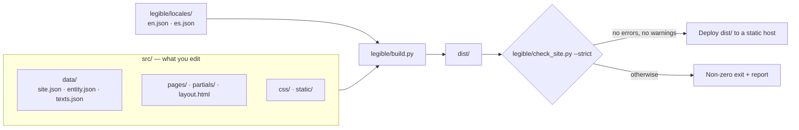

# legible — Reference documentation

> **Who this document is for**
> - **A person** who wants to understand what legible does, how it is built and which rules protect it.
> - **An AI that generates a site** from this base plus a business briefing (sections 5 and 6).
> - **An AI that modifies the engine** (`legible/`, `tests/`) and must keep it small, tested and consistent (sections 0.1 and 2).
>
> **Language policy:** everything is in **English** — README, this document, `AGENTS.md`, code, comments, identifiers, console messages, tests, data-file names and the sample site. Spanish (or any other language) is supported **only as a per-site choice** (see section 4).

---

## 0. How to use this document

| You want to… | Read… |
|---|---|
| Understand what legible is | Section 1 |
| Understand how it works inside | Sections 2, 3 |
| Know the language and naming rules | Section 4 |
| Generate a site with an AI | Sections 5, 6 |
| Look up markers, rules, commands and checks | Section 7 |

### 0.1 Ground rules when changing the project

1. Add no dependencies, no client-side JavaScript and no frameworks. If a change needs one, do not make the change.
2. Never weaken tests or validator thresholds to get a green result. If a test must change because a name or message changed, update it and say why.
3. Keep the baseline (section 7.3, V1) green after every change.
4. Keep changes small and reviewable. A change that turns out to be big is split.
5. Keep `README.md`, `DOCUMENTATION.md` and `AGENTS.md` in step with any rename or behaviour change.
6. Report with facts: run the commands and paste real results. Never claim something passed if it was not run.

---

## 1. What legible is

A static-site generator for **local service businesses**, written with the Python standard library only.

- **Input:** HTML templates + three data files (`site.json`, `entity.json`, `texts.json`).
- **Output:** a `dist/` folder with plain HTML, one CSS file, `sitemap.xml`, `robots.txt`, `llms.txt`, and one JSON-LD (Schema.org) `@graph` per page.
- **Quality gate:** a validator (`check_site.py`) checks the compiled output; in strict mode warnings also fail the build.
- **It does not promise** rankings, indexing or traffic — only predictable, inspectable output.

### 1.1 Design principles (non-negotiable)

| Principle | Practical consequence |
|---|---|
| Standard library only | Nothing to `pip install` in production |
| No client-side JavaScript | The only `<script>` elements are `application/ld+json` blocks |
| No third-party requests | No external fonts, CDNs or trackers; system fonts |
| One source of truth for business facts | Written once, propagated via `{{markers}}` |
| Fail fast and clearly | An unresolved `{{marker}}` stops the build, naming marker and page |
| The validator is a gate | `build.sh` exits non-zero if anything fails |
| Opinionated | Local service businesses (`ProfessionalService`), not a CMS |
| Safe output and a confined dev server | The build refuses an output folder that is, or contains, the project, `src/` or `legible/`; the dev server serves only `.dev-dist/` and blocks path traversal |
| Correct escaping | Derived values are HTML-escaped and JSON-LD values are JSON-escaped (section 2.5) |
| Careful minifiers | The CSS and HTML minifiers protect attributes, `pre`, `textarea`, `calc()` and `url()` |
| All problems at once | Collection validation reports every problem in one pass, not one at a time |
| A test suite that adapts | Tests that depend on the sample data are skipped when a project replaces it, so derived projects keep a green suite |

### 1.2 Known limits (not bugs)

- Shortcut markers cover up to 4 cities, 6 categories and 5 offers.
- The `ProfessionalService` node type is required: the build reads business facts from it and the validator demands it.
- Not a CMS and not a general-purpose static-site framework.
- `compose_page` takes many parameters and `build()` is a long function. They are left as they are on purpose: reshaping them requires tests that cover the behaviour first.

### 1.3 Design decisions

- **Everything is English**, including identifiers, data-file names, marker names and sample URLs: one architecture that every contributor and AI can read. Only site *content* changes language.
- **The default `language` is `en`; other languages ship as locale files** (`legible/locales/<code>.json`, engine-generated strings only) and the content of a site is translated per project.
- **Sample values are neutral and fictional:** currency USD, country `US`, phone `+15550100`, email `hello@example.com`.
- **The `featured_action_*` marker names and the `/featured-action/` URL stay.**
- **The `type` values `guide` and `article` stay English for every site language:** they are architecture, not content.
- **Legal pages are jurisdiction-neutral templates.** They use neutral placeholders (`Your legal name`, `Your jurisdiction`…) and tell the reader to have the text reviewed by a qualified lawyer; a real project turns missing facts into `[CONFIRM …]` markers.
- **The sample brand assets stay** (legible's own branding) as placeholders to be replaced (section 3.7).

---

## 2. Architecture

### 2.1 Overview



> `legible/locales/` holds the strings the engine generates in each language: months and date format, breadcrumb, menu and card labels, the default copy of the guides/blog indexes, the lead strip, the home resources section and the `llms.txt` labels. `site.json › generated_content` overrides the lead strip and the index copy.

Mental rule: **`src/` changes per site; `legible/` is the engine and does not.**

### 2.2 Folder structure

```text
.
├── README.md                  Project presentation
├── DOCUMENTATION.md           This document (full reference and AI guide)
├── AGENTS.md                  Entry point for AI agents
├── LICENSE · readme-logo.svg · .gitignore
├── legible/                   ENGINE (reusable, not edited per site)
│   ├── build.py               Generator
│   ├── check_site.py          Validator for the compiled output
│   ├── build.sh               Build + strict validation (what CI runs)
│   ├── dev.py                 Local server that rebuilds when src/ changes
│   ├── run_all.py             Tests → build+validate → dev server
│   └── locales/               en.json · es.json — engine-generated strings
├── src/                       CONTENT (edited per site)
│   ├── data/                  site.json · entity.json · texts.json
│   ├── pages/                 one folder per URL (index.html with front matter) + 404.html
│   ├── partials/              header.html · footer.html
│   ├── layout.html            Document shell and <head>
│   ├── css/site.css           Single stylesheet; design tokens at the top
│   └── static/                Images, favicons, robots.txt, llms.txt (copied to output root)
├── tests/test_legible.py      Regression suite (unittest)
├── dist/                      Build output (ignored by Git)
└── .dev-dist/                 Dev-server output (ignored by Git)
```

### 2.3 Responsibilities

| Piece | Does | Does not |
|---|---|---|
| `build.py` | Load data, resolve markers, compose pages, JSON-LD, collections (guides/blog), minify, sitemap, robots, llms.txt | Judge SEO quality (the validator does) |
| `check_site.py` | Validate `dist/` | Modify anything |
| `build.sh` | Run build, then strict validation, driven by env vars | Business logic |
| `dev.py` | Serve `.dev-dist/`, rebuild on change (polls every 0.5 s) | Serve anything outside `.dev-dist/` |
| `run_all.py` | Tests → `build.sh` → `dev.py`, stopping at first failure | — |
| `layout.html` | `<head>`, metadata, shell, floating WhatsApp link | Page content |
| `partials/` | Header with menu, footer with navigation and legal links | — |
| `site.css` | Styling via `:root` tokens; no JS, no motion | — |

### 2.4 Exact flow of `build.py`

1. Load `site.json`; apply `SITE_URL` (env wins); **abort unless it starts with `https://`**. Check that `language` is supported and load its locale file.
2. Refuse an output folder that is, or contains, the project, `src/` or `legible/`; then empty it.
3. Copy `src/static/`; write the (optionally minified) CSS.
4. Read `entity.json` and compute the derived values (section 3.2). Load and validate the guide/blog front matter and report **every** problem at once.
5. Build the marker table: `texts.json` first (on top of an optional `site.json › text` object), then the derived values (**derived values win**).
6. Resolve markers in layout, partials and `entity.json` nodes; fill the navigation, footer-blog and year markers.
7. For each page in `src/pages/`: front matter → active menu entry → `geo.*` tags → canonical → merged JSON-LD `@graph` → **fail on any leftover `{{…}}`**.
8. Generate `/guides/` and `/blog/` indexes (at their configured paths) when their rules are met (section 3.5).
9. Write `sitemap.xml`; resolve `robots.txt` and `llms.txt`.
10. Run the validator (unless `--no-validate`) and print the report.

### 2.5 Escaping

| Destination | Rule |
|---|---|
| HTML | **Derived** values (name, city…) are HTML-escaped; values from `texts.json` are **not** (they may contain HTML on purpose) |
| JSON-LD | Values are JSON-escaped; `&` and quotes cannot break the JSON |
| `robots.txt` / `llms.txt` | Plain-text substitution |
| Empty JSON-LD values | Dropped (an empty `price_range` is not published) |

---

## 3. Content model

### 3.1 The three data files

| File | Holds | Notes |
|---|---|---|
| `src/data/site.json` | Project settings: `site_url`, `site_name`, `language`, `contact_email`, `phone_e164`, `whatsapp_message`, `city`, `region`, `geo_enabled`, `geo_region_code`, `price_range`, `build_banner`, `check_banner`, `generated_content`, `collection_topics`, `collection_paths` (default `{"guides": "guides", "blog": "blog"}`: folder and URL of each collection, lowercase ASCII slugs with hyphens, different from each other), `sitemap_base_order`; optionally `text`, an object of extra marker values | Empty `geo_region_code`/`price_range` are simply omitted from the output. Keys of `texts.json` win over `text` |
| `src/data/entity.json` | Business identity in Schema.org: a `ProfessionalService` node and a `WebSite` node | **Keep the `ProfessionalService` type**: cities (`areaServed`), categories (`knowsAbout`) and offers (`hasOfferCatalog`) are read from it |
| `src/data/texts.json` | Reusable copy: key `x` becomes marker `{{x}}` | Derived values override same-named keys |

### 3.2 Derived markers

Full catalogue in section 7.1. In short: identity (`site_name`, `site_url`, `contact_email`), language (`lang`, `og_locale`, `in_language`), contact (`whatsapp_link`, `whatsapp_base`, `phone_e164`, `phone_digits`), place (`city`, `region`, `location`, `city_1…4`), services (`service_category_1…6`, `service_N_name/price/price_number` for N=1…5, `featured_action_name`), `_url` variants for WhatsApp messages and `target_audience`.

**The offer priced `0` in `hasOfferCatalog` is the "featured action"** (page `/featured-action/`). There must be exactly one.

**`{{target_audience}}`** is computed from the names in `areaServed`: the text `businesses in ` followed by the first three names joined with `, `. If `areaServed` is empty the marker stays unresolved and the build fails wherever it is used (the sample `footer_about` text uses it). The wording is fixed in English in `build.py`, so a site in another language that does not want it simply leaves the marker out of its texts.

### 3.3 Pages and front matter

Each page is `src/pages/<slug>/index.html` (URL `/<slug>/`) and starts with:

```text
---
title: Page title | {{site_name}}
description: A 70–160 character summary.
robots: index, follow, max-snippet:-1, max-image-preview:large, max-video-preview:-1
geo: true
canonical: auto
updated: 2026-01-31
---
```

- Required: `title`, `description`. `updated` is required on indexable pages (it feeds sitemap `lastmod`).
- `canonical: none` + `robots: noindex, follow` → pages such as the 404.
- `active` forces which menu entry is highlighted; otherwise the page's own entry or its closest parent.
- The page's `<script type="application/ld+json">` block is extracted and merged with the business nodes into one `@graph`.
- `geo` is an engine feature flag (emit `geo.*` meta tags); the name stays. When it is absent, `site.json › geo_enabled` decides.

### 3.4 Template pages and URLs

| Page | URL (English sample) |
|---|---|
| Home | `/` |
| Services index | `/services/` |
| Sample service | `/services/sample-service/` |
| Pricing | `/pricing/` |
| Featured action | `/featured-action/` |
| About | `/about/` |
| Contact | `/contact/` |
| Legal notice | `/legal-notice/` |
| Privacy policy | `/privacy-policy/` |
| Cookie policy | `/cookie-policy/` |
| 404 | `/404.html` |

The four "Service 1–4" menu entries all point to the sample service page; that is intentional placeholder content. Real sites must point each to its own page.

### 3.5 Optional collections (guides and blog)

| Collection | Content path | `type` | Generated index |
|---|---|---|---|
| Guides | `src/pages/guides/<slug>/index.html` | `guide` | `/guides/` once there is one guide, grouped by topic |
| Blog | `src/pages/blog/<slug>/index.html` | `article` | `/blog/`, newest first |

Each piece needs: `type`, `topic` (one of `collection_topics`), `published`, `updated` (ISO, `updated ≥ published`), `summary`, `service` (an existing path), `title`, `description`. Lowercase-hyphen slug. `related`: at most 2, each an existing guide or article other than the piece itself. **Never hand-create an `index.html` inside the guides or blog folder.**

Blog visibility: 0 articles → no blog; 1–2 → exists as `noindex`, not in menu, footer, sitemap or `llms.txt`; ≥3 → indexable and announced.

The folder names are configurable (`collection_paths`), so a Spanish site can use a localized folder and URL such as `/guias/`.

### 3.6 Generated outputs

HTML per URL · `css/site.css` · JSON-LD per page · `sitemap.xml` (indexable pages only) · `robots.txt` (allows GPTBot, OAI-SearchBot, ClaudeBot, PerplexityBot, Applebot, Meta-ExternalAgent) · `llms.txt` · floating WhatsApp link (`wa.me`, no script).

### 3.7 Sample brand assets

`logo.svg`, `favicon.svg`, `favicon.ico`, `apple-touch-icon.png` and `og-image.png` are legible's own branding, used as neutral placeholders. They contain no agency branding. Every real site replaces them.

---

## 4. Language policy and naming conventions

### 4.1 The rule

| Layer | Language |
|---|---|
| Architecture: code, identifiers, comments, docstrings, console messages, tests, file/folder names under `legible/` and `tests/`, data-file names, marker names, JSON keys, README, this document, `AGENTS.md` | **English, always** |
| The sample site in `src/` (pages, texts, menu, legal pages, `llms.txt`, URLs) | **English**, generic, no trace of any specific business or agency |
| A real site in another language (e.g. Spanish) | The content and URLs of **that site** follow that language; the architecture does not change |

### 4.2 How to build a site in another language

1. `site.json`: `"language": "es"` → `<html lang="es">`, `og:locale es_ES`, `inLanguage es-ES`, `availableLanguage es`, Spanish month names and Spanish engine-generated strings (breadcrumb, index headings, card links, lead strip, `llms.txt` section labels). The supported values are the languages listed in `LANGUAGES` in `legible/build.py` (`en` and `es`); any other value stops the build.
2. Translate everything under `src/`: pages, `texts.json`, layout, partials, `llms.txt`, legal pages.
3. Rename page folders to localized slugs (e.g. `services/` → `servicios/`); update header/footer links, `sitemap_base_order`, internal links and `generated_content.lead_strip.action_url`.
4. `site.json`: `"collection_paths": {"guides": "guias", "blog": "blog"}` for localized collection URLs. Rename the folders under `src/pages/` to match.
5. Keep markers, JSON keys, front-matter keys and `type` values (`guide`, `article`) **in English**: they are the architecture.
6. Unresolved-confirmation markers: the validator matches `[CONFIRM`, which also catches `[CONFIRMAR …]`.
7. `{{target_audience}}` is built with an English phrase (section 3.2); leave it out of translated texts.

**Any other language** needs two things: a file `legible/locales/<code>.json` (copy `en.json` and translate every value; a missing key stops the build) and a row `'<code>': (html lang, og:locale, inLanguage)` in the `LANGUAGES` table of `legible/build.py`. That table row is the only engine edit a new language requires. Then set `language` to the new code.

### 4.3 Naming conventions

- Python: `snake_case` functions and variables, `UPPER_SNAKE` constants, `CamelCase` classes.
- JSON keys and markers: `snake_case`. URL slugs and folders: `kebab-case`, ASCII.
- Comments and identifiers are plain ASCII. Console reports may use symbols such as `✓`, `✗` and box-drawing characters. The exceptions are the user-facing strings of non-English locale files (`legible/locales/es.json`) and test fixtures that deliberately exercise Spanish or Unicode.
- Comments explain *why*, in one short sentence.
- Some names are engine vocabulary and stay as they are on every site: the `geo` front-matter flag, the `{{geo}}` marker, the `geo.*` meta tags, `llms.txt`, the AI-crawler entries in `robots.txt` and the `{{llms_*}}` markers.

---

## 5. Guide for an AI to generate a site from this base

This part is a **contract**: an AI that reads it together with the repository and receives a **briefing** must be able to produce a complete site without breaking the engine.

### 5.1 What the AI must understand

- legible = an **engine** (`legible/`) + a **template** (`src/`). To create a site, **only `src/` changes** (plus `site.json`'s settings).
- Business facts live in three files and spread through `{{markers}}`.
- The validator is strict: any warning stops the build. That is fixed by correcting content, **never** by relaxing rules or tests.
- No JavaScript, no dependencies, no frameworks — none are added.
- Facts the client did not provide are **never invented**. In a real project they stay as visible `[CONFIRM …]` markers (the validator flags them, which is intended: it blocks launch until filled).
- The sample site is English and generic. If the briefing says the site must be in another language, follow section 4.2.

### 5.2 Briefing the AI must receive

Minimum set (if something is missing, the AI **asks or marks it pending** — it does not invent it):

| Block | Fields |
|---|---|
| Identity | Business name, domain (HTTPS), one-line description |
| Contact | Email, phone (E.164), is WhatsApp confirmed? yes/no |
| Location | City, region, street address (if customers visit), ISO 3166-2 `geo_region_code` (optional), country |
| Service area | Up to 4 cities with shortcuts; others as plain list |
| Services | Service list grouped into ≤6 categories; up to 5 priced offers; currency |
| Featured offer | Exactly one offer priced 0 (name, what it includes / excludes) |
| Price range | `price_range` or empty |
| Hours | Confirmed hours or "no hours" |
| Audience | Who the site speaks to |
| Tone | Formal/friendly; (Spanish sites: tú/usted) |
| Legal | Legal name, tax/registration ID, registered address, governing law |
| Brand | Logo, favicon, 1200×630 social image, colours (optional) |
| Collections | Guides? Blog? How many pieces, which topics |
| **Language** | `en` (default) or another; for non-English also the desired URL slugs |
| **Not provided** | An explicit list of what is unknown and must not be invented |

**Fill-in template**

```text
BUSINESS BRIEFING (copy, fill in, paste into the prompt in 6.1)
Name:
Domain (https):
One-line description:
Email:            Phone (E.164):            WhatsApp confirmed (yes/no):
City:             Region:           Country:       Street address (only if customers visit):
ISO 3166-2 geo_region_code (optional):
Service area (up to 4 cities with shortcuts; others as a plain list):
Services (grouped into at most 6 categories):
Priced offers (at most 5):                 Currency:
Featured offer (exactly one, priced 0): name / includes / excludes:
price_range (or empty):
Opening hours (confirmed hours, or 'no hours'):
Audience:                 Tone (formal or friendly; tú or usted for Spanish):
Legal: legal name / tax or registration ID / registered address / governing law:
Brand: logo / favicon / 1200x630 social image / colours (optional):
Collections: guides? blog? how many pieces and which topics:
LANGUAGE: en (default) or other. URL slugs for non-English sites:
NOT PROVIDED (the AI must not invent these):
```

### 5.3 Invariants the AI must not break

1. Always `{{site_url}}` for the domain in pages; set `site_url` in `site.json` and also build with the `SITE_URL` env var.
2. Keep the `ProfessionalService` node, type and `@id`. Add real address fields only if provided; no invented coordinates or ratings.
3. Shortcuts cover 4 cities / 6 categories / 5 offers. Anything beyond is written literally on its own page.
4. Exactly one offer priced `0`; keep the featured-action URL consistent across `lead_strip.action_url`, `sitemap_base_order`, header, footer and `llms.txt`.
5. Sample values (`Service 1`, `Your City`, `$99`, `Topic 1`, `Free Consultation`, `YOUR-DOMAIN`…) **pass the validator**, so **all must be replaced**, and `sitemap_base_order` updated.
6. Every page: `title` 20–60, `description` 70–160, one `h1`, ≥250 words in `<main>` if indexable, `updated: YYYY-MM-DD`, a JSON-LD block, and at least one contextual inbound link from another page's `<main>`. Unique titles and descriptions. Visible FAQ and FAQ JSON-LD identical word for word.
7. New service pages: copy `services/sample-service/`, give each a distinct purpose, add to the menu (`header.html`) and the services index. **No near-duplicate pages per town or keyword.**
8. Images: accurate `alt`, explicit `width` and `height`.
9. WhatsApp: if the phone is not confirmed for WhatsApp, say so and propose removing the floating link (layout) and the WhatsApp calls to action.
10. Legal pages use only provided data; missing items stay as `[CONFIRM …]` (the sample pages use neutral placeholders such as `Your legal name` so the template passes the validator; the pre-launch sweep finds them); do not state legal obligations as fact; recommend legal review.
11. No guides/blog unless requested; if created, follow section 3.5 (≥3 articles for an indexable blog).
12. No JavaScript, no dependencies, no external resources. Do not edit `legible/` or `tests/` to get around a failure.
13. Never invent testimonials, awards, certifications, years in business or figures.
14. **Non-English sites:** apply section 4.2 completely (language setting, translated content, localised slugs, `collection_paths`) and keep markers, keys and `type` values in English.

### 5.4 Stages (the AI stops after each one if asked to)

| Stage | What it does | Checked with |
|---|---|---|
| S0 Read | Read `AGENTS.md`, this document and `README.md`; inspect `src/data/*.json`, `layout.html`, `partials/`, one page, `llms.txt`. Reply with a short plan and the list of missing briefing data | Plan delivered |
| S1 Data | Fill `site.json`, `entity.json`, `texts.json` | `SITE_URL=… ./legible/build.sh` (may fail on pages not yet adapted) |
| S2 Structure | Decide pages and menu; create/remove service pages | Menu, internal links, `sitemap_base_order` |
| S3 Content | Write pages following section 5.3 rule 6 | Strict validator |
| S4 Brand and legal | Logo, images, legal pages with `[CONFIRM …]` where data is missing | Pre-launch sweep (section 7.4) |
| S5 Collections (optional) | Guides/blog per section 3.5 | Build report |
| S6 Close | Full baseline; inspect `dist/` (sitemap, robots, llms.txt, JSON-LD of home and one service page) | Final report |

### 5.5 Definition of done

- Tests and strict build **actually run** and green, or remaining failures listed and justified.
- Pre-launch sweep resolved or each hit justified.
- `dist/` inspected, not just sources.
- Final report with three sections: (1) what changed, by file; (2) commands run and their real results; (3) a table of facts still awaiting client confirmation, including expected validator warnings.

---

## 6. Prompt templates

### 6.1 Generate a site

```text
Read AGENTS.md first.

ROLE
Act as a careful senior web developer. Adapt the legible project into a complete, coherent website for the business below. Reuse the existing architecture and conventions. Add no frameworks, dependencies or client-side JavaScript. Do not touch legible/ or tests/.

START HERE
Read DOCUMENTATION.md fully (especially sections 3, 4.2, 5 and 7) and the "Configure a site" part of README.md. Then inspect src/data/*.json, src/layout.html, src/partials/, one page under src/pages/ and src/static/llms.txt. Reply with (1) a short plan listing the files you will change and (2) the briefing data that is missing. Then work through stages S1…S6 (section 5.4), running the checks after each and summarising the result.

BRIEFING: paste the filled template from 5.2

RULES
Obey the invariants in DOCUMENTATION.md section 5.3. If data is missing, leave a visible [CONFIRM …] marker or ask me; never invent it. Do not weaken validator rules or tests.

DONE WHEN
DOCUMENTATION.md section 5.5 is satisfied. Deliver the final report with its three sections.
```

---

## 7. Appendices

### 7.1 Marker catalogue

**Derived (computed by the build; they override `texts.json`):**

| Marker | Source |
|---|---|
| `{{site_name}}` | `entity.json` name, else `site.json` |
| `{{site_url}}` | `site.json` / `SITE_URL` |
| `{{lang}}`, `{{og_locale}}`, `{{in_language}}` | `site.json › language` |
| `{{contact_email}}` | `entity.json`, else `site.json` |
| `{{phone_e164}}`, `{{phone_digits}}` | `entity.json` telephone, else `site.json` |
| `{{whatsapp_link}}` | `https://wa.me/<digits>?text=<encoded message>` |
| `{{whatsapp_base}}` | `https://wa.me/<digits>` (no text; append `?text=…` by hand) |
| `{{city}}`, `{{region}}`, `{{location}}` | `entity.json` address, else `site.json` |
| `{{city_1}}`…`{{city_4}}` | `areaServed` |
| `{{target_audience}}` | `businesses in ` + the first three `areaServed` names (section 3.2) |
| `{{service_category_1}}`…`{{service_category_6}}` | `knowsAbout` |
| `{{service_N_name}}`, `{{service_N_price}}`, `{{service_N_price_number}}` (N=1…5) | `hasOfferCatalog` |
| `{{featured_action_name}}` | the offer priced `0` |
| `{{featured_action_name_url}}`, `{{service_1_name_url}}` | the above, URL-encoded |
| `{{price_range}}` | `entity.json`, else `site.json` |
| `{{geo_region}}` | `site.json › geo_region_code`, only if set |
| `{{home_resources}}` | Generated HTML: resources section when guides or a visible blog exist |

**From the layout:** `{{title}}`, `{{description}}`, `{{robots}}`, `{{geo}}`, `{{canonical}}`, `{{og_url}}`, `{{jsonld}}`, `{{header}}`, `{{content}}`, `{{footer}}`.
**From partials:** `{{nav_guides}}`, `{{nav_blog}}`, `{{footer_blog}}`, `{{year}}`.
**In `llms.txt`:** `{{llms_guides}}`, `{{llms_blog}}`, `{{llms_sitemap_extra}}`.
**Anything else:** any key of `texts.json`.

### 7.2 Validator rules

| Area | Errors (always fail) | Warnings (fail in strict mode) |
|---|---|---|
| Document metadata | missing `lang`, viewport, `<title>`, description or robots; non-HTTPS or wrong canonical; indexable page without canonical; `og:url` ≠ canonical; `og:image` or `og:url` not HTTPS; `og:image` file missing; 404 with a canonical or `og:url` | title outside 20–60; description outside 70–160; missing Open Graph/Twitter tags; `og:title` ≠ `<title>`; missing `og:image:alt`; unusual `lang`, `og:locale` or `twitter:card` values; viewport without `width=device-width` |
| Structure | not exactly one `h1`; empty headings; more than one `aria-current` | first heading not `h1`; skipped levels; fewer than 250 words in `<main>` (indexable) |
| Images | `` without `alt` | `alt` over 125; missing `width`/`height`; `` without `src` or `srcset` |
| Links | broken internal links, anchors, assets; missing trailing slash; malformed `mailto:`/`tel:`; empty `href`; internal `http://` links | external `http://`; relative links; `target="_blank"` without `noopener`/`noreferrer`; orphan pages (no contextual inbound link from another page's `<main>`) |
| Leftovers | unresolved `{{…}}` | `TODO` or `[CONFIRM` in visible text |
| Structured data | indexable page without JSON-LD; invalid JSON; wrong `@context`; duplicate or undefined `@id`; missing `ProfessionalService` or `WebSite`; `url` ≠ real URL; FAQ differs from visible FAQ; FAQPage without `mainEntity` | `name` ≠ `<title>`; non-ISO `dateModified`; malformed FAQ `Question`/`Answer` |
| Duplicates | duplicate titles/descriptions among indexable pages | — |
| Site files | missing `index.html`, `404.html`, `sitemap.xml`, `robots.txt`; invalid/duplicate/off-domain sitemap URLs; sitemap URL without a generated page; indexable page missing from sitemap or `noindex` page present; global `Disallow: /` | missing `llms.txt`; `lastmod` not ISO or ≠ `dateModified`; `robots.txt` without `Sitemap:` |

Thresholds are constants at the top of `check_site.py`. These checks do not replace browser testing, accessibility review or the search engines' own tools.

### 7.3 Verification kit

**V1 — Baseline (after every change)**
```bash
python3 -B -m unittest discover tests
SITE_URL=https://example.com ./legible/build.sh
```
Expected: `OK` from the tests and `CHECK PASSED` with no warnings.

**V2 — Technical audit**
```bash
bash -n legible/build.sh                       # expect: no output
grep -nE "except( Exception)?( as \w+)?:\s*$" legible/*.py          # review each hit
grep -rnP '<a[^>]*target="_blank"(?![^>]*noopener)' src             # expect: no output
python3 - <<'PY'                               # texts.json keys that nothing uses
import json, pathlib, re
keys = json.load(open('src/data/texts.json'))
used = set()
for f in list(pathlib.Path('src').rglob('*')) + [pathlib.Path('legible/build.py')]:
    if f.is_file() and f.suffix in ('.html', '.txt', '.json', '.py') and f.name != 'texts.json':
        used |= set(re.findall(r'\{\{([a-z0-9_]+)\}\}', f.read_text(errors='ignore')))
print(sorted(k for k in keys if k not in used) or 'no unused keys')
PY
python3 legible/check_site.py --dir /nonexistent >/dev/null 2>&1; echo "exit=$?"   # expect: exit=1
```

**V3 — Template neutrality (sample content only)**
```bash
grep -rnIiE "seo|google|geo\b|chatgpt|gemini|perplexity|copilot|search console|analytics|valdemoro|business profile|directorio|directories" src
```
Expected: no output. `README.md`, `DOCUMENTATION.md` and `legible/` may mention SEO, Google, JSON-LD and AI crawlers: that is what the tool does. **`src/pages`, `src/partials`, `src/data/texts.json` and `src/layout.html` must not.** The engine features that keep their names (`geo` flag, `llms.txt`, AI-crawler entries) are listed in section 4.3.

### 7.4 Pre-launch sweep

Run it on a real project before publishing:

```bash
grep -rIniE "Your Business|Your City|Your Region|YOUR-DOMAIN|Service [1-6]\b|City [1-4]\b|Topic [1-5]\b|Free Consultation|Your legal name|Your registered address|Your registration number|Your jurisdiction|example\.com|555|\$(99|149|290)|CONFIRM" dist src
```

The sweep is a review aid, not a pass/fail test. Replace every hit, or justify it explicitly (for example a real price that happens to match). The sample logo and social image are replaced with the site's own assets (section 3.7). Hits for `CONFIRM` mark facts that are still awaiting confirmation.

### 7.5 Commands

| Action | Command |
|---|---|
| Tests + build + server | `python3 legible/run_all.py [--skip-tests] [--port N]` |
| Without server | `python3 legible/run_all.py --no-dev` |
| Tests only | `python3 -B -m unittest discover tests` |
| Strict build + validation | `SITE_URL=https://example.com ./legible/build.sh` |
| Unminified build | `CSS_MINIFY=FALSE ./legible/build.sh` |
| Warnings do not fail | `CHECK_STRICT=FALSE ./legible/build.sh` |
| Build only | `python3 legible/build.py [--out FOLDER] [--minify true\|false] [--no-validate]` |
| Local server (port 3001) | `python3 legible/dev.py [--port N] [--minify]` |
| Validate an existing build | `python3 legible/check_site.py --dir dist --strict --site-url https://example.com` |

`build.sh` variables: `SITE_URL`, `CSS_MINIFY` (default `TRUE`), `CHECK_STRICT` (default `TRUE`). `build.py` also reads `RENDER_GIT_BRANCH` and `RENDER_GIT_COMMIT`, which feed the report when there is no Git checkout. If the executable bit is missing (for example after unpacking an archive), run `bash legible/build.sh`.

### 7.6 Deployment

Publish `dist/` on any static host (Cloudflare Pages, GitHub Pages, Netlify, Render, S3, Nginx).

```text
Build command:      ./legible/build.sh
Publish directory:  dist
Environment:        SITE_URL=https://your-domain.com
```

The build environment needs Python 3.8+ and `bash`. A failed validation exits non-zero, so the host will not publish it.

### 7.7 Glossary

| Term | Meaning |
|---|---|
| Marker / placeholder | `{{key}}` replaced at build time |
| Front matter | The `---` block at the top of a page (`title`, `description`…) |
| JSON-LD / `@graph` | Schema.org structured data; one per page, merging business + page nodes |
| Indexable | A page without `noindex` that is not the 404; it appears in the sitemap |
| Orphan | A page with no contextual inbound link from another page's `<main>` |
| Strict mode | Validator warnings also fail the build |
| `llms.txt` | Plain-text file with business facts for AI assistants |
| Featured action | The offer priced 0 (`/featured-action/`) |
| Locale file | `legible/locales/<language>.json`: engine-generated strings for one language |
| Briefing | The set of business facts a site is built from (section 5.2); anything not in it is not invented |
| Pre-launch sweep | The search for sample values and `[CONFIRM` markers left in a real project (section 7.4) |
