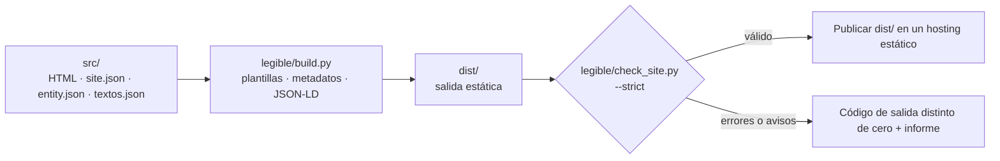

<div align="center">


**Un generador estático y ligero para negocios locales, construido con la librería estándar de Python.**

HTML plano. Sin JavaScript en el cliente. Datos estructurados y comprobaciones SEO integradas en el proceso de build.

[](https://www.python.org/)
[](#principios-de-diseño)
[](#qué-genera)
[](https://schema.org/)
[](LICENSE)

[English](README.md) · [Español](README.es.md)

</div>

## Índice

- [Resumen](#resumen)
- [Por qué este enfoque](#por-qué-este-enfoque)
- [Qué genera](#qué-genera)
- [Inicio rápido](#inicio-rápido)
- [Configurar un sitio](#configurar-un-sitio)
- [Configuración del build](#configuración-del-build)
- [Validación](#validación)
- [Arquitectura](#arquitectura)
- [Principios de diseño](#principios-de-diseño)
- [Rendimiento](#rendimiento)
- [Pruebas](#pruebas)
- [Despliegue](#despliegue)
- [Ejemplo: crear la web de un cliente con un agente de IA](#ejemplo-crear-la-web-de-un-cliente-con-un-agente-de-ia)
- [Alcance y limitaciones](#alcance-y-limitaciones)
- [Contribuir](#contribuir)
- [Licencia](#licencia)
- [Autor](#autor)


---

## Resumen

`legible` genera webs estáticas para negocios de servicios locales a partir de plantillas HTML y unos pocos archivos de datos compartidos. Tiene un alcance deliberadamente concreto: está pensado para webs de negocios de servicios, no para sustituir a una plataforma editorial o a un generador estático de propósito general.

Los datos del negocio se mantienen en `src/data/entity.json` y los textos reutilizables en `src/data/textos.json`. El proceso de build compone las páginas, genera metadatos y JSON-LD y produce archivos auxiliares para publicar el sitio. Después, un validador revisa el resultado compilado y puede detener el build tanto por errores como por avisos.

**El objetivo es obtener una salida predecible y fácil de inspeccionar, no prometer posiciones en buscadores.** Las comprobaciones técnicas detectan errores habituales de implementación, pero no garantizan indexación, resultados enriquecidos, tráfico ni visibilidad en asistentes de IA.

## Por qué este enfoque

- **Una fuente para los datos del negocio.** La información compartida se mantiene centralizada en lugar de duplicarse en cada página.
- **Salida estática.** La web generada son archivos que puede servir un hosting estático; no requiere un runtime de aplicación en producción.
- **Sin JavaScript en el cliente.** La plantilla no envía código de aplicación al navegador. El JSON-LD se incluye como datos dentro de elementos `<script>`.
- **Marcadores *fail-fast*.** Los marcadores de plantilla sin resolver detienen el build en lugar de filtrarse silenciosamente a producción.
- **Validación orientada a SEO.** Se revisan metadatos, encabezados, enlaces, imágenes, datos estructurados y archivos generados.
- **Implementación con la librería estándar.** El generador y las pruebas usan la librería estándar de Python, sin dependencias de terceros para su ejecución.

## Qué genera

Por defecto, el resultado del build se escribe en `dist/`.

| Salida | Función |
| --- | --- |
| Páginas HTML estáticas | Páginas compuestas a partir de plantillas y contenido |
| CSS | Hoja de estilos del sitio, con minificación opcional |
| JSON-LD | Datos estructurados combinados en un `@graph` por página |
| `sitemap.xml` | URLs del sitio generado |
| `robots.txt` | Directivas para rastreadores y referencia al sitemap |
| `llms.txt` | Índice en texto plano de información seleccionada del sitio |
| Índices de guías/blog | Se generan cuando las colecciones cumplen las reglas del proyecto |

La plantilla incluye ejemplos de páginas para negocios, páginas legales de ejemplo, una página 404 y soporte para colecciones de guías y blog. Antes de publicar una web real, revisa y sustituye el contenido de ejemplo.

## Inicio rápido

### Requisitos

- Python 3.10 o posterior.
- `bash` para ejecutar `legible/build.sh` (en Windows, Git Bash o WSL).
- El proyecto no requiere paquetes Python de terceros.

### Ejecutar comprobaciones y arrancar el servidor local

Desde la raíz del repositorio:

```bash
python3 legible/run_all.py
```

Este comando ejecuta las pruebas, compila y valida el sitio y, si todo termina correctamente, inicia el servidor de desarrollo. Se detiene en el primer paso que falla.

Comandos alternativos:

```bash
# Compilar y validar sin iniciar el servidor de desarrollo
python3 legible/run_all.py --no-dev

# Compilar y validar
./legible/build.sh

# Ejecutar las pruebas
python3 -m unittest discover tests

# Iniciar el servidor local
python3 legible/dev.py
```

Por defecto, el servidor de desarrollo está disponible en `http://localhost:3001` y recompila cuando cambian archivos bajo `src/`.

## Configurar un sitio

El motor reutilizable vive en `legible/`. Los valores específicos del proyecto (dominio, nombre, contacto, ubicación y textos de las páginas de índice generadas) se definen en `src/data/site.json`, el archivo principal de configuración, junto con `src/data/entity.json`; los textos editoriales permanecen en `src/`.

### 1. Definir la URL canónica

Define `site_url` en `src/data/site.json` con el origen HTTPS definitivo. La variable de entorno `SITE_URL` lo sobrescribe en una compilación concreta (CI, previsualizaciones, pruebas) sin tocar ningún archivo fuente:

```bash
SITE_URL=https://ejemplo.es ./legible/build.sh
```

Usa el origen HTTPS final. El generador y el validador utilizan este valor para las URLs canónicas y otras referencias generadas, incluidos los datos estructurados y los archivos relacionados con el sitemap. Evita escribir el dominio manualmente en cada página.

### 2. Editar los datos y los textos

- `src/data/site.json` — configuración principal del proyecto: `site_url`, `site_name`, datos de contacto (`contact_email`, `phone_e164`, `whatsapp_message`), ubicación (`city`, `region`, `geo_enabled`, `geo_region_code`), `generated_content` (textos de los índices de guías y blog y de la franja de contacto), `collection_topics` (temas válidos de guías y artículos) y `sitemap_base_order`.
- `src/data/entity.json` — identidad del negocio e información compartida de servicios.
- `src/data/textos.json` — textos reutilizables y valores predeterminados.
- `src/pages/` — contenido de las páginas y *front matter*.
- `src/partials/` — cabecera y pie compartidos.
- `src/css/site.css` — estilos del sitio.
- `src/static/` — recursos estáticos y archivos auxiliares.

Ganchos CSS: `band-cta` y `footer-brand` son nombres de clase semánticos usados en el HTML que no tienen reglas CSS propias a propósito; `toc` está definida en `site.css`, pero ninguna página de la plantilla la usa.

Tema visual: el aspecto se define solo con los tokens del inicio de `src/css/site.css` (paleta tomada del logo y de `og-image.png`: fondo pizarra y acentos cian, verde, ámbar y azul) y con fuentes del sistema (sin fuentes web, sin JavaScript, sin animaciones). Cambia las variables de `:root` para rehacer el aspecto sin tocar el HTML.

Logo: `src/static/images/logo.svg` es el logo de la web; `readme-logo.svg` (raíz del proyecto, junto a los README) es la versión para los README, con placa oscura para que se lea en el tema claro y en el oscuro. Ninguno lleva metadatos.

Antes del lanzamiento, sustituye los datos de ejemplo, las imágenes provisionales y los textos genéricos. Comprueba que los precios, las zonas de servicio, los datos de contacto, las afirmaciones comerciales y las ofertas sean reales.

### 3. Añadir una página de servicio

Usa `src/pages/servicios/servicio-generico/` como plantilla de referencia. Actualiza su *front matter*, contenido visible y datos estructurados. Después, enlaza la nueva página desde el índice de servicios y la navegación cuando corresponda.

### 4. Compilar y validar

```bash
SITE_URL=https://ejemplo.es ./legible/build.sh
```

Por defecto, el modo estricto trata los avisos como fallos del build. La intención es revisarlos, no ignorarlos automáticamente.

## Configuración del build

`legible/build.sh` lee estas variables de entorno:

| Variable | Valor predeterminado | Efecto |
| --- | --- | --- |
| `SITE_URL` | `site_url` de `src/data/site.json` (`https://TU-DOMINIO.com` en la plantilla) | Sobrescribe `site_url`: URL base HTTPS para canonicals y referencias generadas |
| `CSS_MINIFY` | `TRUE` | Con `FALSE`, desactiva la minificación donde está soportado; útil para depurar |
| `CHECK_STRICT` | `TRUE` | Con `FALSE`, los avisos no hacen fallar la validación; los errores siguen fallando |

`run_all.py` también admite:

```bash
python3 legible/run_all.py --no-dev
python3 legible/run_all.py --skip-tests
python3 legible/run_all.py --port 8080
```

Usa `--skip-tests` solo cuando tengas un motivo concreto para omitir las pruebas.

## Validación

`legible/check_site.py` valida la salida compilada, no los archivos fuente de forma aislada. En modo estricto, los errores y los avisos producen un código de salida distinto de cero.

Entre las comprobaciones se incluyen:

- **Metadatos del documento:** idioma, viewport, límites de longitud de título y descripción, directivas robots, canonicals HTTPS y metadatos Open Graph y Twitter.
- **Estructura del contenido:** jerarquía de encabezados, un `h1` principal, longitud mínima del contenido principal para páginas indexables y detección de marcadores o textos provisionales sin resolver.
- **Imágenes:** texto alternativo y dimensiones explícitas.
- **Enlaces:** rutas internas y anclas rotas, páginas huérfanas y comprobaciones básicas de enlaces a nuevas pestañas, correo y teléfono.
- **Datos estructurados:** JSON válido, nodos/campos requeridos, `@id` duplicados, referencias sin resolver y coherencia entre las FAQ visibles y las FAQ del marcado.
- **Archivos del sitio:** presencia de archivos requeridos, coherencia del sitemap y comprobaciones básicas de `robots.txt`.

Para validar un build existente:

```bash
python3 legible/check_site.py --dir dist --strict --site-url https://ejemplo.es
```

Estas reglas son controles técnicos específicos del proyecto. No sustituyen las pruebas en navegadores, la revisión de accesibilidad, la comprobación de elegibilidad real para resultados enriquecidos ni las herramientas para webmasters de los buscadores.

## Arquitectura



| Ruta | Responsabilidad |
| --- | --- |
| `legible/build.py` | Composición de plantillas, sustitución de marcadores, ensamblado de JSON-LD, minificación y archivos generados |
| `legible/check_site.py` | Validación de la salida compilada |
| `legible/build.sh` | Build seguido de validación |
| `legible/dev.py` | Servidor local y flujo de recompilación |
| `legible/run_all.py` | Orquesta pruebas, build/validación y servidor local opcional |
| `tests/test_legible.py` | Pruebas de regresión del build, minificadores, colecciones, URLs, marcadores, seguridad de la carpeta de salida y línea de comandos de `build.py` |
| `src/layout.html` | Estructura común del documento y metadatos |
| `src/pages/` | Plantillas y contenido de páginas |
| `src/data/site.json` | Configuración principal del proyecto: dominio, nombre, contacto, ubicación, textos de los índices generados, temas de colecciones y orden del sitemap |
| `src/data/` | Datos compartidos del negocio (`entity.json`) y textos por defecto (`textos.json`) |
| `src/partials/` | Fragmentos comunes de página |
| `src/css/site.css` | Hoja de estilos |
| `src/static/` | Recursos estáticos y archivos auxiliares |

## Principios de diseño

| Decisión | Ventaja | Compromiso |
| --- | --- | --- |
| Solo librería estándar de Python | No requiere paquetes Python de terceros en ejecución | El código propio reemplaza funciones que ofrecerían motores de plantillas o librerías Markdown |
| `entity.json` compartido | Reduce la duplicación de datos del negocio | El modelo de datos requiere mantenimiento cuidadoso |
| Sin JavaScript en el cliente | Menos código ejecutado en el navegador y sin hidratación JS | No está pensado para interacciones que necesiten lógica de aplicación en el cliente |
| Validación estricta por defecto | Detecta regresiones comunes antes de publicar | Hay que resolver o revisar conscientemente los avisos existentes |
| Colecciones por convención de carpetas | Permite generar índices y entradas relacionadas | La estructura de carpetas y el *front matter* son deliberadamente opinados |
| Minificadores pequeños propios | Mantiene reducido el conjunto de dependencias | El código de minificación requiere pruebas de regresión continuas |

## Rendimiento

La salida estática y la ausencia de JavaScript en el cliente reducen piezas móviles, pero **no garantizan que todas las páginas sean rápidas en cualquier condición**. El rendimiento real también depende del tamaño de HTML/CSS, las imágenes, las fuentes, el hosting, la caché, la red y los recursos de terceros que se añadan posteriormente.

Las mediciones del README original describen la plantilla incluida, no un benchmark universal. Vuelve a medir el build de producción tras cambiar contenido o recursos, combinando comprobaciones de transferencia con herramientas de rendimiento en navegador.

## Pruebas

Ejecuta las pruebas desde la raíz del repositorio:

```bash
python3 -m unittest discover tests
```

Toda la batería está en un único archivo, `tests/test_legible.py`. Cubre una compilación y validación de humo, minificación CSS/HTML, *front matter* de guías y blog, gestión de URLs y marcadores, metadatos geográficos, enlaces contextuales, seguridad de la carpeta de salida y la línea de comandos de `build.py`. El servidor de desarrollo local (`legible/dev.py`) no tiene pruebas automáticas; compruébalo a mano con `python3 legible/dev.py`. La batería está escrita para valer en cualquier proyecto basado en `legible`: lee el dominio, la ciudad y los temas de `src/data/site.json`, y las pocas pruebas que exigen un proyecto vacío (sin guías ni blog) se saltan solas cuando el proyecto ya tiene contenido propio. Añade pruebas de regresión cuando cambies el comportamiento del generador o del validador.

Los scripts de `legible/` no dejan `__pycache__/`. Ejecutar a mano `python3 -m unittest discover tests` sí crea `tests/__pycache__/`; evítalo con `python3 -B -m unittest discover tests`, con `PYTHONDONTWRITEBYTECODE=1` o con `python3 legible/run_all.py` (`.gitignore` ya lo excluye).

Antes de abrir un pull request, ejecuta:

```bash
python3 -m unittest discover tests
./legible/build.sh
```

## Despliegue

Publica el contenido de `dist/` en un proveedor de hosting estático o servidor web, por ejemplo Cloudflare Pages, GitHub Pages, Netlify, Render Static Sites, S3 o Nginx.

Configuración habitual:

```text
Comando de build:    ./legible/build.sh
Directorio público:  dist
Variable:            SITE_URL=https://ejemplo.es
```

Adapta estos valores al entorno real del proveedor. Para ejecutar el script de build se necesita Python 3.10+ y `bash`.

## Ejemplo: crear la web de un cliente con un agente de IA

Este prompt sirve como punto de partida para adaptar la plantilla a un negocio local. Los datos del taller que aparecen a continuación son **datos de ejemplo ilustrativos**, no hechos verificados. Sustitúyelos por información confirmada por el cliente antes de publicar.

Copia el prompt en tu agente de programación desde la raíz del repositorio:

```text
Actúa como un desarrollador web sénior y cuidadoso que trabaja dentro de este repositorio. Adapta el proyecto `legible` existente para crear una web completa y coherente para el taller mecánico de ejemplo descrito abajo. Antes de modificar nada, inspecciona el repositorio, su README, las plantillas, el modelo de datos, el proceso de build, el validador y las pruebas. Respeta las convenciones del proyecto; no sustituyas su arquitectura por otro framework.

DATOS DE EJEMPLO DEL NEGOCIO — verificar cada valor antes de producción
- Nombre: Taller Mecánico García
- Dominio: tallermecanicogarcia.com
- Correo: hola@tallermecanicogarcia.com
- Teléfono: +34912345678
- Dirección: Calle de la Industria 12, 28005 Madrid, España
- Zona de servicio: Madrid, Alcobendas, San Sebastián de los Reyes, Las Rozas, Pozuelo de Alarcón y Majadahonda
- Servicios: mecánica general, diagnosis electrónica, neumáticos, frenos, aire acondicionado, pre-ITV y mantenimiento programado
- Rango de precios de ejemplo: 30–800 €
- Oferta destacada: diagnosis gratuita del vehículo (0 €)

Trata todos los valores anteriores como marcadores de ejemplo. No afirmes que el negocio, la dirección, los datos de contacto, los precios, la oferta, el horario, las certificaciones, las reseñas o las garantías son reales si no se han verificado. No inventes testimonios, premios, cualificaciones ni afirmaciones de rendimiento. Señala claramente los datos que el cliente deba confirmar.

IMPLEMENTACIÓN
1. Inspecciona el proyecto antes de editar. Resume brevemente qué archivos vas a modificar y después trabaja en grupos pequeños y revisables.
2. Actualiza `src/data/entity.json` y `src/data/textos.json` como fuentes compartidas de datos del negocio y textos reutilizables. Respeta la convención `{{site_url}}` para las URLs canónicas y configura la URL del build mediante `SITE_URL`, sin dispersar el dominio escrito a mano por las plantillas.
3. Desarrolla las páginas de inicio, servicios, precios, oferta destacada, contacto y sobre nosotros; actualiza también la cabecera y el pie compartidos cuando sea necesario. Mantén una navegación coherente y útil.
4. Crea páginas individuales de servicios siguiendo `src/pages/servicios/servicio-generico/`. Cada página debe tener una finalidad diferenciada y contenido realmente útil; no generes páginas casi idénticas solo para posicionar ciudades o palabras clave.
5. Mantén alineados el contenido visible y los datos estructurados. Añade JSON-LD válido solo cuando describa con precisión la página. Si una página incluye preguntas frecuentes en JSON-LD, muestra en esa misma página las mismas preguntas y respuestas.
6. Sustituye las imágenes provisionales por recursos adecuados y con licencia apropiada. Todas las imágenes relevantes deben tener un `alt` preciso y los atributos `width` y `height`; no describas una imagen como algo que no muestra.
7. Respeta las restricciones y convenciones del proyecto: salida HTML estática, sin JavaScript en el cliente, plantillas existentes, ejecución con la librería estándar de Python y flujo actual de build/validación. No añadas dependencias ni introduzcas un framework salvo que la tarea lo exija expresamente.
8. Asegúrate de que todas las páginas indexables se puedan alcanzar mediante enlaces internos útiles desde otra página, especialmente desde el contenido principal (`<main>`), el índice de servicios o la navegación pertinente.
9. Revisa el diseño móvil, HTML semántico, jerarquía de encabezados, textos accesibles de enlaces, metadatos, URLs canónicas, enlaces internos, rutas de imágenes y datos estructurados. El contenido debe ser natural, concreto y útil, sin abuso de palabras clave ni afirmaciones no demostradas.
10. Elimina marcadores de plantilla sin resolver, TODO y textos provisionales de las páginas que se vayan a publicar, incluidos `TODO`, `[CONFIRMAR` y cualquier `{{...}}` sin expandir. Si un dato no se puede verificar, documéntalo claramente en vez de inventarlo.

VALIDACIÓN Y CRITERIOS DE FINALIZACIÓN
- Después de cada grupo de cambios, ejecuta las comprobaciones pertinentes y corrige las regresiones antes de continuar.
- Ejecuta `SITE_URL=https://tallermecanicogarcia.com ./legible/build.sh`.
- Ejecuta `python3 -m unittest discover tests`.
- Inspecciona el resultado generado en `dist/`, no solo las plantillas fuente. Resuelve todos los fallos de validación; no debilites ni eludas el validador solo para conseguir que el build termine correctamente.
- Al terminar, resume los cambios, indica qué comprobaciones se han ejecutado y cuáles han pasado, y enumera los datos del negocio que aún debe confirmar el cliente. Nunca afirmes que un comando ha pasado si no lo has ejecutado realmente.
```

La URL usada en el comando de build también es ilustrativa. Utiliza el dominio real de producción solo cuando el cliente haya confirmado que le pertenece y que está listo para el lanzamiento.

## Alcance y limitaciones

`legible` es un generador específico para webs relativamente convencionales de negocios locales. No es un CMS, un framework estático de propósito general ni una garantía de resultados SEO.

- No garantiza posiciones, indexación, resultados enriquecidos, tráfico ni citas en asistentes de IA.
- Los datos estructurados deben describir fielmente el contenido visible y no garantizan por sí mismos resultados destacados.
- `llms.txt` es un archivo informativo; su soporte e impacto varían según quien lo consuma.
- Los datos de negocio y textos legales de ejemplo deben revisarse y sustituirse antes de producción.
- El validador comprueba reglas técnicas concretas. No puede determinar si las afirmaciones comerciales son ciertas, si el contenido responde a la intención de búsqueda o si la web cumple todos los requisitos legales aplicables.
- Si necesitas un CMS, interacciones complejas, una plataforma editorial grande o una cadena de compilación muy personalizable, considera un framework más amplio.

## Contribuir

Se agradecen las incidencias y los pull requests. Mantén los cambios acotados, explica qué comportamiento cambia e incluye una prueba de regresión para las correcciones cuando sea práctico.

Antes de enviar cambios:

```bash
python3 -m unittest discover tests
./legible/build.sh
```

No debilites las reglas de validación solo para hacer pasar un build: comprueba primero si el problema está en el contenido fuente o si la regla necesita un cambio justificado.

## Licencia

Publicado bajo la [licencia MIT](LICENSE).

## Autor

**Angel Maturana Clavero** — Arquitecto de software con más de 26 años de experiencia en banca core, actualmente centrado en agentes de IA generativa y herramientas SEO. `legible` se desarrolla para crear webs rápidas y bien estructuradas para negocios locales a través de [SEO Valdemoro](https://seovaldemoro.com).

- GitHub: [angelmaturana](https://github.com/angelmaturana)
- LinkedIn: [angelmaturana](https://linkedin.com/in/angelmaturana)
- Web: [seovaldemoro.com](https://seovaldemoro.com)


<p align="center">
  <strong>Built for developers who respect the platform.</strong><br>
  <em>No frameworks. No bloat. Just HTML that ranks.</em>
</p>

<p align="center">
  <a href="https://github.com/angelmaturana/legible/stargazers">
    
  </a>
  <a href="https://github.com/angelmaturana/legible/fork">
    
  </a>
</p>
