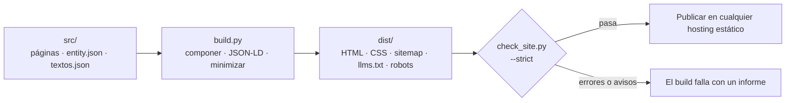

<div align="center">

# legible

**Webs para negocios de servicios locales que los buscadores y los asistentes de IA pueden leer de verdad.**

HTML plano, sin JavaScript, con datos estructurados completos y un validador que corta el build antes de que un error de SEO llegue a producción. Solo librería estándar de Python: no hay nada que instalar.

[](https://www.python.org)
[](#decisiones-de-diseño-y-compromisos)
[](#de-un-vistazo)
[](https://schema.org)
[](LICENSE)

[English](README.md) · **Español**

</div>

---

## Por qué legible

Un fontanero, una clínica o un taller necesitan una web que cargue al instante, que diga con claridad qué hace el negocio, dónde y por cuánto, y que Google y los asistentes de IA entiendan. Casi todas las soluciones para eso son pesadas (frameworks, plugins, herramientas de compilación) y nadie revisa los detalles de SEO hasta que ya se ha perdido tráfico.

legible va por otro camino:

- **Un solo archivo describe el negocio.** Nombre, teléfono, ciudades, servicios y precios viven en `entity.json`; de ahí salen todas las páginas, los datos estructurados, el sitemap y `llms.txt`, así que nada se desincroniza.
- **Rápida por construcción.** HTML estático y una sola hoja de estilos. Nada de JavaScript en el cliente.
- **Los errores paran el build.** `check_site.py` valida el resultado (encabezados, canonicals, imágenes, enlaces, JSON-LD, sitemap, coherencia de las FAQ…) y falla con errores *y* con avisos.
- **Nada que instalar ni mantener.** Librería estándar de Python. La salida se publica en cualquier hosting estático.

No promete posiciones. Garantiza que la información que reciben buscadores y asistentes de IA es limpia, completa y coherente.

## De un vistazo

Medido sobre la plantilla incluida (11 páginas), 2026-10-21:

| | |
|---|---|
| Dependencias en ejecución | **0** (librería estándar de Python) |
| JavaScript enviado al navegador | **0 bytes** (los únicos `<script>` son datos JSON-LD) |
| Peso de la portada | 22 KB de HTML (5,9 KB gzip) + 20 KB de CSS (4,9 KB gzip) |
| Build + validación estricta | **~0,25 s** |
| Datos estructurados | `ProfessionalService`, `WebSite`, `WebPage`, `FAQPage`, `Service`/`Offer`, `BreadcrumbList` combinados en un único `@graph` por página |
| Archivos generados | `sitemap.xml` (con `lastmod`), `robots.txt`, `llms.txt` y, si existen, los índices de `/guias/` y `/blog/` |
| Pruebas | 81 (`unittest`, ~5 s); 6 documentan errores conocidos, ver [Estado](#estado-y-limitaciones-conocidas) |

## Inicio rápido

Requiere Python 3.10+. Clona el repositorio (o descarga el ZIP), entra en la carpeta y ejecuta:

```bash
python3 legible/run_all.py    # pruebas -> build + validación -> servidor local, se detiene en el primer fallo
./legible/build.sh            # compila en dist/ y valida en modo estricto
python3 legible/dev.py        # servidor local en http://localhost:3001, recompila al guardar
python3 -m unittest discover tests   # ejecuta las pruebas
```

Opciones de `build.sh` (variables de entorno):

| Variable | Por defecto | Efecto |
|---|---|---|
| `SITE_URL` | `https://TU-DOMINIO.com` | Dominio del sitio: canonicals, JSON-LD, sitemap, `robots.txt`, `llms.txt`. Debe empezar por `https://`. |
| `CSS_MINIFY` | `TRUE` | `FALSE` deja HTML y CSS sin minimizar (útil para depurar). |
| `CHECK_STRICT` | `TRUE` | `FALSE`: los avisos ya no hacen fallar el build (los errores siempre sí). |

Opciones de `run_all.py`: `--no-dev` (sin servidor, útil antes de publicar), `--skip-tests` (cuando solo has tocado `src/`) y `--port N`. Respeta las variables de entorno de `build.sh`.

Validar una carpeta ya compilada: `python3 legible/check_site.py --dir dist --strict --site-url https://tu-dominio.com` (sin `--site-url` se asume el dominio por defecto).

## Cómo funciona



- **Plantillas.** Cada página es un `.html` con *front matter* (`title`, `description` y, opcionalmente, `robots`, `canonical`, `geo`, `active`). El build lo inserta en `layout.html`, marca el enlace activo del menú con `aria-current` y añade canonical y Open Graph.
- **Marcadores `{{...}}`.** Unos se calculan desde `entity.json` (nombre, email, teléfono, ciudades, precios, dominio); el resto son textos en `src/data/textos.json`. Si un marcador no tiene valor, el build se detiene y te dice cuál es y en qué página.
- **JSON-LD.** Los nodos de `entity.json` se combinan con el JSON-LD de cada página en un único `@graph`; nunca se emiten `@id` duplicados.
- **Guías y blog.** Crea un archivo en `src/pages/guias/<slug>/` o `src/pages/blog/<slug>/` con el front matter requerido (`type`, `topic`, `published`, `updated`, `summary`, `service`; opcional `related`, máx. 2) y el build genera el índice, la entrada del sitemap y la de `llms.txt`. `/guias/` aparece con 1 guía o más; `/blog/` sale `noindex` con 1–2 artículos y pasa a público (menú, pie, sitemap) desde 3.

## Qué valida el validador

`check_site.py` es el único validador. Con `--strict`, los avisos también hacen fallar el build.

- **Cabecera:** `lang`, `viewport`, `title` y `description` (con límites de longitud), `robots`, canonical HTTPS coherente con la URL, Open Graph y Twitter.
- **Contenido:** un solo `h1`, sin saltos de nivel, mínimo de 250 palabras en `<main>` en páginas indexables, sin `TODO`, `[CONFIRMAR` ni `{{...}}` sobrantes.
- **Imágenes:** `alt`, `width` y `height` en todas.
- **Enlaces:** rutas internas absolutas, sin enlaces ni anclas rotas, `rel="noopener"` en `target="_blank"`, `mailto:` y `tel:` bien formados, sin páginas huérfanas.
- **JSON-LD:** válido, con `@context`, sin `@id` duplicados ni referencias sin definir, con los nodos obligatorios, y la FAQ del marcado debe coincidir con la FAQ visible.
- **Sitio:** sin títulos ni descriptions duplicados; `sitemap.xml` completo y coherente; `robots.txt` sin `Disallow: /` y con el sitemap declarado; archivos obligatorios presentes.

## Personalizar para un negocio

1. Edita `src/data/entity.json`: nombre, email, teléfono, ciudades, servicios y precios.
2. Define el dominio una sola vez: `SITE_URL=https://ejemplo.es ./legible/build.sh`. Páginas, `entity.json`, `robots.txt` y `llms.txt` usan el marcador `{{site_url}}`.
3. Sustituye los textos genéricos de `src/data/textos.json` (no hace falta tocar Python), o escribe el texto directamente en cada página.
4. Reemplaza las imágenes de `src/static/images/` (logo, `og-image`, favicon).
5. Para un servicio nuevo, copia `src/pages/servicios/servicio-generico/`, ajusta su front matter, JSON-LD y contenido, y enlázalo desde `servicios/`, `precios/`, `header.html` y `footer.html`.
6. `./legible/build.sh` y publica `dist/`.

> El contenido de la plantilla está en español. La etiqueta `geo.placename` está fijada de momento a «Valdemoro» (`geo.region` = `ES-MD`).

## Despliegue

La salida son archivos estáticos: sirve `dist/` desde Render Static Sites, Netlify, Cloudflare Pages, GitHub Pages, S3, Nginx… Sin ningún runtime en el servidor.

```
Build command:     ./legible/build.sh
Publish directory: dist
Variable:          SITE_URL=https://tu-dominio.com
```

## Decisiones de diseño y compromisos

| Decisión | Por qué | Coste |
|---|---|---|
| **Solo la librería estándar de Python** | Sin cadena de suministro que auditar, funciona donde haya Python, nada que actualizar | Sin Jinja ni Markdown: las plantillas son HTML plano con front matter |
| **Un `entity.json` como fuente única** | Los datos del negocio se definen una vez y se inyectan en todo | Algo de modelado inicial por cliente |
| **Sin JavaScript en el cliente** | Nada que hidratar ni proteger, sin coste en el hilo principal | Sin mejora progresiva; vale para webs de contenido |
| **El validador falla también con avisos** | Las regresiones de SEO se cazan en CI, no en Search Console | Exige una base limpia; no hay «ya lo arreglo luego» |
| **Los marcadores fallan rápido** | Un `{{x}}` sin resolver nunca llega a producción | Cada marcador debe existir en `entity.json` o `textos.json` |
| **Un `@graph` por página, deduplicado por `@id`** | Cada entidad existe una vez y se referencian entre sí | Algo más de lógica de combinación |
| **Colecciones por convención de carpetas** | Sin configuración; índices, sitemap y `llms.txt` salen solos | Estructura con opiniones |
| **Minificadores propios de CSS y HTML** | Mantienen la promesa de «sin dependencias» | Tienen límites conocidos (ver abajo) y necesitan pruebas |
| **Fuentes del sistema y menú solo con CSS** | Sin descargas de fuentes ni saltos de maquetación | Sin tipografía de marca; el menú con checkbox tiene casos límite de accesibilidad |

## Estado y limitaciones conocidas

La plantilla compila y pasa el validador estricto, con y sin minificar. La batería de pruebas (`python3 -m unittest discover tests`) cubre un build completo con validación, los dos minificadores, guías y blog (front matter válido e inválido) y el tratamiento del dominio y de los marcadores. Para comprobar que las pruebas detectan regresiones de verdad, se estropeó el generador a propósito de 11 maneras distintas y la batería falló todas las veces.

Errores conocidos, cada uno fijado con una prueba `expectedFailure`:

- **Límites de `minify_css`.** Puede estropear `a:not(.b) .c`, `var()` dentro de `calc()`, números negativos en `calc()`, `0.0px` y `) and (` en media queries. El CSS de la plantilla evita todos (la cabecera de `site.css` lo avisa); el CSS propio también debe evitarlos.
- **Primera guía o artículo.** Los índices `/guias/` y `/blog/` generados son cortos y no se enlazan desde el cuerpo de ninguna página, así que el validador estricto da un aviso hasta que se amplíen.
- **Etiquetas geo** fijadas a Valdemoro / `ES-MD`.

## Comparación con alternativas

Comprobado el 2026-10-21 en la página de cada proyecto:

| | **legible** | [lintc](https://pypi.org/project/lintc/) 0.11 | [stattic](https://pypi.org/project/stattic) 1.0 |
|---|---|---|---|
| Dependencias | Ninguna | Ninguna (un solo archivo) | 8 (Jinja2, Markdown, PyYAML, Pillow…) |
| Validación tras el build | Sí, estricta y específica de SEO | Sí, con plugins configurables | No documentada |
| JSON-LD de Schema.org | Integrado, `@graph` combinado | No documentado | No documentado |
| `sitemap.xml` | Sí | No documentado | Sí |
| `llms.txt` | Sí | No documentado | Sí |
| Orientado a | Webs de negocios locales | Webs en general | Blogs |

Los generadores de propósito general como Eleventy, Hugo o Astro (que no envía JavaScript por defecto) son mucho más flexibles y tienen ecosistemas mayores. legible es más estrecho a propósito: construye un solo tipo de web y trae sus reglas de SEO incluidas. Si necesitas un sistema de diseño propio, un CMS o una web de contenido grande, usa uno de ellos.

*Fuentes: [lintc en PyPI](https://pypi.org/project/lintc/), [stattic en PyPI](https://pypi.org/project/stattic), [comparativa de SSG 2026](https://jwatte.com/blog/blog-ssg-comparison-2026/).*

## Crear la web de un cliente con un agente de IA

Cualquier agente de programación (Claude Code, Kilo, Cursor…) puede convertir la plantilla en una web real. Prompt de ejemplo:

> Tienes en esta carpeta el generador de webs estáticas **legible**. Conviértelo en la web de **Taller Mecánico García**, un taller de reparación de coches en Madrid.
>
> **Datos:** dominio `tallermecanicogarcia.com`; email `hola@tallermecanicogarcia.com`; teléfono `+34912345678`; dirección Calle de la Industria 12, 28005 Madrid; zona de servicio: Madrid, Alcobendas, San Sebastián de los Reyes, Las Rozas, Pozuelo de Alarcón, Majadahonda; servicios: mecánica general, diagnóstico electrónico, neumáticos, frenos, aire acondicionado, pre-ITV, mantenimiento programado; rango de precios 30 € – 800 €; acción destacada: diagnóstico gratis (0 €).
>
> **Haz:** (1) actualiza `src/data/entity.json` y `src/data/textos.json`; no escribas el dominio a mano, usa `{{site_url}}`; (2) crea una página por servicio copiando `src/pages/servicios/servicio-generico/` (slugs sin tildes, p. ej. `neumaticos`), cada una con su JSON-LD, una FAQ visible idéntica a la del JSON-LD y al menos 250 palabras; (3) actualiza `servicios/`, `precios/`, `accion-destacada/`, `contacto/`, `sobre-nosotros/`, `header.html` y `footer.html`; (4) sustituye las imágenes de ejemplo.
>
> **Reglas:** sin JavaScript; toda imagen con `alt`, `width` y `height`; toda página indexable enlazada desde el `<main>` de otra; sin `TODO`, `[CONFIRMAR` ni `{{...}}` sobrantes.
>
> **Termina cuando** `SITE_URL=https://tallermecanicogarcia.com ./legible/build.sh` acabe con CHECK PASSED y `python3 -m unittest discover tests` pase. Primero planifica la lista de archivos a cambiar y trabaja en grupos pequeños, compilando tras cada uno. Si el build falla, lee el informe y corrige; no debilites el validador.

## Estructura del proyecto

```
legible/
  build.py          Generador: plantillas, JSON-LD, minificadores, sitemap, llms.txt, colecciones
  check_site.py     Validador de la salida compilada
  dev.py            Servidor local que recompila al cambiar src/
  run_all.py        Ejecuta pruebas, build.sh y dev.py en orden; se detiene en el primer fallo
  build.sh          build.py + check_site.py --strict
tests/
  test_legible.py   Build de humo, minificadores, guías/blog, dominio y marcadores
src/
  layout.html       Plantilla base (head, meta, Open Graph, JSON-LD)
  partials/         header.html y footer.html
  pages/            Una carpeta por página, cada una con su index.html (+ 404.html)
  data/             entity.json (datos del negocio) y textos.json (textos por defecto)
  css/site.css      La única hoja de estilos
  static/           Imágenes, robots.txt y plantilla de llms.txt, se copian tal cual
```

Páginas incluidas: inicio, servicios (índice + un servicio de ejemplo), precios, sobre nosotros, contacto, acción destacada, aviso legal, privacidad y cookies (estas tres `noindex`) y 404.

## Contribuir

Se agradecen issues y pull requests. Antes de abrir uno: `python3 -m unittest discover tests` y `./legible/build.sh` deben pasar. Si corriges un error conocido, quita el decorador `expectedFailure` de su prueba (el ejecutor te avisará cuando una empiece a pasar).

## Licencia

MIT. Ver [LICENSE](LICENSE).

## Sobre el autor

**Angel Maturana Clavero** — Arquitecto de software con más de 26 años en banca core, ahora construyendo agentes de IA generativa y herramientas SEO sin JavaScript. Antes en Santander: marco de seguridad global, la migración Gravity, un laboratorio de 40 cajeros y el primer e-commerce del banco. legible es la herramienta con la que entrego webs rápidas y bien estructuradas a negocios locales a través de [seovaldemoro.com](https://seovaldemoro.com).

- LinkedIn: [linkedin.com/in/angelmaturana](https://linkedin.com/in/angelmaturana)
- GitHub: [github.com/angelmaturana](https://github.com/angelmaturana)
- Agencia: [seovaldemoro.com](https://seovaldemoro.com)
