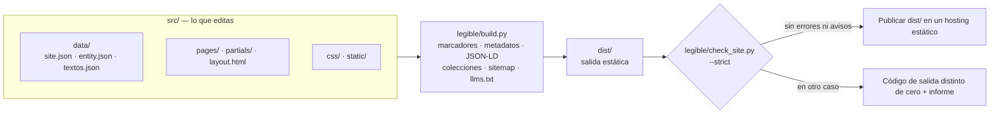

<div align="center">


**Un generador estático y ligero para negocios locales, construido con la librería estándar de Python.**

HTML plano. Sin JavaScript en el cliente. Datos estructurados y comprobaciones SEO integradas en el proceso de build.

[](https://www.python.org/)
[](#principios-de-diseño)
[](#qué-genera)
[](https://schema.org/)
[](LICENSE)

[English](README.md) · [Español](README.es.md)

</div>

## Índice

- [Resumen](#resumen)
- [De un vistazo](#de-un-vistazo)
- [Por qué este enfoque](#por-qué-este-enfoque)
- [Qué genera](#qué-genera)
- [Estructura del proyecto](#estructura-del-proyecto)
- [Inicio rápido](#inicio-rápido)
- [Configurar un sitio](#configurar-un-sitio)
- [Guías y blog](#guías-y-blog)
- [Configuración del build](#configuración-del-build)
- [Validación](#validación)
- [Arquitectura](#arquitectura)
- [Principios de diseño](#principios-de-diseño)
- [Rendimiento](#rendimiento)
- [Pruebas](#pruebas)
- [Antes de lanzar](#antes-de-lanzar)
- [Despliegue](#despliegue)
- [Ejemplo: crear la web de un cliente con un agente de IA](#ejemplo-crear-la-web-de-un-cliente-con-un-agente-de-ia)
- [Alcance y limitaciones](#alcance-y-limitaciones)
- [Contribuir](#contribuir)
- [Licencia](#licencia)
- [Autor](#autor)

---

## Resumen

`legible` genera webs estáticas para negocios de servicios locales a partir de plantillas HTML y unos pocos archivos de datos compartidos. Tiene un alcance deliberadamente concreto: está pensado para webs de negocios de servicios, no para sustituir a una plataforma editorial o a un generador estático de propósito general.

La configuración del proyecto vive en `src/data/site.json`, los datos del negocio en `src/data/entity.json` y los textos reutilizables en `src/data/textos.json`. El build los convierte en páginas, metadatos, un `@graph` JSON-LD por página, `sitemap.xml`, `robots.txt` y `llms.txt`. Después, un validador revisa el resultado compilado y, en su modo estricto por defecto, detiene el build tanto por errores como por avisos.

**El objetivo es obtener una salida predecible y fácil de inspeccionar, no prometer posiciones en buscadores.** Las comprobaciones técnicas detectan errores habituales de implementación, pero no garantizan indexación, resultados enriquecidos, tráfico ni visibilidad en asistentes de IA.

> La plantilla, sus textos de ejemplo y los mensajes del motor están en español (`es-ES`). Consulta [Alcance y limitaciones](#alcance-y-limitaciones).

## De un vistazo

Cifras medidas sobre la plantilla incluida (11 páginas) con `./legible/build.sh`; puedes reproducirlas ejecutando tú mismo el build y las pruebas.

| | |
| --- | --- |
| **0** dependencias de ejecución | El motor, el validador, el servidor local y las pruebas usan solo la librería estándar de Python |
| **0** scripts en el cliente | Los únicos `<script>` son bloques de datos `application/ld+json` |
| **0** peticiones a terceros | Ninguna página carga fuentes, hojas de estilo, scripts ni rastreadores externos |
| **7,6–22 KB** por página HTML | 176 KB las 11 páginas tras minificar (un 29 % menos que sin minificar) |
| **20 KB** de CSS | Minificado desde 28 KB; una sola hoja de estilos y fuentes del sistema |
| **80+** comprobaciones del validador | Unas 50 son errores y 35 avisos; el modo estricto trata ambos como fallos |
| **108** pruebas automáticas | `unittest` de la librería estándar, unos 6 segundos |

## Por qué este enfoque

- **Una fuente para los datos del negocio.** La información compartida se mantiene centralizada en lugar de duplicarse en cada página.
- **Salida estática.** La web generada son archivos que puede servir un hosting estático; no requiere un runtime de aplicación en producción.
- **Sin JavaScript en el cliente.** La plantilla no envía código de aplicación al navegador. El JSON-LD se incluye como datos dentro de elementos `<script>`.
- **Marcadores *fail-fast*.** Un `{{…}}` sin resolver detiene el build indicando el marcador y la página, en lugar de filtrarse silenciosamente a producción.
- **Un validador que condiciona el build.** Se revisan metadatos, encabezados, enlaces, imágenes, datos estructurados, sitemap y robots sobre la salida compilada, no sobre el código fuente.
- **Datos estructurados fiables.** Los nodos de página y de negocio se combinan en un único `@graph`; las referencias `@id` deben resolverse y el marcado de FAQ debe coincidir con las preguntas y respuestas visibles en la página.
- **Seguro por construcción.** El build se niega a vaciar una carpeta de salida que sea, o contenga, el proyecto, `src/` o `legible/`; el servidor local solo sirve su propia carpeta de build.
- **Controles de calidad del contenido.** Un blog con menos de tres artículos queda en `noindex` y sin anunciar; cada página necesita un enlace contextual desde el `<main>` de otra o el validador la marca como huérfana.
- **Implementación con la librería estándar.** El generador y las pruebas usan la librería estándar de Python, sin dependencias de terceros para su ejecución.

## Qué genera

Por defecto, el resultado del build se escribe en `dist/`.

| Salida | Función |
| --- | --- |
| Páginas HTML estáticas | Un `index.html` por URL, compuesto con `layout.html`, la cabecera y el pie compartidos y el contenido de la página, con `<title>`, descripción, robots, canonical, Open Graph, Twitter y etiquetas `geo.*` opcionales |
| CSS | Una hoja de estilos (`/css/site.css`), minificada por defecto |
| JSON-LD | Los nodos del negocio (`ProfessionalService`) y `WebSite` de `entity.json`, combinados con los nodos propios de cada página en un único `@graph` |
| `sitemap.xml` | Solo páginas indexables (sin 404 ni `noindex`), con `lastmod` tomado del `dateModified` de la página o de su `updated` en el *front matter* |
| `robots.txt` | La plantilla permite todos los rastreadores, permite expresamente GPTBot, OAI-SearchBot, ClaudeBot, PerplexityBot, Applebot y Meta-ExternalAgent, y declara el sitemap |
| `llms.txt` | Índice en texto plano con datos del negocio, servicios y URLs, rellenado con los mismos datos que la web |
| Índices `/guias/` y `/blog/` | Se generan desde carpetas de contenido según las reglas de [Guías y blog](#guías-y-blog) |
| Enlace flotante de WhatsApp | Un `<a href="https://wa.me/…">` normal en todas las páginas, construido con `phone_e164` y `whatsapp_message` (sin scripts). Las páginas con mensaje propio usan `{{whatsapp_base}}?text=…` (y las variantes codificadas `{{service_1_name_url}}` / `{{featured_action_name_url}}`), nunca `{{whatsapp_link}}?text=` |

La plantilla incluye 11 páginas: inicio, servicios, una página de servicio de ejemplo, precios, oferta destacada, sobre nosotros, contacto, tres páginas legales y una 404. También incorpora una base de accesibilidad: enlace para saltar al contenido, `aria-current` en la entrada activa del menú y migas de pan en los índices generados. Antes de publicar una web real, revisa y sustituye el contenido de ejemplo.

## Estructura del proyecto

```text
.
├── legible/                 El motor reutilizable
│   ├── build.py             Generador: marcadores, metadatos, JSON-LD, colecciones, sitemap, llms.txt, minificadores
│   ├── check_site.py        Validador de la salida compilada
│   ├── build.sh             Build y después validación (lo que debería ejecutar la CI)
│   ├── dev.py               Servidor local que recompila al cambiar src/
│   └── run_all.py           Pruebas → build + validación → servidor local
├── src/                     Todo lo que editas
│   ├── data/                site.json · entity.json · textos.json
│   ├── pages/               Una carpeta por URL (index.html con front matter) y 404.html
│   ├── partials/            header.html · footer.html
│   ├── layout.html          Estructura del documento y <head>
│   ├── css/site.css         Hoja de estilos (tokens al principio)
│   └── static/              Imágenes, favicons, robots.txt, llms.txt (se copian a la raíz de la salida)
├── tests/test_legible.py    Batería de regresión
├── dist/                    Salida del build (ignorada por git)
├── .dev-dist/               Salida del servidor local (ignorada por git)
└── readme-logo.svg · README.es.md · LICENSE
```

## Inicio rápido

### Requisitos

- Python 3.8 o posterior. La batería de pruebas, el build y el validador pasan en 3.8, 3.9, 3.10, 3.11, 3.12, 3.13 y 3.14 (probado en Linux). Conviene usar una versión con soporte vigente; 3.8 y 3.9 ya no lo tienen.
- `bash` para ejecutar `legible/build.sh` (en Windows, Git Bash o WSL).
- El proyecto no requiere paquetes Python de terceros.

### Ejecutar comprobaciones y arrancar el servidor local

Desde la raíz del repositorio:

```bash
python3 legible/run_all.py
```

Este comando ejecuta las pruebas, compila y valida el sitio y, si todo termina correctamente, inicia el servidor de desarrollo. Se detiene en el primer paso que falla.

Comandos alternativos:

```bash
# Compilar y validar sin iniciar el servidor de desarrollo
python3 legible/run_all.py --no-dev

# Compilar y validar
./legible/build.sh

# Ejecutar las pruebas
python3 -m unittest discover tests

# Iniciar el servidor local
python3 legible/dev.py
```

El servidor de desarrollo escucha por defecto en `http://localhost:3001` (`--port` lo cambia). Compila en `.dev-dist/` (sin minificar salvo que pases `--minify`), consulta `src/` cada medio segundo y recompila ante cualquier cambio; si una recompilación falla, muestra el informe y sigue vigilando. Los cambios en `legible/` requieren reiniciarlo. Responde con `404.html` a las rutas inexistentes y ejecuta el validador en cada recompilación en modo no estricto: los errores hacen fallar la recompilación, los avisos no.

## Configurar un sitio

El motor reutilizable vive en `legible/`. Los valores específicos del proyecto (dominio, nombre, contacto, ubicación y textos de las páginas de índice generadas) se definen en `src/data/site.json`, el archivo principal de configuración, junto con `src/data/entity.json`; los textos editoriales permanecen en `src/`.

### 1. Definir la URL canónica

Define `site_url` en `src/data/site.json` con el origen HTTPS definitivo. La variable de entorno `SITE_URL` lo sobrescribe en una compilación concreta (CI, previsualizaciones, pruebas) sin tocar ningún archivo fuente:

```bash
SITE_URL=https://ejemplo.es ./legible/build.sh
```

El valor debe empezar por `https://` o el build se aborta. El generador y el validador lo utilizan para las URLs canónicas y otras referencias generadas, incluidos los datos estructurados, el sitemap y `robots.txt`. Evita escribir el dominio a mano en cada página; usa `{{site_url}}`.

### 2. Editar los datos y los textos

- `src/data/site.json` — configuración principal del proyecto: `site_url`, `site_name`, datos de contacto (`contact_email`, `phone_e164`, `whatsapp_message`), ubicación (`city`, `region`, `geo_enabled`, `geo_region_code`), `price_range`, los rótulos de consola (`build_banner`, `check_banner`), `generated_content` (textos de los índices de guías y blog y de la franja de contacto), `collection_topics` (temas válidos de guías y artículos) y `sitemap_base_order`. Las etiquetas `geo.*` solo se emiten cuando tienen valor, así que un `geo_region_code` vacío simplemente se omite. Lo mismo vale para los valores vacíos del JSON-LD, como un `price_range` sin rellenar: se omiten en lugar de publicarse vacíos. Las comillas, el `&` y las barras invertidas de estos valores se escapan según el contexto en que acaban (HTML o JSON-LD), así que un nombre como `Ana & Hijos` o con comillas no rompe nada.
- `src/data/entity.json` — identidad del negocio e información de servicios en formato Schema.org: un nodo `ProfessionalService` y un nodo `WebSite`. Conserva el tipo `ProfessionalService`: el build lee de él los datos del negocio y el validador lo exige en cada página indexable.
- `src/data/textos.json` — textos y valores reutilizables. Cada clave se convierte en un marcador `{{clave}}` disponible en páginas, fragmentos, layout, JSON-LD, `robots.txt` y `llms.txt`.
- `src/pages/` — contenido de las páginas y *front matter*.
- `src/partials/` — cabecera y pie compartidos.
- `src/css/site.css` — estilos del sitio.
- `src/static/` — recursos estáticos y archivos auxiliares.

Cómo se resuelven los marcadores: los valores derivados de `entity.json` y `site.json` (por ejemplo `{{site_name}}`, `{{city}}`, `{{service_1_name}}`, `{{service_1_price}}`) tienen prioridad sobre `textos.json`. Los atajos derivados cubren hasta cuatro ciudades (`{{city_1}}`–`{{city_4}}`, desde `areaServed`), seis categorías de servicio (`{{service_category_1}}`–`{{service_category_6}}`, desde `knowsAbout`) y cinco ofertas (`{{service_1_name}}`–`{{service_5_name}}`, con sus precios, desde `hasOfferCatalog`); la oferta con precio `0` pasa a ser `{{featured_action_name}}`. La plantilla incluye valores de ejemplo neutros (`Servicio 1`, `Tu Ciudad`, `99 €`…) que el build y el validador consideran válidos, por lo que conviene usar la [revisión previa al lanzamiento](#antes-de-lanzar) para detectar los que sobrevivan.

Ganchos CSS: `band-cta` y `footer-brand` son nombres de clase semánticos usados en el HTML que no tienen reglas CSS propias a propósito; `toc` está definida en `site.css`, pero ninguna página de la plantilla la usa.

Tema visual: el aspecto se define solo con los tokens del inicio de `src/css/site.css` (paleta tomada del logo y de `og-image.png`: fondo pizarra y acentos cian, verde, ámbar y azul) y con fuentes del sistema (sin fuentes web, sin JavaScript, sin animaciones). Cambia las variables de `:root` para rehacer el aspecto sin tocar el HTML.

Logo: `src/static/images/logo.svg` es el logo de la web; `readme-logo.svg` (raíz del proyecto, junto a los README) es la versión para los README, con placa oscura para que se lea en el tema claro y en el oscuro. Ninguno lleva metadatos.

Antes del lanzamiento, sustituye los datos de ejemplo, las imágenes provisionales y los textos genéricos. Comprueba que los precios, las zonas de servicio, los datos de contacto, las afirmaciones comerciales y las ofertas sean reales.

### 3. Añadir una página

Crea `src/pages/<slug>/index.html` (la URL será `/<slug>/`). Toda página empieza con *front matter*:

```text
---
title: Título de la página | {{site_name}}
description: Un resumen de entre 70 y 160 caracteres.
robots: index, follow, max-snippet:-1, max-image-preview:large, max-video-preview:-1
geo: true
canonical: auto
updated: 2026-01-31
---
```

`title` y `description` son obligatorios. `canonical: none` y `robots: noindex, follow` están pensados para páginas como la 404. `updated` (o un `dateModified` en el JSON-LD de la página) es obligatorio en las páginas indexables, porque se convierte en el `lastmod` del sitemap. `active` permite elegir qué entrada del menú se resalta; si no se indica, se usa la entrada de la propia página o la del ancestro más cercano del menú.

Para una nueva página de servicio, copia `src/pages/servicios/servicio-generico/` y actualiza su *front matter*, contenido visible y datos estructurados. Después, añádela al menú de `src/partials/header.html`, enlázala desde el índice de servicios (y donde ayude al lector) para que tenga al menos un enlace contextual desde el `<main>` de otra página, e inclúyela en `sitemap_base_order` si quieres una posición concreta en el sitemap.

### 4. Compilar y validar

```bash
SITE_URL=https://ejemplo.es ./legible/build.sh
```

Por defecto, el modo estricto trata los avisos como fallos del build. La intención es revisarlos, no ignorarlos automáticamente.

## Guías y blog

La plantilla no contiene guías ni artículos. Ambas colecciones son opcionales y se generan por convención a partir de carpetas:

| Colección | Ruta del contenido | `type` | Índice |
| --- | --- | --- | --- |
| Guías | `src/pages/guias/<slug>/index.html` | `guia` | `/guias/`, se genera en cuanto hay una guía, agrupadas por tema |
| Blog | `src/pages/blog/<slug>/index.html` | `articulo` | `/blog/`, de más reciente a más antiguo (visibilidad más abajo) |

Cada pieza necesita `type`, `topic`, `published`, `updated` (fecha ISO `AAAA-MM-DD`, con `updated` no anterior a `published`), `summary`, `service` (una ruta como `/servicios/servicio-generico/` que debe existir), `title` y `description`. `topic` debe ser uno de los `collection_topics` de `site.json`, el *slug* va en minúsculas con guiones y `related` admite como máximo otras dos piezas. No crees tú los `index.html` de `guias/` ni de `blog/`. El build comprueba todo esto al principio y muestra todos los problemas de una vez.

La visibilidad del blog depende de cuántos artículos haya:

| Artículos | `/blog/` |
| --- | --- |
| 0 | No se genera |
| 1–2 | Se genera con `noindex`; no aparece en menú, pie, sitemap ni `llms.txt` |
| 3 o más | Indexable y anunciado en menú, pie, sitemap y `llms.txt` |

Cuando existen guías o un blog visible, la home incluye una sección de «recursos» que enlaza a ellos (el marcador `{{home_recursos}}` de `src/pages/index.html`), lo que da a los índices el enlace contextual entrante que espera el validador.

## Configuración del build

`legible/build.sh` lee estas variables de entorno:

| Variable | Valor predeterminado | Efecto |
| --- | --- | --- |
| `SITE_URL` | `site_url` de `src/data/site.json` (`https://TU-DOMINIO.com` en la plantilla) | Sobrescribe `site_url`: URL base HTTPS para canonicals y referencias generadas |
| `CSS_MINIFY` | `TRUE` | Con `FALSE`, desactiva la minificación de HTML y CSS; útil para depurar |
| `CHECK_STRICT` | `TRUE` | Con `FALSE`, los avisos no hacen fallar la validación; los errores siguen fallando |

La cabecera del informe muestra la rama y el commit de Git; `RENDER_GIT_BRANCH` y `RENDER_GIT_COMMIT` se respetan cuando el build se ejecuta fuera de un repositorio Git (por ejemplo, en Render).

`run_all.py` también admite:

```bash
python3 legible/run_all.py --no-dev
python3 legible/run_all.py --skip-tests
python3 legible/run_all.py --port 8080
```

Usa `--skip-tests` solo cuando tengas un motivo concreto para omitir las pruebas.

Los scripts también pueden llamarse directamente:

```bash
python3 legible/build.py [--out CARPETA] [--minify true|false] [--no-validate]
python3 legible/check_site.py [--dir CARPETA] [--site-url URL] [--strict]
python3 legible/dev.py [--port N] [--minify]
```

`build.py` por sí solo no minifica salvo que pases `--minify true`, valida salvo que pases `--no-validate` y nunca falla por avisos. El camino estricto es `build.sh`.

## Validación

`legible/check_site.py` valida la salida compilada, no los archivos fuente de forma aislada. Termina con código `0` si el sitio pasa y `1` en caso contrario; en modo estricto cuentan tanto los errores como los avisos.

| Área | Errores (siempre fallan) | Avisos (fallan en modo estricto) |
| --- | --- | --- |
| **Metadatos del documento** | falta `lang`, viewport, `<title>`, description o meta robots; canonical sin HTTPS o incorrecto; `og:url` ≠ canonical; 404 con canonical | título fuera de 20–60 caracteres; description fuera de 70–160; faltan etiquetas Open Graph/Twitter; `og:title` ≠ `<title>`; falta `og:image:alt` |
| **Estructura** | no hay exactamente un `h1`; encabezados vacíos; más de un `aria-current` | el primer encabezado no es `h1`; saltos de nivel; menos de 250 palabras en `<main>` en una página indexable |
| **Imágenes** | `` sin `alt` | `alt` de más de 125 caracteres; faltan `width`/`height` |
| **Enlaces** | enlaces internos, anclas y recursos rotos; falta la barra final; `mailto:`/`tel:` mal formados; `href` vacío | `http://` externo; enlaces relativos; `target="_blank"` sin `noopener`/`noreferrer`; páginas sin enlace contextual entrante (huérfanas) |
| **Restos de plantilla** | `{{…}}` sin resolver | `TODO` o `[CONFIRMAR` en el texto visible |
| **Datos estructurados** | página indexable sin JSON-LD; JSON no válido; `@context` incorrecto; `@id` duplicado o sin resolver; falta el nodo `ProfessionalService` o `WebSite`; `url` de la página ≠ URL real; FAQ del marcado distinta de la visible | `name` de la página ≠ `<title>`; `dateModified` no ISO; entradas de FAQ mal formadas |
| **Duplicados** | títulos o descripciones duplicados entre páginas indexables | — |
| **Archivos del sitio** | faltan `index.html`, `404.html`, `sitemap.xml` o `robots.txt`; XML del sitemap no válido; URLs duplicadas o de otro dominio; página indexable ausente del sitemap o página `noindex` incluida; `Disallow: /` para todos los rastreadores | falta `llms.txt`; `lastmod` no ISO o distinto de `dateModified`; `robots.txt` sin la línea `Sitemap:` |

Para validar un build existente:

```bash
python3 legible/check_site.py --dir dist --strict --site-url https://ejemplo.es
```

Los umbrales (longitud de título, descripción y `alt`, mínimo de palabras, mínimo de enlaces entrantes) son constantes al principio de `check_site.py`.

Estas reglas son controles técnicos específicos del proyecto. No sustituyen las pruebas en navegadores, la revisión de accesibilidad, la comprobación de elegibilidad real para resultados enriquecidos ni las herramientas para webmasters de los buscadores.

## Arquitectura



Qué hace `build.py`, en orden:

1. Carga `site.json`, aplica `SITE_URL` y rechaza cualquier valor que no sea HTTPS.
2. Rechaza una carpeta de salida que sea, o contenga, el proyecto, `src/` o `legible/`, y después vacía la carpeta de salida.
3. Copia `src/static/` y escribe la hoja de estilos (minificada si procede).
4. Construye la tabla de marcadores a partir de `textos.json` y de `entity.json`/`site.json`, y la resuelve en el layout, los fragmentos y los nodos de la entidad.
5. Carga y valida el *front matter* de guías y blog, y comunica todos los problemas a la vez.
6. Renderiza cada página: *front matter*, entrada activa del menú, canonical, etiquetas `geo.*`, `@graph` JSON-LD combinado, y falla ante cualquier `{{…}}` restante. Las páginas se minifican al final.
7. Genera los índices de guías y blog cuando se cumplen sus reglas.
8. Escribe `sitemap.xml` y resuelve `robots.txt` y `llms.txt`.
9. Ejecuta el validador (salvo `--no-validate`) e imprime el informe.

| Ruta | Responsabilidad |
| --- | --- |
| `legible/build.py` | Composición de plantillas, sustitución de marcadores, ensamblado de JSON-LD, colecciones, minificación y archivos generados |
| `legible/check_site.py` | Validación de la salida compilada |
| `legible/build.sh` | Build seguido de validación estricta |
| `legible/dev.py` | Servidor local y flujo de recompilación |
| `legible/run_all.py` | Orquesta pruebas, build/validación y servidor local opcional |
| `tests/test_legible.py` | Pruebas de regresión del build, minificadores, colecciones, URLs, marcadores, seguridad de la carpeta de salida y línea de comandos de `build.py` |
| `src/layout.html` | Estructura común del documento y metadatos |
| `src/pages/` | Plantillas y contenido de páginas |
| `src/data/site.json` | Configuración principal del proyecto: dominio, nombre, contacto, ubicación, textos de los índices generados, temas de colecciones y orden del sitemap |
| `src/data/` | Datos compartidos del negocio (`entity.json`) y textos por defecto (`textos.json`) |
| `src/partials/` | Fragmentos comunes de página |
| `src/css/site.css` | Hoja de estilos |
| `src/static/` | Recursos estáticos y archivos auxiliares |

## Principios de diseño

| Decisión | Ventaja | Compromiso |
| --- | --- | --- |
| Solo librería estándar de Python | No requiere paquetes Python de terceros en ejecución | El código propio reemplaza funciones que ofrecerían motores de plantillas o librerías Markdown |
| `entity.json` compartido | Reduce la duplicación de datos del negocio | El modelo de datos requiere mantenimiento cuidadoso |
| Sin JavaScript en el cliente | Menos código ejecutado en el navegador y sin hidratación JS | No está pensado para interacciones que necesiten lógica de aplicación en el cliente |
| Validación estricta por defecto | Detecta regresiones comunes antes de publicar | Hay que resolver o revisar conscientemente los avisos existentes |
| Colecciones por convención de carpetas | Permite generar índices y entradas relacionadas | La estructura de carpetas y el *front matter* son deliberadamente opinados |
| Minificadores pequeños propios | Mantiene reducido el conjunto de dependencias | El código de minificación requiere pruebas de regresión continuas |

## Rendimiento

La salida estática y la ausencia de JavaScript en el cliente reducen piezas móviles, pero **no garantizan que todas las páginas sean rápidas en cualquier condición**. El rendimiento real también depende del tamaño de HTML/CSS, las imágenes, las fuentes, el hosting, la caché, la red y los recursos de terceros que se añadan posteriormente.

Las cifras de [De un vistazo](#de-un-vistazo) describen la plantilla incluida, no un benchmark universal. El recurso más pesado de la plantilla es `og-image.png` (unos 200 KB), que solo se referencia desde metadatos (Open Graph, Twitter, JSON-LD) y no se carga cuando un visitante ve una página. Vuelve a medir el build de producción tras cambiar contenido o recursos, combinando comprobaciones de transferencia con herramientas de rendimiento en navegador.

## Pruebas

Ejecuta las pruebas desde la raíz del repositorio:

```bash
python3 -m unittest discover tests
```

Toda la batería está en un único archivo, `tests/test_legible.py`. Cubre una compilación y validación de humo, minificación CSS/HTML, *front matter* y reglas de visibilidad de guías y blog, gestión de URLs y marcadores, metadatos geográficos, enlaces contextuales, seguridad de la carpeta de salida y la línea de comandos de `build.py`. El servidor de desarrollo local (`legible/dev.py`) no tiene pruebas automáticas; compruébalo a mano con `python3 legible/dev.py`. La batería está escrita para valer en cualquier proyecto basado en `legible`: lee el dominio, la ciudad y los temas de `src/data/site.json`, y las pocas pruebas que exigen un proyecto vacío (sin guías ni blog) o los datos de ejemplo de la plantilla se saltan solas cuando el proyecto ya tiene contenido propio. Añade pruebas de regresión cuando cambies el comportamiento del generador o del validador.

Los scripts de `legible/` no dejan `__pycache__/`. Ejecutar a mano `python3 -m unittest discover tests` sí crea `tests/__pycache__/`; evítalo con `python3 -B -m unittest discover tests`, con `PYTHONDONTWRITEBYTECODE=1` o con `python3 legible/run_all.py` (`.gitignore` ya lo excluye).

Antes de abrir un pull request, ejecuta:

```bash
python3 -m unittest discover tests
./legible/build.sh
```

## Antes de lanzar

El validador comprueba reglas técnicas; no puede saber que un valor sigue siendo de ejemplo. Como los valores de ejemplo de la plantilla son válidos, busca restos en el proyecto y revisa cada coincidencia:

```bash
grep -rIniE "Tu Negocio|Tu Ciudad|Tu Provincia|TU-DOMINIO|Servicio [1-6]\b|Ciudad [1-4]\b|Tema [1-5]\b|Acción Destacada|example\.com|34600000000|\b(99|149|290) €|(49|299) €/mes|legible" dist src
```

Después, confirma a mano que el logo y las imágenes (`logo.svg`, `og-image.png`, favicons), el horario, la dirección, los precios, las páginas legales y cada afirmación corresponden al negocio real. Si el negocio no tiene WhatsApp, elimina el botón flotante de `src/layout.html` y las llamadas a la acción de WhatsApp de las páginas.

## Despliegue

Publica el contenido de `dist/` en un proveedor de hosting estático o servidor web, por ejemplo Cloudflare Pages, GitHub Pages, Netlify, Render Static Sites, S3 o Nginx.

Configuración habitual:

```text
Comando de build:    ./legible/build.sh
Directorio público:  dist
Variable:            SITE_URL=https://ejemplo.es
```

Adapta estos valores al entorno real del proveedor. Para ejecutar el script de build se necesita Python 3.8+ y `bash`. Una validación fallida termina con código distinto de cero, así que el hosting no publicará un build que no haya pasado.

## Ejemplo: crear la web de un cliente con un agente de IA

Este prompt sirve como punto de partida para adaptar la plantilla a un negocio local. Está escrito a partir del funcionamiento real de `legible`, incluidas las reglas del motor y del validador que un agente rompería sin darse cuenta. Los datos del taller que aparecen a continuación son **datos de ejemplo ilustrativos**, no hechos verificados. Sustitúyelos por información confirmada por el cliente antes de publicar.

Copia el prompt en tu agente de programación desde la raíz del repositorio:

```text
ROL
Actúa como un desarrollador web sénior y cuidadoso que trabaja dentro de este repositorio. Adapta la plantilla `legible` para crear una web completa y coherente para el taller mecánico de ejemplo descrito abajo. Respeta la arquitectura y las convenciones del proyecto; no introduzcas ningún framework, dependencia ni JavaScript en el cliente.

PUNTO DE PARTIDA
Antes de editar, lee en README.es.md: «Configurar un sitio», «Guías y blog», «Validación» y «Antes de lanzar». Después inspecciona src/data/*.json, src/layout.html, src/partials/, una página de src/pages/ y src/static/llms.txt. Responde con un plan breve que enumere los archivos que vas a modificar y trabaja después en grupos pequeños.

DATOS DE EJEMPLO DEL NEGOCIO — ilustrativos; verificar cada valor antes de producción
- Nombre: Taller Mecánico García
- Dominio: tallermecanicogarcia.com
- Correo: hola@tallermecanicogarcia.com
- Teléfono: +34912345678 (fijo de Madrid; NO está confirmado que tenga WhatsApp)
- Dirección: Calle de la Industria 12, 28005 Madrid, España (taller con atención al público en local)
- Zona de servicio: Madrid, Alcobendas, San Sebastián de los Reyes, Las Rozas, Pozuelo de Alarcón y Majadahonda
- Servicios: mecánica general, diagnosis electrónica, neumáticos, frenos, aire acondicionado, pre-ITV y mantenimiento programado
- Rango de precios: 30–800 €
- Oferta destacada: diagnosis gratuita del vehículo (0 €)
- NO FACILITADO, no lo inventes: horario, razón social y NIF, datos registrales, certificaciones, marcas atendidas, garantías, reseñas, fotos, años de actividad

Trata los valores anteriores como marcadores de ejemplo. No presentes como reales datos sin verificar ni inventes testimonios, premios, cualificaciones o afirmaciones de rendimiento.

CÓMO FUNCIONA ESTE MOTOR — restricciones que debes respetar
1. La configuración vive en tres archivos. Define dominio, nombre, contacto, ciudad, provincia, `price_range`, mensaje de WhatsApp, `collection_topics` y rótulos de consola en `src/data/site.json`; la identidad del negocio, servicios, ofertas, zonas y horario en `src/data/entity.json`; y los textos reutilizables en `src/data/textos.json`. En las páginas usa `{{site_url}}`, nunca un dominio escrito a mano. Define `site_url` en `site.json` y comprueba además con la variable de entorno `SITE_URL`.
2. Conserva el nodo `ProfessionalService` y su `@type` tal cual, aunque `AutoRepair` sería un tipo Schema.org más cercano: el build lee de ese nodo los datos del negocio y el validador lo exige en cada página indexable. Añade a su `address` el `streetAddress` y el `postalCode` reales. No añadas coordenadas `geo` ni valoraciones salvo que se faciliten.
3. Los marcadores derivados solo cubren 4 ciudades (`{{city_1}}`–`{{city_4}}`), 6 categorías de servicio (`{{service_category_1}}`–`{{service_category_6}}`) y 5 ofertas (`{{service_N_name}}`/`price`). `areaServed` y `knowsAbout` son listas normales: incluye las seis zonas y agrupa los siete servicios en un máximo de seis categorías. Los servicios que excedan las cinco ofertas tendrán su propia página con texto literal.
4. La oferta destacada es la que tiene precio `0` en `hasOfferCatalog`; mantén exactamente una. Conserva la URL `/accion-destacada/`, a la que hacen referencia la franja de contacto, `sitemap_base_order` y las pruebas.
5. Un `{{…}}` sin resolver detiene el build, pero los valores de ejemplo de la plantilla (`Servicio 1`, `Tu Ciudad`, `99 €`, `Tema 1`, `Acción Destacada`…) son válidos y pasan todas las comprobaciones. Sustitúyelos todos, junto con las entradas correspondientes de `sitemap_base_order`.
6. La plantilla está escrita para una consultoría solo remota. Reescribe ese enfoque en todas partes: las páginas de inicio, sobre nosotros y contacto, los textos `about_*` y `contact_*`, la franja de contacto de `site.json` y `src/static/llms.txt` (las líneas «sin local de atención al público» y «Atención: Remota» y la línea de horario). Dirígete a propietarios de vehículos, no a «negocios».
7. `entity.json` incluye un horario de ejemplo (L–V 09:00–19:00). Sustitúyelo por el horario confirmado o elimina `openingHoursSpecification`; no conserves el de ejemplo.
8. Cada página necesita `title` (20–60 caracteres) y `description` (70–160), exactamente un `h1`, al menos 250 palabras en `<main>` si es indexable, `updated: AAAA-MM-DD` en el *front matter*, un bloque JSON-LD y al menos un enlace contextual desde el `<main>` de otra página. Títulos y descripciones deben ser únicos. Las FAQ visibles y las del JSON-LD deben coincidir palabra por palabra.
9. Para cada nueva página de servicio, copia `src/pages/servicios/servicio-generico/`, dale una finalidad diferenciada y contenido realmente útil, añádela al menú de `src/partials/header.html` y al índice de servicios. No crees páginas casi idénticas por localidad o palabra clave.
10. El layout incluye un botón flotante de WhatsApp y llamadas a la acción de WhatsApp, construidos con `phone_e164`. Si no está confirmado que el teléfono tenga WhatsApp, indícalo y propón eliminarlos (layout y páginas) en lugar de dejar un canal de contacto roto.
11. Sustituye los recursos de marca de la plantilla en `src/static/` (`logo.svg`, `og-image.png` de 1200×630, `favicon.svg`, `favicon.ico`, `apple-touch-icon.png`) por los del taller, o enuméralos como pendientes. Toda imagen relevante necesita un `alt` preciso y `width` y `height` explícitos. No modifiques el logo del README.
12. Las páginas legales (aviso legal, privacidad, cookies) deben usar solo datos facilitados. Lo que falte se queda como marcador visible `[CONFIRMAR …]`: el validador estricto lo señalará, y es lo previsto, porque bloquea el lanzamiento hasta que el cliente lo complete. No afirmes obligaciones legales como hechos; recomienda una revisión jurídica.
13. No crees guías ni artículos de blog salvo que se pida. Si lo haces, sigue «Guías y blog» del README y crea tres o más artículos para que el blog se indexe.

CRITERIOS DE FINALIZACIÓN
- Tras cada grupo de cambios, ejecuta `python3 -B -m unittest discover tests` y `SITE_URL=https://tallermecanicogarcia.com ./legible/build.sh`, y corrige las regresiones antes de continuar. No debilites pruebas, umbrales ni reglas del validador para conseguir que pase.
- Ejecuta la búsqueda de restos de «Antes de lanzar» y resuelve o justifica cada coincidencia.
- Abre la salida generada en `dist/`, no solo las fuentes: revisa `sitemap.xml`, `robots.txt`, `llms.txt` y el JSON-LD de la home y de una página de servicio.
- Informe final con tres secciones: (1) qué ha cambiado, por archivo; (2) los comandos que has ejecutado de verdad y su resultado real (no afirmes que un comando ha pasado si no lo has ejecutado); (3) una tabla con los datos que aún debe confirmar el cliente, incluidos los avisos del validador estricto que se esperan hasta que se completen.
```

La URL usada en el comando de build también es ilustrativa. Utiliza el dominio real de producción solo cuando el cliente haya confirmado que le pertenece y que está listo para el lanzamiento.

## Alcance y limitaciones

`legible` es un generador específico para webs relativamente convencionales de negocios locales. No es un CMS, un framework estático de propósito general ni una garantía de resultados SEO.

- No garantiza posiciones, indexación, resultados enriquecidos, tráfico ni citas en asistentes de IA.
- Los datos estructurados deben describir fielmente el contenido visible y no garantizan por sí mismos resultados destacados.
- `llms.txt` es un archivo informativo; su soporte e impacto varían según quien lo consuma.
- La plantilla está en español (`lang="es"`, `og:locale` `es_ES`, fechas en español, textos de ejemplo y mensajes de consola). Otros idiomas exigen cambios en el layout, en los textos de `src/` y en algunas cadenas integradas de `build.py`.
- El modelo de negocio encaja con `ProfessionalService`: hay atajos de marcador para hasta cuatro ciudades, seis categorías y cinco ofertas, y el validador exige ese tipo de nodo.
- Los datos de negocio y textos legales de ejemplo deben revisarse y sustituirse antes de producción.
- El validador comprueba reglas técnicas concretas. No puede determinar si las afirmaciones comerciales son ciertas, si el contenido responde a la intención de búsqueda o si la web cumple todos los requisitos legales aplicables.
- Si necesitas un CMS, interacciones complejas, una plataforma editorial grande o una cadena de compilación muy personalizable, considera un framework más amplio.

## Contribuir

Se agradecen las incidencias y los pull requests. Mantén los cambios acotados, explica qué comportamiento cambia e incluye una prueba de regresión para las correcciones cuando sea práctico.

Antes de enviar cambios:

```bash
python3 -m unittest discover tests
./legible/build.sh
```

No debilites las reglas de validación solo para hacer pasar un build: comprueba primero si el problema está en el contenido fuente o si la regla necesita un cambio justificado.

## Licencia

Publicado bajo la [licencia MIT](LICENSE).

## Autor

**Angel Maturana Clavero** — Arquitecto de software con más de 26 años de experiencia en banca core, actualmente centrado en agentes de IA generativa y herramientas SEO. `legible` se desarrolla para crear webs rápidas y bien estructuradas para negocios locales a través de [SEO Valdemoro](https://seovaldemoro.com).

- GitHub: [angelmaturana](https://github.com/angelmaturana)
- LinkedIn: [angelmaturana](https://linkedin.com/in/angelmaturana)
- Web: [seovaldemoro.com](https://seovaldemoro.com)


<p align="center">
  <strong>Built for developers who respect the platform.</strong><br>
  <em>No frameworks. No bloat. Just clean, inspectable HTML.</em>
</p>

<p align="center">
  <a href="https://github.com/angelmaturana/legible/stargazers">
    
  </a>
  <a href="https://github.com/angelmaturana/legible/fork">
    
  </a>
</p>
