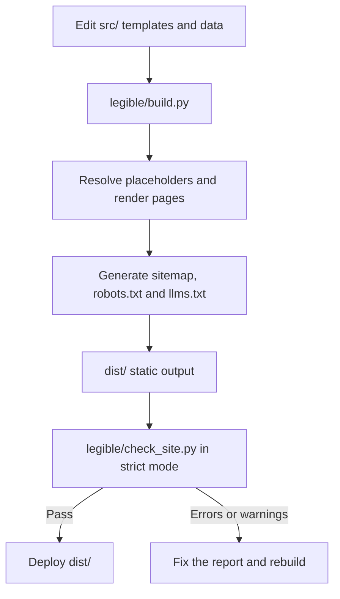

<div align="center">


**A lightweight static-site generator for local service businesses, built with Python's standard library.**

[](https://www.python.org/)
[](#features-at-a-glance)
[](#features-at-a-glance)
[](https://schema.org/)
[](LICENSE)

</div>

## Overview

`legible` turns editable HTML templates and shared JSON data into a static website for a local service business. It generates page metadata, Schema.org JSON-LD, a sitemap, `robots.txt` and `llms.txt`, then validates the compiled output.

The aim is predictable, inspectable output—not guaranteed rankings, indexing, rich results, traffic or AI citations. The included site is generic sample content; replace it with verified business information before publishing.

The full technical reference, marker catalogue, content rules and AI-agent guide live in [`DOCUMENTATION.md`](DOCUMENTATION.md). The generated files and their roles are summarized in [Generated outputs](DOCUMENTATION.md#36-generated-outputs).

## Features at a glance

Figures below are from the included template and the checks run for this release; they are not guarantees for a customized site.

| Feature | Verified result |
| --- | --- |
| Generated HTML pages | 11, including the 404 page |
| Automated tests | 119 `unittest` tests in `tests/test_legible.py` |
| Python runtime dependencies | None; the engine uses the standard library |
| Client-side JavaScript | None; script elements carry JSON-LD data only |
| Build validation | Strict by default; errors and warnings fail the build |
| Output | Static files that can be deployed without a Python application server |

## Requirements

- Python 3.8 or newer.
- `bash` to run `legible/build.sh` (use Git Bash or WSL on Windows).
- No third-party Python packages are required for building, validation or testing.

The project owner has confirmed that the project works on Python 3.8.20, 3.9.25, 3.10.22, 3.11.17, 3.12.3, 3.13.17 and 3.14.9. The P39 automated test classes and strict builds were run in the release-check environment; the full 119-test suite is not claimed to have been run separately under every version listed here.

## Quick start

Run these commands from the project root:

```bash
# Run the regression tests
python3 -B -m unittest discover tests

# Build and validate in strict mode
SITE_URL=https://example.com ./legible/build.sh

# Start the local development server
python3 legible/dev.py --port 3001
```

Open `http://localhost:3001` while the development server is running. Stop it with `Ctrl+C`. The server rebuilds when files under `src/` change; changes to files under `legible/` require a restart.

`SITE_URL` is a placeholder in the commands above. Set it to the site's real canonical HTTPS origin before deploying.

## Configure a site

Start with these three files:

- `src/data/site.json` — canonical URL, site name, language, contact information, location, collection settings and generated-index copy.
- `src/data/entity.json` — business identity, service areas, service categories, offers and opening hours in Schema.org form.
- `src/data/texts.json` — reusable copy referenced by `{{placeholders}}` in templates and generated files.

Then edit `src/pages/`, `src/partials/`, `src/layout.html` and `src/css/site.css` as needed. Use `{{site_url}}` for the canonical site origin instead of hard-coding a domain. The build fails on unresolved placeholders and the validator checks the rendered site.

For a new page, create `src/pages/<slug>/index.html` with front matter (`title`, `description`, `updated`, `robots`, `geo` and `canonical`). Keep titles and descriptions unique, provide exactly one `h1`, include valid JSON-LD and add a contextual internal link from another page. For a new service, use `src/pages/services/sample-service/` as the starting point. The full front-matter contract and derived markers are in [`DOCUMENTATION.md`](DOCUMENTATION.md#3-content-model). Guides and blog posts are optional folder-based collections; see [`DOCUMENTATION.md` §3.5](DOCUMENTATION.md#35-optional-collections-guides-and-blog) for their front matter and indexing rules.

### Before launch

The template contains valid sample values which the validator cannot identify as false business facts. Run this search and review every result before publishing:

```bash
grep -rIniE 'Your Business|Your City|Your Region|YOUR-DOMAIN|Service [1-6]\b|City [1-4]\b|Topic [1-5]\b|Free Consultation|Your legal name|Your registered address|Your registration number|Your jurisdiction|example\.com|555|\$(99|149|290)|CONFIRM' dist src
```

This search is a review aid, not a pass/fail test. Replace or justify every hit, especially sample contact details, offers, prices, legal placeholders, logo and social image. The reusable sweep pattern and its allowed exceptions are in [`DOCUMENTATION.md`](DOCUMENTATION.md#94-allowed-exceptions-to-the-sweeps).

## Language support

Set `"language": "en"` or `"language": "es"` in `src/data/site.json`. This configures the engine-generated labels and metadata; it does not translate your page content. Translate the pages, data, legal copy and static text yourself, and update URL slugs and internal links as appropriate. See [`DOCUMENTATION.md` §4.2](DOCUMENTATION.md#42-how-a-site-becomes-spanish-target-behaviour-after-track-c) for the full Spanish-site procedure and additional-language rules.

## Project layout

```text
.
├── src/
│   ├── data/              site.json · entity.json · texts.json
│   ├── pages/             one folder per page, plus 404.html
│   ├── partials/          shared header and footer
│   ├── layout.html        document shell and metadata
│   ├── css/site.css       visual design and tokens
│   └── static/            images, icons, robots.txt, llms.txt
├── legible/
│   ├── build.py           static-site generator
│   ├── check_site.py      compiled-site validator
│   ├── build.sh           build followed by strict validation
│   ├── dev.py             local development server
│   ├── run_all.py         tests, build and optional server
│   └── locales/           engine-generated English and Spanish strings
├── tests/test_legible.py  regression suite
├── README.md
├── DOCUMENTATION.md      full reference and cleanup plan
├── STATUS.md             phase tracker and changelog
├── LICENSE
└── readme-logo.svg
```

`dist/` is generated output and is ignored by Git. `.dev-dist/` is used by the development server; neither directory should be treated as source.

## How it works



The build checks configuration, renders all pages, generates optional guide/blog indexes, writes site-level files and invokes the validator. The production output contains files that a static host can serve; Python is needed at build time, not to serve the published site.

## Validation

`legible/check_site.py` validates the compiled output: metadata, headings, links and assets, placeholders, JSON-LD references, sitemap and `robots.txt`. Strict mode is enabled by default, so warnings also cause a non-zero exit. For the full list of checks and thresholds, see [`DOCUMENTATION.md` §9.2](DOCUMENTATION.md#92-validator-rules-summary).

## Deployment

Build from the repository root and publish the contents of `dist/` to a static host such as Cloudflare Pages, GitHub Pages, Netlify, Render Static Sites, S3 or Nginx. A typical configuration is:

```text
Build command:      ./legible/build.sh
Publish directory:  dist
Environment:        SITE_URL=https://your-domain.com
```

Use the real production HTTPS URL for `SITE_URL`. The deployment environment needs Python 3.8+ and `bash`. The build exits unsuccessfully if validation fails, so a host configured to respect the exit code will not publish a failed build.

Optional build settings are `CSS_MINIFY=FALSE` for readable, unminified output and `CHECK_STRICT=FALSE` to make warnings non-fatal while keeping errors fatal. Use the latter only when you have reviewed the warnings. See [`DOCUMENTATION.md` §9.5](DOCUMENTATION.md#95-commands) for the command reference.

## Scope and limitations

- `legible` is a focused generator for conventional local-service websites, not a CMS or a general-purpose publishing framework.
- Technical checks do not guarantee search rankings, indexing, rich results, traffic or citations by AI assistants.
- Structured data must accurately match visible content; adding JSON-LD alone does not guarantee enhanced search results.
- `llms.txt` is an informational index; support and impact vary by consumer.
- The validator cannot determine whether business claims are true, content meets every visitor's needs, or a site complies with all applicable laws.
- Sample business facts and legal copy must be reviewed and replaced. Obtain a suitable legal review before using the legal templates in production.
- Complex interactivity, a CMS, a large editorial platform or a highly customizable pipeline may require a broader framework.

## Contributing

Keep changes focused and explain the behavior being changed. Add a regression test for bug fixes and behavior changes when practical. Before submitting, run the tests and strict build shown in [Quick start](#quick-start). Do not weaken validator rules just to make a failing build pass; investigate the source content or justify a change to the rule.

## License

Released under the [MIT License](LICENSE).

## Author

**Angel Maturana Clavero** — Software architect with more than 26 years of experience in core banking, now building generative-AI agents and SEO tooling. `legible` is developed for creating fast, structured websites for local businesses through [SEO Valdemoro](https://seovaldemoro.com).
