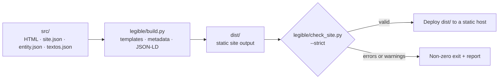

<div align="center">


**A lightweight static-site generator for local service businesses, built with Python’s standard library.**

Plain HTML. No client-side JavaScript. Structured data and SEO checks built into the build pipeline.

[](https://www.python.org/)
[](#design-principles)
[](#what-it-generates)
[](https://schema.org/)
[](LICENSE)

[English](README.md) · [Español](README.es.md)

</div>

## Contents

- [Overview](#overview)
- [Why this approach?](#why-this-approach)
- [What it generates](#what-it-generates)
- [Quick start](#quick-start)
- [Configure a site](#configure-a-site)
- [Build configuration](#build-configuration)
- [Validation](#validation)
- [Architecture](#architecture)
- [Design principles](#design-principles)
- [Performance notes](#performance-notes)
- [Testing](#testing)
- [Deployment](#deployment)
- [Example: build a client site with an AI coding agent](#example-build-a-client-site-with-an-ai-coding-agent)
- [Scope and limitations](#scope-and-limitations)
- [Contributing](#contributing)
- [License](#license)
- [Author](#author)


---

## Overview

`legible` builds static websites for local service businesses from HTML templates and a small set of shared data files. It is intentionally opinionated: the project focuses on service-business websites rather than trying to be a general-purpose publishing platform.

Business details are maintained in `src/data/entity.json`; reusable copy lives in `src/data/textos.json`. The build process uses these inputs to compose pages, generate metadata and JSON-LD, and produce supporting files for publication. A separate validator checks the compiled site and can fail the build on warnings as well as errors.

**The goal is predictable, inspectable output—not a promise of search rankings.** Technical checks can catch common implementation mistakes, but they cannot guarantee indexing, rich results, traffic, or visibility in AI assistants.

## Why this approach?

- **One source for business facts.** Shared details are maintained centrally instead of being copied into every page.
- **Static output.** The generated site is made of files that can be served by a static host; no application runtime is required in production.
- **No client-side JavaScript.** The template does not ship browser-side application code. JSON-LD is embedded as data in `<script>` elements.
- **Fail-fast placeholders.** Unresolved template markers stop the build instead of silently leaking into the published site.
- **SEO-oriented validation.** The validator checks page metadata, headings, links, images, structured data and generated site files.
- **Standard-library implementation.** The generator and test suite use Python's standard library, avoiding third-party Python runtime dependencies.

## What it generates

The build output is written to `dist/` by default.

| Output | Purpose |
| --- | --- |
| Static HTML pages | Rendered pages composed from templates and page content |
| CSS | The site's stylesheet, with optional minification |
| JSON-LD | Structured data assembled into a page-level `@graph` |
| `sitemap.xml` | URLs for the generated site |
| `robots.txt` | Crawler directives and sitemap reference |
| `llms.txt` | A plain-text index of selected site information |
| Guide/blog indexes | Generated when the corresponding content collections meet the project's rules |

The template includes business-oriented page examples, legal-page placeholders, a 404 page, and support for guide and blog collections. Review and replace example content before publishing a real business site.

## Quick start

### Requirements

- Python 3.10 or newer
- `bash` to run `legible/build.sh` (on Windows, use Git Bash or WSL)
- No third-party Python packages are required by the project

### Run the checks and start the local server

From the repository root:

```bash
python3 legible/run_all.py
```

This runs the test suite, builds and validates the site, then starts the local development server. The process stops at the first failed step.

Useful alternatives:

```bash
# Build and validate without starting the development server
python3 legible/run_all.py --no-dev

# Build and validate only
./legible/build.sh

# Run the test suite
python3 -m unittest discover tests

# Start the development server
python3 legible/dev.py
```

The development server is available at `http://localhost:3001` by default and rebuilds when files under `src/` change.

## Configure a site

The reusable engine lives in `legible/`. Project-specific values (domain, name, contact details, location and the texts of the generated index pages) are defined in `src/data/site.json`, the main configuration file, together with `src/data/entity.json`; editorial copy stays under `src/`.

### 1. Set the canonical site URL

Set `site_url` in `src/data/site.json` to the production HTTPS origin. The `SITE_URL` environment variable overrides it for a single build (CI, previews, test builds) without touching any source file:

```bash
SITE_URL=https://example.com ./legible/build.sh
```

Use the final HTTPS origin for the site. The value is used by the generator and validator for canonical URLs and related output, including structured data and sitemap-related files. Avoid hard-coding the production domain in individual pages.

### 2. Edit business data and copy

- `src/data/site.json` — main project configuration: `site_url`, `site_name`, contact details (`contact_email`, `phone_e164`, `whatsapp_message`), location (`city`, `region`, `geo_enabled`, `geo_region_code`), `generated_content` (texts of the guide/blog index pages and the lead strip), `collection_topics` (valid topics for guides and blog entries) and `sitemap_base_order`.
- `src/data/entity.json` — shared business identity and service information.
- `src/data/textos.json` — default reusable text and configuration values.
- `src/pages/` — page content and front matter.
- `src/partials/` — shared header and footer.
- `src/css/site.css` — site styling.
- `src/static/` — static assets and supporting files.

CSS hooks: `band-cta` and `footer-brand` are semantic class names used in the HTML that intentionally have no CSS rules of their own; `toc` is defined in `site.css` but is not used by any page in the template.

Visual theme: the look is defined only by the tokens at the top of `src/css/site.css` (palette taken from the logo and `og-image.png`: slate background, cyan/green/amber/blue accents) and by system fonts only (no web fonts, no JavaScript, no motion). Change the `:root` variables to re-skin the site without touching any HTML.

Logo: `src/static/images/logo.svg` is the website logo; `readme-logo.svg` (project root, next to the READMEs) is the README version, with a dark plate so it reads on light and dark themes. Neither carries metadata.

Replace all sample details, placeholder images, and generic copy before launch. Ensure prices, service areas, contact information, claims, and offers reflect the real business.

### 3. Add a service page

Use `src/pages/servicios/servicio-generico/` as the example template. Update its front matter, visible content and structured data, then link it from the relevant service index and navigation where appropriate.

### 4. Build and validate

```bash
SITE_URL=https://example.com ./legible/build.sh
```

The default strict mode treats warnings as build failures. This is deliberate: warnings should be reviewed rather than ignored by default.

## Build configuration

`legible/build.sh` reads these environment variables:

| Variable | Default | Effect |
| --- | --- | --- |
| `SITE_URL` | `site_url` from `src/data/site.json` (`https://TU-DOMINIO.com` in the template) | Overrides `site_url`: base HTTPS URL used for canonical URLs and generated site references |
| `CSS_MINIFY` | `TRUE` | Set to `FALSE` to leave generated HTML/CSS unminified where supported, for debugging |
| `CHECK_STRICT` | `TRUE` | Set to `FALSE` so warnings do not fail validation; errors still fail |

`run_all.py` also supports:

```bash
python3 legible/run_all.py --no-dev
python3 legible/run_all.py --skip-tests
python3 legible/run_all.py --port 8080
```

Use `--skip-tests` only when you have a specific reason to skip the test suite.

## Validation

`legible/check_site.py` validates the generated output, not the source files in isolation. In strict mode, both errors and warnings cause a non-zero exit status.

Checks include:

- **Document metadata:** language, viewport, title and description constraints, robots directives, HTTPS canonicals, Open Graph and Twitter metadata.
- **Content structure:** heading hierarchy, one primary `h1`, minimum main-content length for indexable pages, and unresolved placeholder or draft markers.
- **Images:** required alternative text and explicit dimensions.
- **Links:** broken internal paths and anchors, orphan pages, and basic checks for external-tab, email and telephone links.
- **Structured data:** JSON parsing, required fields/nodes, duplicate `@id` values, unresolved references, and consistency between visible FAQs and FAQ structured data.
- **Site files:** required output files, sitemap consistency, and basic `robots.txt` checks.

Run the validator directly against an existing build:

```bash
python3 legible/check_site.py --dir dist --strict --site-url https://example.com
```

These checks are project-specific guardrails, not a substitute for testing in browsers, reviewing accessibility, checking real structured-data eligibility, or using search-engine webmaster tools.

## Architecture



| Path | Responsibility |
| --- | --- |
| `legible/build.py` | Template composition, placeholder replacement, JSON-LD assembly, minification and generated files |
| `legible/check_site.py` | Validation of the compiled output |
| `legible/build.sh` | Build followed by validation |
| `legible/dev.py` | Local development server and rebuild workflow |
| `legible/run_all.py` | Orchestrates tests, build/validation and optional local server |
| `tests/test_legible.py` | Regression tests for the build, minifiers, collections, URL handling, placeholders, output-folder safety and the `build.py` command line |
| `src/layout.html` | Shared document layout and metadata |
| `src/pages/` | Page templates and content |
| `src/data/site.json` | Main project configuration: domain, name, contact, location, generated index texts, collection topics and sitemap order |
| `src/data/` | Shared business data (`entity.json`) and default text (`textos.json`) |
| `src/partials/` | Shared page fragments |
| `src/css/site.css` | Stylesheet |
| `src/static/` | Static assets and supporting files |

## Design principles

| Choice | Benefit | Trade-off |
| --- | --- | --- |
| Python standard library only | No third-party Python runtime packages to install | Custom code replaces the features a template or Markdown library might provide |
| Shared `entity.json` | Reduces duplicated business facts across output | The data model needs to be maintained carefully |
| No client-side JavaScript | Less browser-side code and no JS hydration step | Not intended for interactions that require client-side application logic |
| Strict validation by default | Common regressions are caught before publication | Existing warnings must be resolved or consciously reviewed |
| Folder-based guide/blog collections | Content indexes and related entries can be generated by convention | The directory structure and front matter are opinionated |
| Small custom minifiers | Keeps the dependency footprint small | Custom minification code needs ongoing regression tests |

## Performance notes

Static output and the absence of client-side JavaScript reduce moving parts, but they do **not** guarantee that every page will be fast under every condition. Actual performance also depends on HTML/CSS size, images, fonts, hosting, caching, network conditions and third-party resources added later.

The repository's README measurements describe the included template, not a universal benchmark. Re-measure the production build after changing content or assets, ideally with both transfer-size checks and real browser performance tools.

## Testing

Run the tests from the repository root:

```bash
python3 -m unittest discover tests
```

The whole suite lives in a single file, `tests/test_legible.py`. It covers a build/validation smoke test, CSS and HTML minification, guide/blog front matter, URL handling, placeholder handling, geo metadata, contextual links, output-folder safety and the `build.py` command line. The local development server (`legible/dev.py`) has no automated tests; check it by hand with `python3 legible/dev.py`. The suite is written to work in any project built on `legible`: it reads the domain, city and topics from `src/data/site.json`, and the few tests that need an empty project (no guides or blog) are skipped automatically once a project has its own content. Add regression tests when changing generator or validator behavior.

The scripts in `legible/` do not leave `__pycache__/` behind. Running `python3 -m unittest discover tests` by hand does create `tests/__pycache__/`; avoid it with `python3 -B -m unittest discover tests`, `PYTHONDONTWRITEBYTECODE=1` or `python3 legible/run_all.py` (`.gitignore` excludes it anyway).

Before opening a pull request, run:

```bash
python3 -m unittest discover tests
./legible/build.sh
```

## Deployment

Publish the contents of `dist/` with a static hosting provider or web server, such as Cloudflare Pages, GitHub Pages, Netlify, Render Static Sites, S3 or Nginx.

Typical settings:

```text
Build command:      ./legible/build.sh
Publish directory:  dist
Environment:        SITE_URL=https://example.com
```

Adapt these settings to the hosting provider's actual build environment. The deploy environment needs Python 3.10+ and `bash` to run the included build script.

## Example: build a client site with an AI coding agent

This is a reusable example prompt for adapting the starter site to a local business. The business details below are **illustrative sample data**, not verified facts. Replace them with information confirmed by the client before publishing.

Copy the prompt into your coding agent from the repository root:

```text
Act as a careful senior web developer working inside this repository. Adapt the existing `legible` project into a complete, coherent website for the example mechanical workshop described below. First inspect the repository, its README, templates, data model, build process, validator and tests. Reuse the project's conventions; do not replace its architecture with a different framework.

EXAMPLE BUSINESS DATA — verify every value before production
- Business name: Taller Mecánico García
- Domain: tallermecanicogarcia.com
- Email: hola@tallermecanicogarcia.com
- Phone: +34912345678
- Address: Calle de la Industria 12, 28005 Madrid, Spain
- Service area: Madrid, Alcobendas, San Sebastián de los Reyes, Las Rozas, Pozuelo de Alarcón and Majadahonda
- Services: general mechanics, electronic diagnostics, tyres, brakes, air conditioning, pre-ITV inspections and scheduled maintenance
- Example price range: €30–€800
- Featured offer: free vehicle diagnosis (€0)

Treat all values above as placeholders. Do not claim that the business, address, contact details, prices, offer, opening hours, certifications, reviews or guarantees are real unless verified. Do not invent testimonials, awards, qualifications or performance claims. Clearly flag any missing facts that must be confirmed.

IMPLEMENTATION
1. Inspect the project before editing. Briefly outline the files you intend to change, then implement the site in small, reviewable groups.
2. Update `src/data/entity.json` and `src/data/textos.json` as the shared source of business facts and reusable copy. Use the project's `{{site_url}}` convention for canonical URLs; set the build URL through `SITE_URL`, not by scattering a hard-coded domain across templates.
3. Build out the home, services, pricing, featured offer, contact and about pages, plus shared header and footer where needed. Keep navigation consistent and useful.
4. Create individual service pages by following `src/pages/servicios/servicio-generico/`. Give each page a distinct purpose and genuinely useful content; do not generate near-duplicate pages just to target locations or keywords.
5. Keep visible content and structured data consistent. Add valid JSON-LD only where it accurately represents the page. If a page includes an FAQ in JSON-LD, render the same questions and answers visibly on that page.
6. Replace placeholder imagery with suitable, properly licensed assets. Give every meaningful image an accurate `alt` value and explicit `width` and `height`; do not describe an image as depicting something it does not show.
7. Preserve the project's constraints and conventions: static HTML output, no client-side JavaScript, existing templates, Python standard-library runtime and current build/validation workflow. Do not add dependencies or introduce a framework unless the task explicitly requires it.
8. Ensure every indexable page is reachable through meaningful internal links from another page, especially from the main content (`<main>`), service index or relevant navigation.
9. Review mobile layout, semantic HTML, heading hierarchy, accessible link text, metadata, canonical URLs, internal links, image paths and structured data. Keep the copy natural, specific and useful; avoid keyword stuffing and unsupported claims.
10. Remove unresolved template markers, TODOs and draft placeholders from pages intended for publication, including strings such as `TODO`, `[CONFIRMAR` and unexpanded `{{...}}`. If a fact cannot be verified, document it clearly rather than fabricating it.

VALIDATION AND DEFINITION OF DONE
- After each group of changes, run the relevant checks and fix regressions before continuing.
- Run `SITE_URL=https://tallermecanicogarcia.com ./legible/build.sh`.
- Run `python3 -m unittest discover tests`.
- Inspect the generated `dist/` output, not just the source templates. Resolve all validation failures; do not weaken or bypass the validator simply to get a passing build.
- Finish by summarizing what changed, which checks passed, and which business facts still need client verification. Never report a command as passed unless you actually ran it.
```

The build URL in this example is also illustrative. Use the real production domain only after the client has confirmed ownership and launch details.

## Scope and limitations

`legible` is a focused generator for relatively conventional local-business websites. It is not a CMS, a general-purpose static-site framework, or a guarantee of SEO results.

- It does not guarantee rankings, indexing, rich results, traffic or AI citations.
- Structured data must accurately describe visible page content and does not itself guarantee enhanced search results.
- `llms.txt` is an informational file; support and impact vary by consumer.
- Example business details and legal copy must be reviewed and replaced before production.
- The validator checks specific technical rules. It cannot judge whether marketing claims are true, whether content satisfies user intent, or whether a site complies with every applicable legal requirement.
- If you need a CMS, complex interactive features, a large editorial platform or a highly customizable build pipeline, consider a broader framework.

## Contributing

Issues and pull requests are welcome. Keep changes focused, explain the behavior being changed, and include a regression test for bug fixes where practical.

Before submitting:

```bash
python3 -m unittest discover tests
./legible/build.sh
```

Do not weaken validation rules merely to make a failing build pass; investigate whether the source content or the rule needs a justified change.

## License

Released under the [MIT License](LICENSE).

## Author

**Angel Maturana Clavero** — Software architect with more than 26 years of experience in core banking, now building generative-AI agents and SEO tooling. `legible` is developed for creating fast, structured websites for local businesses through [SEO Valdemoro](https://seovaldemoro.com).

- GitHub: [angelmaturana](https://github.com/angelmaturana)
- LinkedIn: [angelmaturana](https://linkedin.com/in/angelmaturana)
- Website: [seovaldemoro.com](https://seovaldemoro.com)


<p align="center">
  <strong>Built for developers who respect the platform.</strong><br>
  <em>No frameworks. No bloat. Just HTML that ranks.</em>
</p>

<p align="center">
  <a href="https://github.com/angelmaturana/legible/stargazers">
    
  </a>
  <a href="https://github.com/angelmaturana/legible/fork">
    
  </a>
</p>
