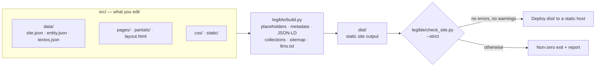

<div align="center">


**A lightweight static-site generator for local service businesses, built with Python’s standard library.**

Plain HTML. No client-side JavaScript. Structured data and SEO checks built into the build pipeline.

[](https://www.python.org/)
[](#design-principles)
[](#what-it-generates)
[](https://schema.org/)
[](LICENSE)

[English](README.md) · [Español](README.es.md)

</div>

## Contents

- [Overview](#overview)
- [At a glance](#at-a-glance)
- [Why this approach?](#why-this-approach)
- [What it generates](#what-it-generates)
- [Project layout](#project-layout)
- [Quick start](#quick-start)
- [Configure a site](#configure-a-site)
- [Guides and blog](#guides-and-blog)
- [Build configuration](#build-configuration)
- [Validation](#validation)
- [Architecture](#architecture)
- [Design principles](#design-principles)
- [Performance notes](#performance-notes)
- [Testing](#testing)
- [Before you launch](#before-you-launch)
- [Deployment](#deployment)
- [Example: build a client site with an AI coding agent](#example-build-a-client-site-with-an-ai-coding-agent)
- [Scope and limitations](#scope-and-limitations)
- [Contributing](#contributing)
- [License](#license)
- [Author](#author)

---

## Overview

`legible` builds static websites for local service businesses from HTML templates and a small set of shared data files. It is intentionally opinionated: the project focuses on service-business websites rather than trying to be a general-purpose publishing platform.

Project settings live in `src/data/site.json`, business facts in `src/data/entity.json`, and reusable copy in `src/data/textos.json`. The build resolves these into pages, metadata, one JSON-LD `@graph` per page, `sitemap.xml`, `robots.txt` and `llms.txt`. A separate validator then checks the compiled site and, in its default strict mode, fails the build on warnings as well as errors.

**The goal is predictable, inspectable output—not a promise of search rankings.** Technical checks can catch common implementation mistakes, but they cannot guarantee indexing, rich results, traffic, or visibility in AI assistants.

> The template, its sample copy and the engine's messages are in Spanish (`es-ES`). See [Scope and limitations](#scope-and-limitations).

## At a glance

Measured on the included template (11 pages) with `./legible/build.sh`; reproduce them by running the build and the tests yourself.

| | |
| --- | --- |
| **0** runtime dependencies | The engine, validator, dev server and tests use only the Python standard library |
| **0** client-side scripts | The only `<script>` elements are `application/ld+json` data blocks |
| **0** third-party requests | No external fonts, stylesheets, scripts or trackers are loaded by any page |
| **7.6–22 KB** per HTML page | 176 KB for all 11 pages after minification (29 % smaller than the unminified output) |
| **20 KB** of CSS | Minified from 28 KB; one stylesheet, system fonts only |
| **80+** validator checks | About 50 are errors and 35 warnings; strict mode treats both as failures |
| **102** automated tests | Standard-library `unittest`, about 6 seconds |

## Why this approach?

- **One source for business facts.** Shared details are maintained centrally instead of being copied into every page.
- **Static output.** The generated site is made of files that can be served by a static host; no application runtime is required in production.
- **No client-side JavaScript.** The template does not ship browser-side application code. JSON-LD is embedded as data in `<script>` elements.
- **Fail-fast placeholders.** Unresolved `{{…}}` markers stop the build, naming the marker and the page, instead of silently leaking into the published site.
- **A validator that gates the build.** Page metadata, headings, links, images, structured data, sitemap and robots are checked on the compiled output, not on the source.
- **Structured data you can trust.** Page and business nodes are merged into one `@graph`; `@id` references must resolve, and FAQ markup must match the questions and answers visible on the page.
- **Safe by construction.** The build refuses to empty an output folder that is, or contains, the project, `src/` or `legible/`; the dev server only serves its own build folder.
- **Quality gates on content.** A blog with fewer than three articles stays `noindex` and unannounced; pages need a contextual link from another page’s `<main>` or the validator flags them as orphans.
- **Standard-library implementation.** The generator and test suite use Python's standard library, avoiding third-party Python runtime dependencies.

## What it generates

The build output is written to `dist/` by default.

| Output | Purpose |
| --- | --- |
| Static HTML pages | One `index.html` per URL, composed from `layout.html`, the shared header/footer and the page content, with `<title>`, description, robots, canonical, Open Graph, Twitter and optional `geo.*` tags |
| CSS | One stylesheet (`/css/site.css`), minified by default |
| JSON-LD | The business (`ProfessionalService`) and `WebSite` nodes from `entity.json` merged with each page's own nodes into a single `@graph` |
| `sitemap.xml` | Indexable pages only (no 404, no `noindex`), with `lastmod` taken from the page’s `dateModified` or its `updated` front matter |
| `robots.txt` | The template allows all crawlers and explicitly allows GPTBot, OAI-SearchBot, ClaudeBot, PerplexityBot, Applebot and Meta-ExternalAgent, and declares the sitemap |
| `llms.txt` | A plain-text index of business facts, services and URLs, filled from the same data as the site |
| `/guias/` and `/blog/` indexes | Generated from content folders under the rules in [Guides and blog](#guides-and-blog) |
| Floating WhatsApp link | A plain `<a href="https://wa.me/…">` on every page, built from `phone_e164` and `whatsapp_message` (no script). Pages with their own message use `{{whatsapp_base}}?text=…` (plus URL-encoded `{{service_1_name_url}}` / `{{featured_action_name_url}}`), never `{{whatsapp_link}}?text=` |

The template includes 11 pages: home, services, one example service page, pricing, featured offer, about, contact, three legal pages and a 404. It also ships an accessible baseline: a skip link, `aria-current` on the active menu entry and breadcrumbs on generated indexes. Review and replace the example content before publishing a real business site.

## Project layout

```text
.
├── legible/                 The reusable engine
│   ├── build.py             Generator: placeholders, metadata, JSON-LD, collections, sitemap, llms.txt, minifiers
│   ├── check_site.py        Validator for the compiled output
│   ├── build.sh             Build, then validate (what CI should run)
│   ├── dev.py               Local server that rebuilds when src/ changes
│   └── run_all.py           Tests → build + validation → dev server
├── src/                     Everything you edit
│   ├── data/                site.json · entity.json · textos.json
│   ├── pages/               One folder per URL (index.html with front matter) plus 404.html
│   ├── partials/            header.html · footer.html
│   ├── layout.html          Document shell and <head>
│   ├── css/site.css         Stylesheet (tokens at the top)
│   └── static/              Images, favicons, robots.txt, llms.txt (copied to the output root)
├── tests/test_legible.py    Regression suite
├── dist/                    Build output (git-ignored)
├── .dev-dist/               Dev-server output (git-ignored)
└── readme-logo.svg · LICENSE
```

## Quick start

### Requirements

- Python 3.8 or newer. The full test suite, build and validator pass on 3.8, 3.9, 3.10, 3.11, 3.12, 3.13 and 3.14 (tested on Linux). Prefer a currently supported release; 3.8 and 3.9 are past end of life.
- `bash` to run `legible/build.sh` (on Windows, use Git Bash or WSL)
- No third-party Python packages are required by the project

### Run the checks and start the local server

From the repository root:

```bash
python3 legible/run_all.py
```

This runs the test suite, builds and validates the site, then starts the local development server. The process stops at the first failed step.

Useful alternatives:

```bash
# Build and validate without starting the development server
python3 legible/run_all.py --no-dev

# Build and validate only
./legible/build.sh

# Run the test suite
python3 -m unittest discover tests

# Start the development server
python3 legible/dev.py
```

The development server listens on `http://localhost:3001` by default (`--port` changes it). It builds into `.dev-dist/` (unminified unless you pass `--minify`), polls `src/` every half second and rebuilds on any change; a failed rebuild prints the report and keeps watching. Changes to `legible/` need a restart. It serves `404.html` for unknown paths, and the validator runs on every rebuild in its non-strict mode, so errors fail the rebuild but warnings do not.

## Configure a site

The reusable engine lives in `legible/`. Project-specific values (domain, name, contact details, location and the texts of the generated index pages) are defined in `src/data/site.json`, the main configuration file, together with `src/data/entity.json`; editorial copy stays under `src/`.

### 1. Set the canonical site URL

Set `site_url` in `src/data/site.json` to the production HTTPS origin. The `SITE_URL` environment variable overrides it for a single build (CI, previews, test builds) without touching any source file:

```bash
SITE_URL=https://example.com ./legible/build.sh
```

The value must start with `https://` or the build aborts. It is used by the generator and validator for canonical URLs and related output, including structured data, the sitemap and `robots.txt`. Avoid hard-coding the production domain in individual pages; use `{{site_url}}`.

### 2. Edit business data and copy

- `src/data/site.json` — main project configuration: `site_url`, `site_name`, contact details (`contact_email`, `phone_e164`, `whatsapp_message`), location (`city`, `region`, `geo_enabled`, `geo_region_code`), `price_range`, the console banners (`build_banner`, `check_banner`), `generated_content` (texts of the guide/blog index pages and the lead strip), `collection_topics` (valid topics for guides and blog entries) and `sitemap_base_order`. `geo.*` tags are emitted only when their value is set, so an empty `geo_region_code` is simply omitted.
- `src/data/entity.json` — the business identity and service information in Schema.org form: a `ProfessionalService` node and a `WebSite` node. Keep the `ProfessionalService` type: the build reads the business facts from it and the validator requires it on every indexable page.
- `src/data/textos.json` — reusable copy and values. Each key becomes a `{{key}}` placeholder available in pages, partials, the layout, JSON-LD, `robots.txt` and `llms.txt`.
- `src/pages/` — page content and front matter.
- `src/partials/` — shared header and footer.
- `src/css/site.css` — site styling.
- `src/static/` — static assets and supporting files.

How placeholders resolve: values derived from `entity.json` and `site.json` (for example `{{site_name}}`, `{{city}}`, `{{service_1_name}}`, `{{service_1_price}}`) take precedence over `textos.json`. Derived shortcuts cover up to four cities (`{{city_1}}`–`{{city_4}}`, from `areaServed`), six service categories (`{{service_category_1}}`–`{{service_category_6}}`, from `knowsAbout`) and five offers (`{{service_1_name}}`–`{{service_5_name}}`, with prices, from `hasOfferCatalog`); the offer priced at `0` becomes `{{featured_action_name}}`. The template ships neutral sample values (`Servicio 1`, `Tu Ciudad`, `99 €`…) that the build and validator accept as valid, so use the [pre-launch sweep](#before-you-launch) to catch any that survive.

CSS hooks: `band-cta` and `footer-brand` are semantic class names used in the HTML that intentionally have no CSS rules of their own; `toc` is defined in `site.css` but is not used by any page in the template.

Visual theme: the look is defined only by the tokens at the top of `src/css/site.css` (palette taken from the logo and `og-image.png`: slate background, cyan/green/amber/blue accents) and by system fonts only (no web fonts, no JavaScript, no motion). Change the `:root` variables to re-skin the site without touching any HTML.

Logo: `src/static/images/logo.svg` is the website logo; `readme-logo.svg` (project root, next to the READMEs) is the README version, with a dark plate so it reads on light and dark themes. Neither carries metadata.

Replace all sample details, placeholder images, and generic copy before launch. Ensure prices, service areas, contact information, claims, and offers reflect the real business.

### 3. Add a page

Create `src/pages/<slug>/index.html` (the URL is `/<slug>/`). Every page starts with front matter:

```text
---
title: Page title | {{site_name}}
description: A 70–160 character summary.
robots: index, follow, max-snippet:-1, max-image-preview:large, max-video-preview:-1
geo: true
canonical: auto
updated: 2026-01-31
---
```

`title` and `description` are required. `canonical: none` and `robots: noindex, follow` are meant for pages such as the 404. `updated` (or a `dateModified` in the page's JSON-LD) is required for indexable pages, because it becomes the sitemap `lastmod`. `active` lets you choose which menu entry is highlighted; otherwise the page's own entry, or the closest parent in the menu, is used.

For a new service page, copy `src/pages/servicios/servicio-generico/` and update its front matter, visible content and structured data. Then add it to the menu in `src/partials/header.html`, link to it from the services index (and anywhere it helps readers) so it has at least one contextual link from another page's `<main>`, and add it to `sitemap_base_order` if you want a specific position in the sitemap.

### 4. Build and validate

```bash
SITE_URL=https://example.com ./legible/build.sh
```

The default strict mode treats warnings as build failures. This is deliberate: warnings should be reviewed rather than ignored by default.

## Guides and blog

The template contains no guides or blog posts. Both collections are optional and generated by convention from folders:

| Collection | Content path | `type` | Index |
| --- | --- | --- | --- |
| Guides | `src/pages/guias/<slug>/index.html` | `guia` | `/guias/`, generated as soon as there is one guide, grouped by topic |
| Blog | `src/pages/blog/<slug>/index.html` | `articulo` | `/blog/`, newest first (see visibility below) |

Every piece needs `type`, `topic`, `published`, `updated` (ISO `YYYY-MM-DD`, with `updated` not earlier than `published`), `summary`, `service` (a path such as `/servicios/servicio-generico/` that must exist), `title` and `description`. `topic` must be one of `collection_topics` in `site.json`, the slug must be lowercase with hyphens, and `related` may list at most two other pieces. Do not create `index.html` files in `guias/` or `blog/` yourself. The build checks all of this up front and reports every problem in one go.

Blog visibility depends on how many articles exist:

| Articles | `/blog/` |
| --- | --- |
| 0 | Not generated |
| 1–2 | Generated as `noindex`; not in the menu, footer, sitemap or `llms.txt` |
| 3 or more | Indexable and announced in the menu, footer, sitemap and `llms.txt` |

When guides or a visible blog exist, the home page gets a “resources” section linking to them (the `{{home_recursos}}` marker in `src/pages/index.html`), which gives the indexes the contextual inbound link the validator expects.

## Build configuration

`legible/build.sh` reads these environment variables:

| Variable | Default | Effect |
| --- | --- | --- |
| `SITE_URL` | `site_url` from `src/data/site.json` (`https://TU-DOMINIO.com` in the template) | Overrides `site_url`: base HTTPS URL used for canonical URLs and generated site references |
| `CSS_MINIFY` | `TRUE` | Set to `FALSE` to leave generated HTML/CSS unminified, for debugging |
| `CHECK_STRICT` | `TRUE` | Set to `FALSE` so warnings do not fail validation; errors still fail |

The report header shows the Git branch and commit; `RENDER_GIT_BRANCH` and `RENDER_GIT_COMMIT` are honoured when the build runs outside a Git checkout (for example on Render).

`run_all.py` also supports:

```bash
python3 legible/run_all.py --no-dev
python3 legible/run_all.py --skip-tests
python3 legible/run_all.py --port 8080
```

Use `--skip-tests` only when you have a specific reason to skip the test suite.

The scripts can also be called directly:

```bash
python3 legible/build.py [--out FOLDER] [--minify true|false] [--no-validate]
python3 legible/check_site.py [--dir FOLDER] [--site-url URL] [--strict]
python3 legible/dev.py [--port N] [--minify]
```

`build.py` on its own does not minify unless you pass `--minify true`, validates unless you pass `--no-validate`, and never fails on warnings. `build.sh` is the strict path.

## Validation

`legible/check_site.py` validates the generated output, not the source files in isolation. It exits `0` when the site passes and `1` otherwise; in strict mode, errors and warnings both count.

| Area | Errors (always fail) | Warnings (fail in strict mode) |
| --- | --- | --- |
| **Document metadata** | missing `lang`, viewport, `<title>`, description or robots meta; non-HTTPS or wrong canonical; `og:url` ≠ canonical; 404 with a canonical | title outside 20–60 characters; description outside 70–160; missing Open Graph/Twitter tags; `og:title` ≠ `<title>`; missing `og:image:alt` |
| **Structure** | not exactly one `h1`; empty headings; more than one `aria-current` | first heading not `h1`; skipped heading levels; fewer than 250 words in `<main>` on an indexable page |
| **Images** | `` without `alt` | `alt` over 125 characters; missing `width`/`height` |
| **Links** | broken internal links, anchors and assets; missing trailing slash; malformed `mailto:`/`tel:`; empty `href` | external `http://`; relative links; `target="_blank"` without `noopener`/`noreferrer`; pages with no contextual inbound link (orphans) |
| **Leftovers** | unresolved `{{…}}` | `TODO` or `[CONFIRMAR` in visible text |
| **Structured data** | indexable page without JSON-LD; invalid JSON; wrong `@context`; duplicate or unresolved `@id`; missing `ProfessionalService` or `WebSite` node; page `url` ≠ real URL; FAQ markup that differs from the visible FAQ | page `name` ≠ `<title>`; non-ISO `dateModified`; malformed FAQ entries |
| **Duplicates** | duplicate titles or descriptions among indexable pages | — |
| **Site files** | missing `index.html`, `404.html`, `sitemap.xml` or `robots.txt`; invalid sitemap XML; duplicate or off-domain URLs; indexable page missing from the sitemap or `noindex` page in it; `Disallow: /` for all crawlers | missing `llms.txt`; `lastmod` not ISO or different from `dateModified`; `robots.txt` without the `Sitemap:` line |

Run the validator directly against an existing build:

```bash
python3 legible/check_site.py --dir dist --strict --site-url https://example.com
```

The thresholds (title, description and alt lengths, minimum words, minimum inbound links) are constants at the top of `check_site.py`.

These checks are project-specific guardrails, not a substitute for testing in browsers, reviewing accessibility, checking real structured-data eligibility, or using search-engine webmaster tools.

## Architecture



What `build.py` does, in order:

1. Loads `site.json`, applies `SITE_URL` and refuses anything that is not HTTPS.
2. Refuses an output folder that is, or contains, the project, `src/` or `legible/`, then empties the output folder.
3. Copies `src/static/` and writes the (optionally minified) stylesheet.
4. Builds the placeholder table from `textos.json` and from `entity.json`/`site.json`, and resolves it in the layout, partials and entity nodes.
5. Loads and validates the guide and blog front matter, reporting every problem at once.
6. Renders each page: front matter, active menu entry, canonical, `geo.*` tags, merged JSON-LD `@graph`, then fails on any leftover `{{…}}`. Pages are minified last.
7. Generates the guide and blog indexes when their rules are met.
8. Writes `sitemap.xml` and resolves `robots.txt` and `llms.txt`.
9. Runs the validator (unless `--no-validate`) and prints the report.

| Path | Responsibility |
| --- | --- |
| `legible/build.py` | Template composition, placeholder replacement, JSON-LD assembly, collections, minification and generated files |
| `legible/check_site.py` | Validation of the compiled output |
| `legible/build.sh` | Build followed by strict validation |
| `legible/dev.py` | Local development server and rebuild workflow |
| `legible/run_all.py` | Orchestrates tests, build/validation and optional local server |
| `tests/test_legible.py` | Regression tests for the build, minifiers, collections, URL handling, placeholders, output-folder safety and the `build.py` command line |
| `src/layout.html` | Shared document layout and metadata |
| `src/pages/` | Page templates and content |
| `src/data/site.json` | Main project configuration: domain, name, contact, location, generated index texts, collection topics and sitemap order |
| `src/data/` | Shared business data (`entity.json`) and default text (`textos.json`) |
| `src/partials/` | Shared page fragments |
| `src/css/site.css` | Stylesheet |
| `src/static/` | Static assets and supporting files |

## Design principles

| Choice | Benefit | Trade-off |
| --- | --- | --- |
| Python standard library only | No third-party Python runtime packages to install | Custom code replaces the features a template or Markdown library might provide |
| Shared `entity.json` | Reduces duplicated business facts across output | The data model needs to be maintained carefully |
| No client-side JavaScript | Less browser-side code and no JS hydration step | Not intended for interactions that require client-side application logic |
| Strict validation by default | Common regressions are caught before publication | Existing warnings must be resolved or consciously reviewed |
| Folder-based guide/blog collections | Content indexes and related entries can be generated by convention | The directory structure and front matter are opinionated |
| Small custom minifiers | Keeps the dependency footprint small | Custom minification code needs ongoing regression tests |

## Performance notes

Static output and the absence of client-side JavaScript reduce moving parts, but they do **not** guarantee that every page will be fast under every condition. Actual performance also depends on HTML/CSS size, images, fonts, hosting, caching, network conditions and third-party resources added later.

The figures in [At a glance](#at-a-glance) describe the included template, not a universal benchmark. The largest asset in the template is `og-image.png` (about 200 KB), which is only referenced from metadata (Open Graph, Twitter, JSON-LD) and is not loaded when a visitor views a page. Re-measure the production build after changing content or assets, ideally with both transfer-size checks and real browser performance tools.

## Testing

Run the tests from the repository root:

```bash
python3 -m unittest discover tests
```

The whole suite lives in a single file, `tests/test_legible.py`. It covers a build/validation smoke test, CSS and HTML minification, guide/blog front matter and visibility rules, URL handling, placeholder handling, geo metadata, contextual links, output-folder safety and the `build.py` command line. The local development server (`legible/dev.py`) has no automated tests; check it by hand with `python3 legible/dev.py`. The suite is written to work in any project built on `legible`: it reads the domain, city and topics from `src/data/site.json`, and the few tests that need an empty project (no guides or blog) or the template’s sample data are skipped automatically once a project has its own content. Add regression tests when changing generator or validator behavior.

The scripts in `legible/` do not leave `__pycache__/` behind. Running `python3 -m unittest discover tests` by hand does create `tests/__pycache__/`; avoid it with `python3 -B -m unittest discover tests`, `PYTHONDONTWRITEBYTECODE=1` or `python3 legible/run_all.py` (`.gitignore` excludes it anyway).

Before opening a pull request, run:

```bash
python3 -m unittest discover tests
./legible/build.sh
```

## Before you launch

The validator checks technical rules; it cannot know that a value is still a sample. Because the template’s sample values are valid, search the project for leftovers and review every hit:

```bash
grep -rIniE "Tu Negocio|Tu Ciudad|Tu Provincia|TU-DOMINIO|Servicio [1-6]\b|Ciudad [1-4]\b|Tema [1-5]\b|Acción Destacada|example\.com|34600000000|\b(99|149|290) €|(49|299) €/mes|legible" dist src
```

Then confirm by hand that the logo and images (`logo.svg`, `og-image.png`, favicons), opening hours, address, prices, legal pages and every claim belong to the real business. If the business has no WhatsApp number, remove the floating button from `src/layout.html` and the WhatsApp calls to action from the pages.

## Deployment

Publish the contents of `dist/` with a static hosting provider or web server, such as Cloudflare Pages, GitHub Pages, Netlify, Render Static Sites, S3 or Nginx.

Typical settings:

```text
Build command:      ./legible/build.sh
Publish directory:  dist
Environment:        SITE_URL=https://example.com
```

Adapt these settings to the hosting provider's actual build environment. The deploy environment needs Python 3.8+ and `bash` to run the included build script. A failed validation exits non-zero, so the host will not publish a build that did not pass.

## Example: build a client site with an AI coding agent

This is a reusable example prompt for adapting the starter site to a local business. It is written around how `legible` actually works, including the engine and validator rules that an agent would otherwise break by accident. The business details are **illustrative sample data**, not verified facts. Replace them with information confirmed by the client before publishing.

Copy the prompt into your coding agent from the repository root:

```text
ROLE
Act as a careful senior web developer working inside this repository. Adapt the `legible` starter into a complete, coherent website for the example mechanical workshop below. Reuse the project's architecture and conventions; do not introduce a framework, a dependency or client-side JavaScript.

START HERE
Before editing, read in README.md: "Configure a site", "Guides and blog", "Validation" and "Before you launch". Then inspect src/data/*.json, src/layout.html, src/partials/, one page under src/pages/ and src/static/llms.txt. Reply with a short plan listing the files you will change, then work in small groups.

EXAMPLE BUSINESS DATA — illustrative; every value must be verified before production
- Name: Taller Mecánico García
- Domain: tallermecanicogarcia.com
- Email: hola@tallermecanicogarcia.com
- Phone: +34912345678 (a Madrid landline; WhatsApp availability NOT confirmed)
- Address: Calle de la Industria 12, 28005 Madrid, Spain (walk-in workshop, with customer reception)
- Service area: Madrid, Alcobendas, San Sebastián de los Reyes, Las Rozas, Pozuelo de Alarcón, Majadahonda
- Services: general mechanics, electronic diagnostics, tyres, brakes, air conditioning, pre-ITV inspections, scheduled maintenance
- Price range: €30–€800
- Featured offer: free vehicle diagnosis (€0)
- NOT PROVIDED, do not invent: opening hours, legal entity name and tax ID, registry data, certifications, brands serviced, guarantees, reviews, photos, years in business

Treat the values above as placeholders. Never present unverified facts as real, and never invent testimonials, awards, qualifications or performance claims.

HOW THIS ENGINE WORKS — constraints you must respect
1. Configuration lives in three files. Set the domain, name, contact, city, region, `price_range`, WhatsApp message, `collection_topics` and the console banners in `src/data/site.json`; set the business identity, services, offers, areas and opening hours in `src/data/entity.json`; put reusable copy in `src/data/textos.json`. Use `{{site_url}}`, never a hard-coded domain, in pages. Set `site_url` in `site.json` and also verify with the `SITE_URL` environment variable.
2. Keep the `ProfessionalService` node and its `@type` exactly as is, even though `AutoRepair` would be a closer Schema.org type: the build reads the business facts from that node and the validator requires it on every indexable page. Add real `streetAddress` and `postalCode` to its `address`. Do not add `geo` coordinates or ratings unless provided.
3. Derived placeholders only cover 4 cities (`{{city_1}}`–`{{city_4}}`), 6 service categories (`{{service_category_1}}`–`{{service_category_6}}`) and 5 offers (`{{service_N_name}}`/`price`). `areaServed` and `knowsAbout` are plain lists: list all six areas and group the seven services into at most six categories. Give services beyond the five offers their own pages with literal copy.
4. The featured offer is whichever offer in `hasOfferCatalog` is priced `0`; keep exactly one. Keep the `/accion-destacada/` URL, which the lead strip, `sitemap_base_order` and tests reference.
5. A `{{…}}` that cannot be resolved stops the build, but the template's sample values (`Servicio 1`, `Tu Ciudad`, `99 €`, `Tema 1`, `Acción Destacada`…) are valid and pass every check. Replace all of them and the matching entries in `sitemap_base_order`.
6. The template is written for a remote-only consultancy. Rewrite that framing everywhere: the home, about and contact pages, the `about_*` and `contact_*` copy, the lead strip in `site.json`, and `src/static/llms.txt` (the "sin local de atención al público" and "Atención: Remota" lines and the opening-hours line). Address visitors as vehicle owners, not "negocios".
7. `entity.json` ships sample opening hours (Mon–Fri 09:00–19:00). Replace them with confirmed hours or remove `openingHoursSpecification`; do not keep the sample.
8. Every page needs `title` (20–60 characters) and `description` (70–160), exactly one `h1`, at least 250 words in `<main>` when indexable, an `updated: YYYY-MM-DD` front matter, a JSON-LD block, and at least one contextual link from another page's `<main>`. Titles and descriptions must be unique. Visible FAQs and FAQ JSON-LD must match word for word.
9. For each new service page, copy `src/pages/servicios/servicio-generico/`, give it a distinct purpose and genuinely useful content, add it to the menu in `src/partials/header.html` and to the services index. Do not create near-duplicate pages for each town or keyword.
10. The layout ships a floating WhatsApp button and WhatsApp calls to action, built from `phone_e164`. If the phone is not confirmed to have WhatsApp, report it and propose removing them (layout and pages) instead of leaving a broken contact path.
11. Replace the starter's brand assets in `src/static/` (`logo.svg`, `og-image.png` 1200×630, `favicon.svg`, `favicon.ico`, `apple-touch-icon.png`) with the workshop's own, or list them as pending. Every meaningful image needs an accurate `alt` and explicit `width` and `height`. Do not edit the README logo.
12. Legal pages (aviso legal, privacidad, cookies) must use only data that was supplied. Anything missing stays as a visible `[CONFIRMAR …]` marker: the strict validator will flag it, which is intended, because it blocks launch until the client fills it in. Do not state legal obligations as fact; recommend a legal review.
13. Do not create guides or blog posts unless asked. If you do, follow "Guides and blog" in the README, and create three or more articles for the blog to be indexed.

DEFINITION OF DONE
- After each group of changes, run `python3 -B -m unittest discover tests` and `SITE_URL=https://tallermecanicogarcia.com ./legible/build.sh`, and fix regressions before continuing. Never weaken tests, validator thresholds or rules to get a pass.
- Run the leftover sweep from "Before you launch" and resolve or justify every hit.
- Open the generated `dist/` output, not just the sources: check `sitemap.xml`, `robots.txt`, `llms.txt` and the JSON-LD of the home and one service page.
- Final report with three sections: (1) what changed, by file; (2) commands you actually ran and their real result (never claim a command passed if you did not run it); (3) a table of facts still awaiting client confirmation, including the strict-validator warnings that are expected until they are filled in.
```

The build URL in this example is also illustrative. Use the real production domain only after the client has confirmed ownership and launch details.

## Scope and limitations

`legible` is a focused generator for relatively conventional local-business websites. It is not a CMS, a general-purpose static-site framework, or a guarantee of SEO results.

- It does not guarantee rankings, indexing, rich results, traffic or AI citations.
- Structured data must accurately describe visible page content and does not itself guarantee enhanced search results.
- `llms.txt` is an informational file; support and impact vary by consumer.
- The template is in Spanish (`lang="es"`, `og:locale` `es_ES`, Spanish date formatting, sample copy and console messages). Other languages need changes to the layout, the copy in `src/` and a few built-in strings in `build.py`.
- The business model fits `ProfessionalService`: up to four named cities, six categories and five offers have placeholder shortcuts, and the validator requires that node type.
- Example business details and legal copy must be reviewed and replaced before production.
- The validator checks specific technical rules. It cannot judge whether marketing claims are true, whether content satisfies user intent, or whether a site complies with every applicable legal requirement.
- If you need a CMS, complex interactive features, a large editorial platform or a highly customizable build pipeline, consider a broader framework.

## Contributing

Issues and pull requests are welcome. Keep changes focused, explain the behavior being changed, and include a regression test for bug fixes where practical.

Before submitting:

```bash
python3 -m unittest discover tests
./legible/build.sh
```

Do not weaken validation rules merely to make a failing build pass; investigate whether the source content or the rule needs a justified change.

## License

Released under the [MIT License](LICENSE).

## Author

**Angel Maturana Clavero** — Software architect with more than 26 years of experience in core banking, now building generative-AI agents and SEO tooling. `legible` is developed for creating fast, structured websites for local businesses through [SEO Valdemoro](https://seovaldemoro.com).

- GitHub: [angelmaturana](https://github.com/angelmaturana)
- LinkedIn: [angelmaturana](https://linkedin.com/in/angelmaturana)
- Website: [seovaldemoro.com](https://seovaldemoro.com)


<p align="center">
  <strong>Built for developers who respect the platform.</strong><br>
  <em>No frameworks. No bloat. Just clean, inspectable HTML.</em>
</p>

<p align="center">
  <a href="https://github.com/angelmaturana/legible/stargazers">
    
  </a>
  <a href="https://github.com/angelmaturana/legible/fork">
    
  </a>
</p>
