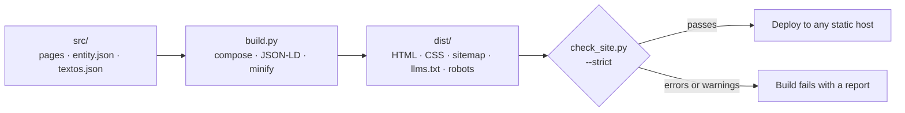

<div align="center">

# legible

**Websites for local service businesses that search engines and AI assistants can actually read.**

Plain HTML, no JavaScript, complete structured data, and a validator that stops the build before a SEO mistake reaches production. Python standard library only: nothing to install.

[](https://www.python.org)
[](#design-decisions-and-trade-offs)
[](#at-a-glance)
[](https://schema.org)
[](LICENSE)

**English** · [Español](README.es.md)

</div>

---

## Why legible

A plumber, a clinic or a workshop needs a website that loads instantly, says clearly what the business does, where, and for how much, and is understood by Google and by AI assistants. Most stacks for that are heavy (frameworks, plugins, build tooling) and nobody checks the SEO details until traffic is already lost.

legible takes a different route:

- **One file describes the business.** Name, phone, cities, services and prices live in `entity.json`; every page, the structured data, the sitemap and `llms.txt` are generated from it, so nothing drifts out of sync.
- **Fast by construction.** Static HTML and a single stylesheet. No client-side JavaScript at all.
- **Mistakes stop the build.** `check_site.py` validates the result (headings, canonicals, images, links, JSON-LD, sitemap, FAQ consistency…) and fails on errors *and* warnings.
- **Nothing to install, nothing to maintain.** Python 3 standard library. Deploy the output to any static host.

It does not promise rankings. It makes sure that the information search engines and AI assistants receive is clean, complete and consistent.

## At a glance

Measured on the included template (11 pages), 2026-10-21:

| | |
|---|---|
| Runtime dependencies | **0** (Python standard library) |
| JavaScript sent to the browser | **0 bytes** (the only `<script>` tags are JSON-LD data) |
| Home page weight | 22 KB HTML (5.9 KB gzip) + 20 KB CSS (4.9 KB gzip) |
| Build + strict validation | **~0.25 s** |
| Structured data | `ProfessionalService`, `WebSite`, `WebPage`, `FAQPage`, `Service`/`Offer`, `BreadcrumbList` merged into one `@graph` per page |
| Generated files | `sitemap.xml` (with `lastmod`), `robots.txt`, `llms.txt`, optional `/guias/` and `/blog/` indexes |
| Tests | 81 (`unittest`, ~5 s); 6 of them document known issues, see [Status](#status-and-known-limitations) |

## Quick start

Requires Python 3.10+. Clone the repository (or download the ZIP), enter the folder and run:

```bash
python3 legible/run_all.py    # tests -> build + validation -> local server, stopping at the first failure
./legible/build.sh            # builds into dist/ and validates in strict mode
python3 legible/dev.py        # local server at http://localhost:3001, rebuilds on save
python3 -m unittest discover tests   # run the tests
```

`build.sh` options (environment variables):

| Variable | Default | Effect |
|---|---|---|
| `SITE_URL` | `https://TU-DOMINIO.com` | Site domain: canonicals, JSON-LD, sitemap, `robots.txt`, `llms.txt`. Must start with `https://`. |
| `CSS_MINIFY` | `TRUE` | `FALSE` leaves HTML and CSS unminified (useful for debugging). |
| `CHECK_STRICT` | `TRUE` | `FALSE`: warnings no longer fail the build (errors always do). |

`run_all.py` options: `--no-dev` (no server, handy before publishing), `--skip-tests` (when you only touched `src/`) and `--port N`. It honours the `build.sh` environment variables.

Validate an already built folder: `python3 legible/check_site.py --dir dist --strict --site-url https://your-domain.com` (without `--site-url` it assumes the default domain).

## How it works



- **Templates.** Each page is an `.html` file with front matter (`title`, `description`, optionally `robots`, `canonical`, `geo`, `active`). The build inserts it into `layout.html`, marks the active menu item with `aria-current` and adds canonical and Open Graph tags.
- **Placeholders `{{...}}`.** Some are computed from `entity.json` (name, email, phone, cities, prices, domain); the rest are plain texts in `src/data/textos.json`. If a placeholder has no value, the build stops and tells you which one and on which page.
- **JSON-LD.** The nodes of `entity.json` are merged with each page's own JSON-LD in a single `@graph`; duplicate `@id`s are never emitted.
- **Guides and blog.** Drop a file in `src/pages/guias/<slug>/` or `src/pages/blog/<slug>/` with the required front matter (`type`, `topic`, `published`, `updated`, `summary`, `service`; optional `related`, max. 2) and the build generates the index, the sitemap entry and the `llms.txt` entry. `/guias/` appears with 1+ guides; `/blog/` stays `noindex` with 1–2 articles and goes public (menu, footer, sitemap) from 3.

## What the validator checks

`check_site.py` is the only validator. With `--strict`, warnings fail the build too.

- **Head:** `lang`, `viewport`, `title` and `description` (with length limits), `robots`, HTTPS canonical consistent with the URL, Open Graph and Twitter tags.
- **Content:** a single `h1`, no skipped heading levels, at least 250 words in `<main>` on indexable pages, no `TODO`, `[CONFIRMAR` or `{{...}}` left over.
- **Images:** `alt`, `width` and `height` on every image.
- **Links:** absolute internal paths, no broken links or anchors, `rel="noopener"` on `target="_blank"`, well-formed `mailto:` and `tel:`, no orphan pages.
- **JSON-LD:** valid, with `@context`, no duplicate `@id`, no dangling references, required nodes present, and the FAQ in the markup must match the visible FAQ.
- **Site:** no duplicate titles or descriptions; complete and consistent `sitemap.xml`; `robots.txt` without `Disallow: /` and with the sitemap declared; required files present.

## Set it up for a business

1. Edit `src/data/entity.json`: name, email, phone, cities, services and prices.
2. Set the domain once: `SITE_URL=https://example.com ./legible/build.sh`. Pages, `entity.json`, `robots.txt` and `llms.txt` all use the `{{site_url}}` placeholder.
3. Replace the generic copy in `src/data/textos.json` (no Python needed), or write the text straight into each page.
4. Replace the images in `src/static/images/` (logo, `og-image`, favicon).
5. For a new service, copy `src/pages/servicios/servicio-generico/`, adjust its front matter, JSON-LD and content, and link it from `servicios/`, `precios/`, `header.html` and `footer.html`.
6. `./legible/build.sh` and publish `dist/`.

> The template content is in Spanish. The `geo.placename` meta tag is currently fixed to "Valdemoro" (`geo.region` = `ES-MD`).

## Deploy

The output is plain static files: serve `dist/` from Render Static Sites, Netlify, Cloudflare Pages, GitHub Pages, S3, Nginx… No runtime on the server.

```
Build command:     ./legible/build.sh
Publish directory: dist
Environment:       SITE_URL=https://your-domain.com
```

## Design decisions and trade-offs

| Decision | Why | Trade-off |
|---|---|---|
| **Python standard library only** | No supply chain to audit, runs anywhere Python does, nothing to update | No Jinja or Markdown: templates are plain HTML with front matter |
| **One `entity.json` as the source of truth** | Business data is defined once and injected everywhere | Some upfront modelling per client |
| **No client-side JavaScript** | Nothing to hydrate or secure, no main-thread cost | No progressive enhancement; fine for content sites |
| **Validator fails on warnings** | SEO regressions are caught in CI, not in Search Console | Requires a clean base; no "I'll fix it later" |
| **Placeholders fail fast** | An unresolved `{{x}}` can never ship | Every placeholder must exist in `entity.json` or `textos.json` |
| **One `@graph` per page, deduplicated by `@id`** | Entities exist once and reference each other | Slightly more merge logic |
| **Collections by folder convention** | Zero configuration; indexes, sitemap and `llms.txt` follow | Opinionated structure |
| **Custom CSS and HTML minifiers** | Keep the "no dependencies" promise | They have known limits (see below) and need tests |
| **System font stack, CSS-only menu** | No font downloads, no layout shift | No brand typography; the checkbox menu has accessibility edge cases |

## Status and known limitations

The template builds and passes the strict validator, with and without minification. The test suite (`python3 -m unittest discover tests`) covers a full build and validation, both minifiers, guides and blog (valid and invalid front matter), and domain and placeholder handling. To check that the tests really catch regressions, the generator was deliberately broken in 11 different ways and the suite failed every time.

Known issues, each pinned by an `expectedFailure` test:

- **`minify_css` limits.** It can mangle `a:not(.b) .c`, `var()` inside `calc()`, negative numbers in `calc()`, `0.0px` and `) and (` in media queries. The template's CSS avoids all of them (the header of `site.css` says so); custom CSS must too.
- **First guide or blog post.** The generated `/guias/` and `/blog/` indexes are short and not linked from a page body, so the strict validator reports a warning until they are expanded.
- **Geo tags** are fixed to Valdemoro / `ES-MD`.

## Compared with alternatives

Checked on 2026-10-21 against each project's own page:

| | **legible** | [lintc](https://pypi.org/project/lintc/) 0.11 | [stattic](https://pypi.org/project/stattic) 1.0 |
|---|---|---|---|
| Dependencies | None | None (single file) | 8 (Jinja2, Markdown, PyYAML, Pillow…) |
| Validation after build | Yes, strict, SEO-specific | Yes, configurable plugins | Not documented |
| Schema.org JSON-LD | Built in, merged `@graph` | Not documented | Not documented |
| `sitemap.xml` | Yes | Not documented | Yes |
| `llms.txt` | Yes | Not documented | Yes |
| Aimed at | Local business sites | General sites | Blogs |

General-purpose generators such as Eleventy, Hugo or Astro (which ships zero JavaScript by default) are far more flexible and have bigger ecosystems. legible is narrower on purpose: it builds one kind of site and ships its SEO rules with it. If you need a custom design system, a CMS or a large content site, use one of them.

*Sources: [lintc on PyPI](https://pypi.org/project/lintc/), [stattic on PyPI](https://pypi.org/project/stattic), [SSG comparison 2026](https://jwatte.com/blog/blog-ssg-comparison-2026/).*

## Build a client site with an AI coding agent

Any coding agent (Claude Code, Kilo, Cursor…) can turn the template into a real site. Example prompt:

> You have the **legible** static site generator in this folder. Turn it into a website for **Taller Mecánico García**, a car repair shop in Madrid.
>
> **Data:** domain `tallermecanicogarcia.com`; email `hola@tallermecanicogarcia.com`; phone `+34912345678`; address Calle de la Industria 12, 28005 Madrid; area served: Madrid, Alcobendas, San Sebastián de los Reyes, Las Rozas, Pozuelo de Alarcón, Majadahonda; services: general mechanics, electronic diagnosis, tyres, brakes, air conditioning, pre-ITV inspection, scheduled maintenance; price range 30 € – 800 €; featured action: free diagnosis (0 €).
>
> **Do:** (1) update `src/data/entity.json` and `src/data/textos.json`; never write the domain by hand, use `{{site_url}}`; (2) create one page per service by copying `src/pages/servicios/servicio-generico/` (slugs without accents, e.g. `neumaticos`), each with its own JSON-LD, a visible FAQ identical to the FAQ in the JSON-LD, and at least 250 words; (3) update `servicios/`, `precios/`, `accion-destacada/`, `contacto/`, `sobre-nosotros/`, `header.html` and `footer.html`; (4) replace the placeholder images.
>
> **Rules:** no JavaScript; every image with `alt`, `width` and `height`; every indexable page linked from the `<main>` of another page; no `TODO`, `[CONFIRMAR` or `{{...}}` left.
>
> **Finish when** `SITE_URL=https://tallermecanicogarcia.com ./legible/build.sh` ends with CHECK PASSED and `python3 -m unittest discover tests` passes. First plan the list of files to change, then work in small groups, building after each one. If the build fails, read the report and fix it; do not weaken the validator.

## Project layout

```
legible/
  build.py          Generator: templates, JSON-LD, minifiers, sitemap, llms.txt, collections
  check_site.py     Validator for the built output
  dev.py            Local server that rebuilds when src/ changes
  run_all.py        Runs tests, build.sh and dev.py in order; stops at the first failure
  build.sh          build.py + check_site.py --strict
tests/
  test_legible.py   Smoke build, minifiers, guides/blog, domain and placeholders
src/
  layout.html       Base template (head, meta, Open Graph, JSON-LD)
  partials/         header.html and footer.html
  pages/            One folder per page, each with index.html (+ 404.html)
  data/             entity.json (business data) and textos.json (default copy)
  css/site.css      The single stylesheet
  static/           Images, robots.txt and llms.txt template, copied as they are
```

Pages included: home, services (index + one example service), pricing, about, contact, featured action, legal notice, privacy and cookies (these three `noindex`) and 404.

## Contributing

Issues and pull requests are welcome. Before opening one: `python3 -m unittest discover tests` and `./legible/build.sh` must pass. If you fix a known issue, remove its `expectedFailure` decorator (the test runner will tell you when one starts passing).

## License

MIT. See [LICENSE](LICENSE).

## About the author

**Angel Maturana Clavero** — Software architect with 26+ years in core banking, now building GenAI agents and zero-JavaScript SEO tooling. Previously at Santander: global security framework, the Gravity migration, a 40-ATM lab and the bank's first e-commerce. legible is the tool I use to deliver fast, well-structured sites for local businesses through [seovaldemoro.com](https://seovaldemoro.com).

- LinkedIn: [linkedin.com/in/angelmaturana](https://linkedin.com/in/angelmaturana)
- GitHub: [github.com/angelmaturana](https://github.com/angelmaturana)
- Agency: [seovaldemoro.com](https://seovaldemoro.com)
