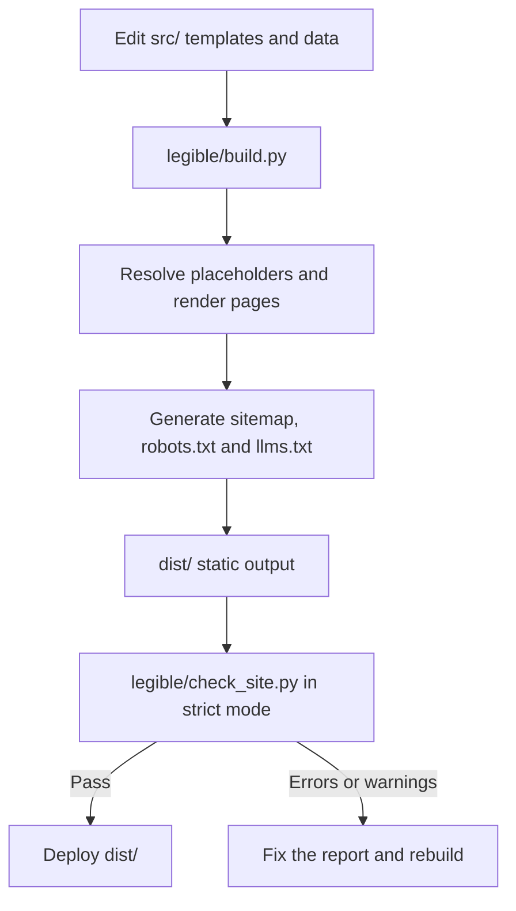

<div align="center">


**A lightweight static-site generator for small sites with one main entity (a business, a project or a person), built with Python's standard library.**

[](https://www.python.org/)
[](#features-at-a-glance)
[](#features-at-a-glance)
[](https://schema.org/)
[](LICENSE)

</div>

## Overview

`legible` turns editable HTML templates and shared JSON data into a static website for a small site with one main entity: a business, a project or a person (the Schema.org type of each kind is in `DOCUMENTATION.md` section 5.7). It generates page metadata, Schema.org JSON-LD, a sitemap, `robots.txt` and `llms.txt`, then validates the compiled output.

The aim is predictable, inspectable output—not guaranteed rankings, indexing, rich results, traffic or AI citations. The included site is generic sample content; replace it with verified business information before publishing.

The full technical reference, marker catalogue, content rules and AI-agent guide live in [`DOCUMENTATION.md`](DOCUMENTATION.md). AI agents should start at [`AGENTS.md`](AGENTS.md): the project is meant to be used to **build a site**, not to modify the engine. See [Build a site with an AI](#build-a-site-with-an-ai). The generated files and their roles are summarized in [Generated outputs](DOCUMENTATION.md#36-generated-outputs).

## Features at a glance

Figures below are from the included template and the checks run for this release; they are not guarantees for a customized site.

| Feature | Verified result |
| --- | --- |
| Generated HTML pages | 11, including the 404 page |
| Automated tests | 187 `unittest` tests in `tests/test_legible.py` |
| Python runtime dependencies | None; the engine uses the standard library |
| Client-side JavaScript | None; script elements carry JSON-LD data only |
| Build validation | Strict by default; errors and warnings fail the build |
| Output | Static files that can be deployed without a Python application server |

## Requirements

- Python 3.8 or newer.
- `bash` to run `legible/build.sh` (use Git Bash or WSL on Windows).
- No third-party Python packages are required for building, validation or testing.

Tested on Python 3.8.20, 3.9.25, 3.10.22, 3.11.17, 3.12.3, 3.13.17 and 3.14.9 with the full test suite, strict build and validator.

## Quick start

Run these commands from the project root:

```bash
# Run the regression tests
python3 -B -m unittest discover tests

# Build and validate in strict mode
./legible/build.sh

# Start the local development server
python3 legible/dev.py --port 3001
```

Open `http://localhost:3001` while the development server is running. Stop it with `Ctrl+C`. The server rebuilds when files under `src/` change; changes to files under `legible/` require a restart.

Set `site_url` in `src/data/site.json` to the site's real canonical HTTPS origin before deploying. `SITE_URL` is an optional override for CI and previews; if it is missing or empty, `site_url` is used, and if that is still the sample domain, `build.sh` prints a warning.

## Build a site with an AI

The zip is a generic base. Attach it to an AI assistant and say `legible start`. The command is exact and always in English, whatever language you speak; other phrases (`run legible`, `ejecuta legible`, `start site`) are not commands and only get a short explanation of what `legible` is and the list of commands. The assistant follows the protocol in [`AGENTS.md`](AGENTS.md), which begins by looking for `SITE_PLAN.md`:

1. **Interview.** If the zip has no `SITE_PLAN.md`, the assistant asks twelve short questions in three rounds (the business, the contact and offer, the design and gaps) and proposes the pages, URLs and design direction for you to confirm.
2. **Plan.** It returns your zip with a short `SITE_PLAN.md` already inside, for the base of the site only. You do not need to add it anywhere.
3. **Execute, one phase per session.** Attach the zip that contains the plan and say `legible continue` (or anything similar in your language, or nothing specific): the assistant finds the plan and carries on. It executes the next pending phase, verifies it, updates the plan and returns the zip.
4. **Finish and maintain.** When the last phase is done, the plan records the final state of everything. Later, attach the zip again and ask for any part to be fixed or extended.

If the zip holds a site in progress but the plan is missing, the assistant does not start from zero: it audits the project, rebuilds a short `SITE_PLAN.md` from what it finds and asks you to confirm it. If the site is already marked complete (`project_stage` in `site.json`), no plan is needed: the assistant simply works on the part you name. If a phase could not be checked (for example, the assistant cannot run commands), it stays in progress and the next session resumes it instead of repeating it.

The assistant changes only `src/`. It does not improve or refactor the engine, the tests or the architecture, and it does not deal with deployment. Anything beyond the base (blog, guides, interactive features) goes to the plan's **Later** list.

If there is no plan and you ask for anything other than `legible start`, the assistant first explains what `legible` is, what it fits and how it is used, and warns you when the request is outside what it does. To skip the plan and build everything in one session, say so explicitly (see [`DOCUMENTATION.md` section 6.3](DOCUMENTATION.md#63-build-everything-in-one-session-optional)). The methodology, step by step, is in [`DOCUMENTATION.md` section 5.0](DOCUMENTATION.md#50-the-methodology-start-interview-plan-phases-completion).

### AI commands

| Command | What it does | It asks |
|---|---|---|
| `legible start` | Full interview (twelve questions, three rounds) | Everything |
| `legible start <url>` | Style from a website | The business name, and whether to keep the same theme |
| `legible start name: …; activity: …` | Your data in one line; the design is proposed from the theme | Nothing |
| `legible start <url> name: …; activity: …` | Style from a website plus your data | Nothing |
| `legible start` + attached images | A design image (style) and/or a data image (card, flyer, menu); `style: design.png; data: card.jpg` says which is which, and `logo: logo.png` marks your own logo | Nothing if there are data |
| `legible continue` | Continues the plan | Nothing |
| `legible help` | A simple explanation of what `legible` is, plus this list | Nothing |
| `legible flow off` / `legible flow on` | For maintainers: turns the AI flows off or on by creating or deleting `FLOW_OFF.lock` | Nothing |

Examples:

```text
legible start
legible start https://example-style-site.com/
legible start name: Bodega La Esquina; activity: wine shop with tastings; city: Valdemoro; phone: +34 600 000 000
legible start style: design.png; data: card.jpg
```

With inputs, the AI runs a **fast start**: it asks only for the business name and the theme if they are missing, writes the plan with no confirmation round and keeps the template's sample values for everything else and lists them as pending. Descriptive example text it writes is marked `<!-- SAMPLE COPY -->` and the [pre-launch sweep](#before-launch) finds it; facts (phone, address, hours, prices, reviews) are never invented. From a reference website or image it takes the palette, structure and proportions, never the name, logo, images or text, and it is limited by what `legible` allows (system fonts, no scripts, no external resources). If the zip already holds a plan, `legible start` with data does not run: the assistant says the plan exists and asks whether to continue it or redo the site from zero. Fields, rules and details: [`DOCUMENTATION.md` section 6.1.1](DOCUMENTATION.md#611-the-commands-and-the-fast-start).

`FLOW_OFF.lock` is a local switch: it is ignored by git and the test suite fails while it exists, so run `legible flow on` before packaging a zip. Every signal the AI reads (the lock, `SITE_PLAN.md`, `project_stage`, your message), who sets it and in what order it wins are in the control-surface table of [section 5.0](DOCUMENTATION.md#50-the-methodology-start-interview-plan-phases-completion). Engine mode is not a file: the AI announces `Engine mode on` and `Engine mode off` in the conversation.

## Configure a site

Start with these three files:

- `src/data/site.json` — canonical URL, site name, language, project stage (a marker for AI-assisted builds; the build ignores it), contact information, location, collection settings and generated-index copy.
- `src/data/entity.json` — business identity, service areas, service categories, offers and opening hours in Schema.org form.
- `src/data/texts.json` — reusable copy referenced by `{{placeholders}}` in templates and generated files.

Then edit `src/pages/`, `src/partials/`, `src/layout.html` and `src/css/site.css` as needed. Use `{{site_url}}` for the canonical site origin instead of hard-coding a domain. The build fails on unresolved placeholders and the validator checks the rendered site.

For a new page, create `src/pages/<slug>/index.html` with front matter (`title`, `description`, `updated`, `robots`, `geo` and `canonical`). Keep titles and descriptions unique, provide exactly one `h1`, include valid JSON-LD and add a contextual internal link from another page. For a new service, use `src/pages/services/sample-service/` as the starting point. The full front-matter contract and derived markers are in [`DOCUMENTATION.md`](DOCUMENTATION.md#3-content-model). Guides and blog posts are optional folder-based collections; see [`DOCUMENTATION.md` section 3.5](DOCUMENTATION.md#35-optional-collections-guides-and-blog) for their front matter and indexing rules.

### Before launch

The template contains valid sample values which the validator cannot identify as false business facts. Run this search and review every result before publishing:

```bash
grep -rIniE 'Your Business|Your City|Your Region|YOUR-DOMAIN|Service [1-6]\b|City [1-4]\b|Topic [1-5]\b|Free Consultation|Your legal name|Your registered address|Your registration number|Your jurisdiction|example\.com|555|\$(49|55|99|149|229|290|299|490)\b|09:00|19:00|9am|7pm|business day|business hours|addressCountry|priceCurrency|CONFIRM|SAMPLE COPY' dist src
```

This search is a review aid, not a pass/fail test. Replace or justify every hit, especially sample contact details, offers, prices, legal placeholders, logo and social image. How to read the result is explained in [`DOCUMENTATION.md`](DOCUMENTATION.md#74-pre-launch-sweep).

## Language support

Set `"language": "en"` or `"language": "es"` in `src/data/site.json`. This configures the engine-generated labels and metadata; it does not translate your page content. Translate the pages, data, legal copy and static text yourself, and update URL slugs and internal links as appropriate. See [`DOCUMENTATION.md` section 4.2](DOCUMENTATION.md#42-how-to-build-a-site-in-another-language) for the full Spanish-site procedure and additional-language rules.

## Project layout

```text
.
├── src/
│   ├── data/              site.json · entity.json · texts.json
│   ├── pages/             one folder per page, plus 404.html
│   ├── partials/          shared header and footer
│   ├── layout.html        document shell and metadata
│   ├── css/site.css       visual design and tokens
│   └── static/            images, icons, robots.txt, llms.txt
├── legible/
│   ├── build.py           static-site generator
│   ├── check_site.py      compiled-site validator
│   ├── build.sh           build followed by strict validation
│   ├── dev.py             local development server
│   ├── run_all.py         tests, build and optional server
├── tests/test_legible.py  regression suite
├── README.md
├── DOCUMENTATION.md      full reference and AI-agent guide
├── AGENTS.md             entry point for AI agents: interview, plan and execution
├── SITE_PLAN.md          short plan and its status (created by the interview inside your zip, not in the template)
├── LICENSE
└── readme-logo.svg
```

`dist/` is generated output and is ignored by Git. `.dev-dist/` is used by the development server; neither directory should be treated as source.

## How it works



The build checks configuration, renders all pages, generates optional guide/blog indexes, writes site-level files and invokes the validator. The production output contains files that a static host can serve; Python is needed at build time, not to serve the published site.

## Validation

`legible` includes minimal SEO checks as part of the build, with nothing to install or configure: metadata, Schema.org JSON-LD, `sitemap.xml`, `robots.txt` and `llms.txt` are generated, and a strict validator checks the result. It does not replace analytics, Search Console or rank tracking.

`legible/check_site.py` validates the compiled output: metadata, headings, links and assets, placeholders, JSON-LD references, sitemap and `robots.txt`. Strict mode is enabled by default, so warnings also cause a non-zero exit. For the full list of checks and thresholds, see [`DOCUMENTATION.md` section 7.2](DOCUMENTATION.md#72-validator-rules).

## Deployment

Build from the repository root and publish the contents of `dist/` to a static host such as Cloudflare Pages, GitHub Pages, Netlify, Render Static Sites, S3 or Nginx. A typical configuration is:

```text
Build command:      ./legible/build.sh
Publish directory:  dist
Environment:        SITE_URL=https://your-domain.com
```

Use the real production HTTPS URL for `SITE_URL`. The deployment environment needs Python 3.8+ and `bash`. The build exits unsuccessfully if validation fails, so a host configured to respect the exit code will not publish a failed build.

Optional build settings are `CSS_MINIFY=FALSE` for readable, unminified output and `CHECK_STRICT=FALSE` to make warnings non-fatal while keeping errors fatal. Use the latter only when you have reviewed the warnings. See [`DOCUMENTATION.md` section 7.5](DOCUMENTATION.md#75-commands) for the command reference.

## Scope and limitations

- `legible` is a focused generator for conventional local-service websites, not a CMS or a general-purpose publishing framework.
- Technical checks do not guarantee search rankings, indexing, rich results, traffic or citations by AI assistants.
- Structured data must accurately match visible content; adding JSON-LD alone does not guarantee enhanced search results.
- `llms.txt` is an informational index; support and impact vary by consumer.
- The validator cannot determine whether business claims are true, content meets every visitor's needs, or a site complies with all applicable laws.
- Sample business facts and legal copy must be reviewed and replaced. Obtain a suitable legal review before using the legal templates in production.
- Complex interactivity, a CMS, a large editorial platform or a highly customizable pipeline may require a broader framework. Interactive features (calculators, booking, forms with a backend, maps) are outside the base: record them in the plan's **Later** list or decide explicitly how to handle them. The SEO checks described under Validation are built in and are not optional extras.

## Contributing

Keep changes focused and explain the behavior being changed. Add a regression test for bug fixes and behavior changes when practical. Before submitting, run the tests and strict build shown in [Quick start](#quick-start). Do not weaken validator rules just to make a failing build pass; investigate the source content or justify a change to the rule.

## License

Released under the [MIT License](LICENSE).

## Author

**Angel Maturana Clavero** — Software architect with more than 26 years of experience in core banking, now building generative-AI agents and SEO tooling. `legible` is developed for creating fast, structured websites for local businesses through [SEO Valdemoro](https://seovaldemoro.com).
